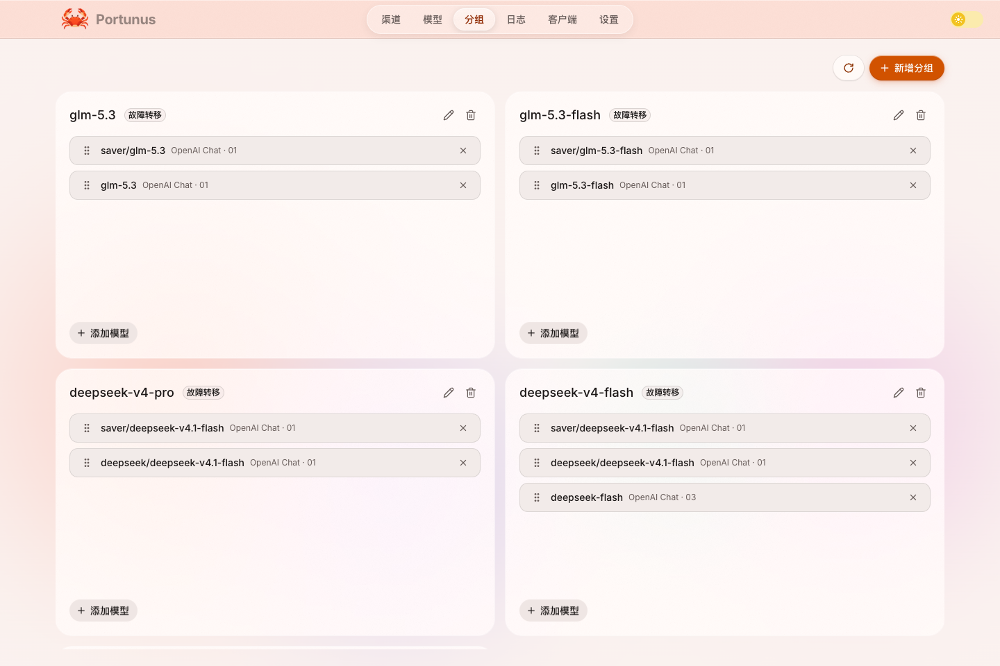

<p align="center">
  
</p>

<h1 align="center">Portunus</h1>

<p align="center">
  <strong>本地聚合上游 API，以模型分组统一提供服务。</strong>
</p>

<p align="center">
  本地运行的多上游 API 聚合网关。<br />
  接入官方 API 与中转站，将模型组织为分组，为客户端和应用提供稳定入口。
</p>

<p align="center">
  <a href="https://github.com/Lixiuxiu559/portunus/releases/latest"><strong>下载 Portunus</strong></a> ·
  <a href="#三步开始使用">开始使用</a> ·
  <a href="https://github.com/Lixiuxiu559/portunus/issues">反馈问题</a>
</p>

<p align="center">
  macOS · Windows · Linux<br />
  <a href="./README_EN.md">English</a> | <strong>简体中文</strong>
</p>

---

## 让模型管理回到一个地方

当你同时使用多个模型渠道，切换工具往往也意味着切换地址、密钥和配置文件。渠道出问题时，要手动寻找替代；想看用量时，又得翻不同的后台。

Portunus 把这些操作集中到桌面上。接入上游渠道、将模型编成分组，再把分组交给你常用的客户端。之后调整渠道或路由时，客户端继续使用同一个入口。

**装一个应用，就能开始。** 后端随安装包提供，无需另外部署服务器、Docker 或数据库。

<p align="center">
  
</p>
<p align="center"><sub>按用途组织模型，为常用工作流配置故障转移。</sub></p>

> 以下截图记录此前版本实际运行的产品界面，使用独立的本地数据副本；渠道名称与服务地址已脱敏。当前源码保留顶部胶囊导航，页面内布局已有后续调整；截图主要展示模型分组与路由配置。

## 围绕模型分组提供服务

### 接好一次，随时切换

在「服务接入」中选择分组，复制网关地址、Portunus 令牌与通用 API 示例，或使用 Claude Code / Codex 等客户端配置指南。应用不读取或修改客户端配置文件；之后切换上游渠道和路由时，客户端继续使用同一个入口。

### 多种协议，一个入口

上游支持 OpenAI Chat Completions、OpenAI Responses、Anthropic Messages 和 Gemini；对调用方提供 Chat Completions、Responses、Messages 三类生成入口及模型列表。客户端与上游协议不一致时按字段语义转换，支持 SSE 流式响应与工具调用；能力范围仍取决于目标协议和上游。Gemini 当前仅作为上游协议接入。

### 给常用模型安排好后路

将不同渠道的模型放进同一个分组，按用途命名，例如 `coding` 或 `daily`。分组名称就是客户端使用的模型名，上游选择由 Portunus 管理。

| 路由策略 | 如何工作 | 适用场景 |
| --- | --- | --- |
| 手动指定 | 使用你选定的模型 | 固定主力模型，按需切换 |
| 轮询 | 在组内模型之间轮流分配请求 | 分摊多个渠道的调用 |
| 故障转移 | 按优先级尝试，失败后切换后续模型 | 为常用工作流配置备用渠道 |

配合失败重试、超时处理与熔断保护，减少上游故障对工作流的影响。优先级可拖拽调整。流式响应已开始发送后，中途断流不能无损切换或自动重放。分组改名会改变客户端使用的 model，调整组内成员则保留分组入口。

### 查看用量与调用诊断

调用记录包含实际模型、渠道、分组、协议、耗时、请求 ID，以及上游报告的输入、输出、缓存读取和缓存写入 token，帮助判断请求去了哪里、用了多少 token、为何失败。

统计中的“记录数”按日志行计算；重试或切换可能为同一请求生成多条记录，不能等同于客户端请求数。Portunus 不配置模型价格或计算调用费用，实际费用请以供应商账单为准。

可按渠道、分组和请求 ID 筛选，打开详情复制请求 ID 或错误摘要；切换“按请求归并”可关联同一请求的日志，查看普通重试、预算字段兼容重试和渠道切换过程。没有请求 ID 的历史日志单独保留。归并项显示最近持久化日志结果；尝试记录缺失或序号连续，都不能证明完整请求已成功。使用方法见[调用记录与排障](docs/call-records.md)。

### 查看上游余额与额度

在「上游渠道」的「查询余额」入口添加查询来源。支持 DeepSeek、硅基流动中国站、OpenRouter、NewAPI 账户，以及自定义 GET/POST 与 JSON 字段映射。查询凭据与模型调用凭据分别配置，多个账户和币种分别展示，不合计为全局余额。

卡片直接显示上次查询余额、查询时间和刷新入口。正常成功记录不会仅因放置较久就隐藏；查询失败与凭据失效分别提示。查询只用于查看上游账户，不参与路由、熔断或调用费用计算。自动刷新默认关闭，详细步骤和限制见[余额与额度查询](docs/channel-quota.md)。本节描述当前源码能力，下载包以对应 Release 为准。

### 日常维护，也在桌面完成

新增或编辑渠道时，可先获取模型并选择导入项，也可手动输入模型名；保存只新增所选模型，不自动全量同步。支持定时同步和一键同步所有渠道。同步只新增发现的模型，保留已有模型，不自动删除上游消失的模型，也不执行付费生成验证。日志可按保留天数自动清理，应用提供明暗主题与应用内更新。

在「服务接入」中管理现有单令牌与「仅本机 / 局域网」访问范围。开启局域网后，其他设备可凭令牌访问 `/v1` 服务；`/api` 管理接口只允许真实本机回环连接，不依据转发头放行。不要通过本机反向代理向远端公开 `/api`；本机进程仍属于管理信任边界。

## 三步开始使用

### 1. 下载并打开

前往 [GitHub Releases](https://github.com/Lixiuxiu559/portunus/releases/latest)，选择对应系统的安装包：

| 系统 | 架构 | 安装包 |
| --- | --- | --- |
| macOS | Apple Silicon（arm64） | DMG 或 ZIP |
| Windows | x64 | EXE 安装程序或便携 ZIP |
| Linux | x64 | AppImage |

首次启动遇到系统提示时，参见下方的[安装帮助](#安装帮助)。

### 2. 添加渠道，创建分组

在「上游渠道」中选择厂商预设和协议，填写地址与 API Key；获取并选择模型，或手动填写模型名后保存。详见[上游渠道接入](docs/upstream-channels.md)。随后在默认首页「模型分组」中选择上游模型并设置路由策略；如需自动切换备用渠道，选择「故障转移」并排好优先级。

### 3. 向客户端和应用提供服务

从分组进入「服务接入」，选择通用 API 示例，或复制 Claude Code、Codex 等客户端配置指南并手动合并配置。使用分组名作为 model 发起调用后，在「调用记录」中查看实际渠道、模型、用量与调用结果。

其他兼容客户端也可以使用网关地址、Portunus 令牌和分组名称接入。桌面安装版默认使用 `http://127.0.0.1:13060`，OpenAI 兼容 Base URL 为 `http://127.0.0.1:13060/v1`。

## 安装帮助

<details>
<summary><strong>macOS：安装与首次启动</strong></summary>

将应用放入「应用程序」目录。也可以通过终端下载最新版 ZIP 并解压：

```bash
curl -fL -o /tmp/portunus.zip https://github.com/Lixiuxiu559/portunus/releases/latest/download/Portunus-mac-arm64.zip
unzip -o /tmp/portunus.zip -d /Applications
```

当前构建未签名。如果系统拦截启动，可在「系统设置 → 隐私与安全性」中查看是否提供「仍要打开」。若提示「已损坏，无法打开」，确认安装包来自本仓库的 Release 后，可移除应用的隔离属性并重新打开：

```bash
xattr -rd com.apple.quarantine /Applications/Portunus.app
```

</details>

<details>
<summary><strong>Windows：安装版与便携版</strong></summary>

运行 EXE 安装程序，按提示选择安装目录；或解压 ZIP 后直接运行。若 SmartScreen 提示未知发布者，确认安装包来源后，点击「更多信息 → 仍要运行」。

</details>

<details>
<summary><strong>Linux：运行 AppImage</strong></summary>

下载 Release 中的 `Portunus-linux-x64.AppImage`，添加执行权限后运行：

```bash
chmod +x Portunus-linux-x64.AppImage
./Portunus-linux-x64.AppImage
```

</details>

## 常见问题

**Portunus 提供模型或 API 额度吗？**

Portunus 负责连接、路由和记录调用。你需要自行准备上游渠道的服务地址和 API Key；模型可用性、额度和实际账单由上游提供方决定。

**数据保存在哪里？**

应用使用本地 SQLite 保存配置和调用日志，请求会转发到你配置的上游服务。桌面版默认仅监听本机，也可以在「服务接入」中切换为局域网服务；管理接口仍只接受本机回环连接。

**协议转换意味着所有模型能力都能通用吗？**

协议转换支持消息、流式响应与工具调用等交互；模型的上下文长度、推理能力和上游托管工具仍取决于实际提供方。配置 1M 上下文标记不会扩展模型本身的上下文限制。

## 开发与构建

<details>
<summary><strong>从源码运行</strong></summary>

环境要求：Go 1.26.6+、Node.js 24（与发布流水线一致）、pnpm 10。

```bash
git clone https://github.com/Lixiuxiu559/portunus.git
cd portunus
go mod download
go run .
```

后端默认监听 `0.0.0.0:3060`，SQLite 数据文件默认位于 `data/`。可通过 `config.json` 或 `PORTUNUS_*` 环境变量调整配置，例如 `PORTUNUS_SERVER_HOST`、`PORTUNUS_SERVER_PORT`、`PORTUNUS_DATABASE_PATH`。

桌面开发使用独立的 **Portunus Dev**，无需另外运行 `go run .`：

```bash
cd web
pnpm install
pnpm run dev        # 自动编译并管理 Dev 后端，Vite http://127.0.0.1:5173
# 或构建并启动独立桌面预览：
pnpm run build:dev
pnpm run preview:dev
```

Dev 后端固定 `127.0.0.1:13061`（局域网模式可另行启用），正式安装版继续使用 `13060`。两者的数据、配置、缓存和更新互相隔离；Dev 从空配置开始，不自动复制正式凭据。单独运行 `dev:web` 需要先启动 Dev 后端。管理界面和开发代理只供本机使用，代理不要向远端转发 `/api`。详见[开发隔离说明](docs/product/DEVELOPMENT.md)。

</details>

<details>
<summary><strong>构建安装包与运行测试</strong></summary>

在仓库根目录运行后端测试：

```bash
go test ./...
```

在 `web/` 中安装依赖、运行前端测试或构建安装包：

```bash
cd web
pnpm install
pnpm test
pnpm run build:mac   # macOS DMG / ZIP（arm64）
pnpm run build:win   # Windows EXE / ZIP（x64）
```

每次分支提交和 PR 会触发 [CI](.github/workflows/ci.yml)：运行 Go 全量测试、`go vet`、Go 构建、前端测试与 renderer 构建。依赖使用 `pnpm install --frozen-lockfile` 安装，CI 不需要上游密钥或真实模型调用。

产物位于 `web/dist-electron/`。推送 `v*` 标签会触发 GitHub Actions，先通过同一套 CI 检查，再构建 macOS、Windows、Linux 安装包并创建草稿 Release，确认后手动发布。手动触发 Release 同样先检查，再打包。

如需阻止检查失败的 PR 合并，在 GitHub 分支保护或 ruleset 中将 `Go checks` 和 `Web checks` 设为必需状态检查；工作流文件本身不改变远端分支保护规则。检查范围、本地验证结果与线上待验证项见[持续集成说明](docs/product/DEVELOPMENT.md#持续集成与发布检查)。桌面启动检查仍按[开发隔离说明](docs/product/DEVELOPMENT.md)单独执行。

</details>

---

[上游接入](./docs/upstream-channels.md) · [余额与额度](./docs/channel-quota.md) · [产品定义与阶段计划](./docs/product/PRODUCT.md) · [更新分发说明](./docs/updates.md) · [架构与设计](./ARCHITECTURE.md) · [技术研究](./docs/research) · [版本更新](https://github.com/Lixiuxiu559/portunus/releases) · [问题与建议](https://github.com/Lixiuxiu559/portunus/issues)
