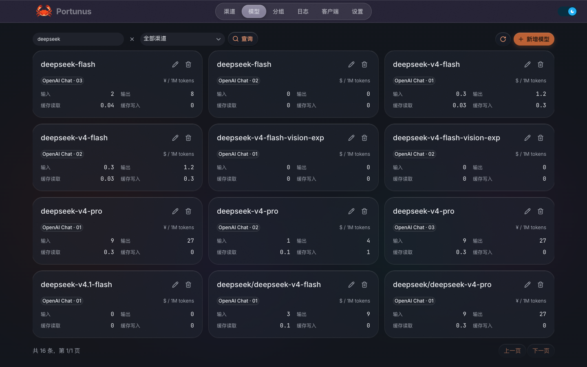
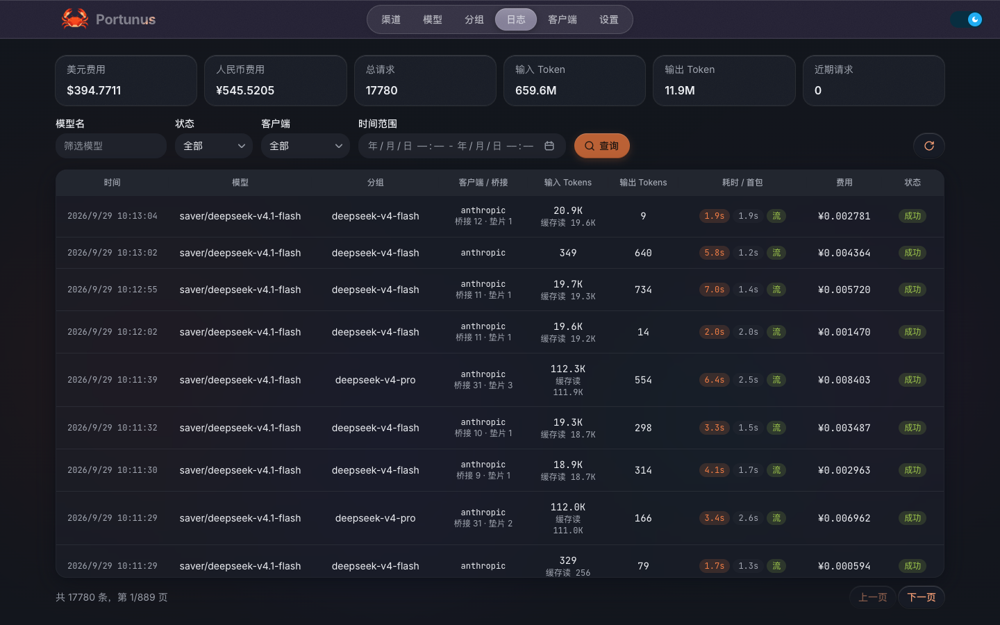

<p align="center">
  
</p>

<h1 align="center">Portunus</h1>

<p align="center">
  <strong>把分散的模型渠道，变成顺手的开发工具。</strong>
</p>

<p align="center">
  为个人开发者打造的桌面 LLM 网关。<br />
  统一管理 API 渠道、接入 Claude Code 与 Codex、追踪每一次调用的用量与费用。
</p>

<p align="center">
  <a href="https://github.com/Lixiuxiu559/portunus/releases/latest"><strong>下载 Portunus</strong></a> ·
  <a href="#三步开始使用">开始使用</a> ·
  <a href="https://github.com/Lixiuxiu559/portunus/issues">反馈问题</a>
</p>

<p align="center">
  macOS · Windows · Linux<br />
  <a href="./README.md">English</a> | <strong>简体中文</strong>
</p>

---

## 让模型管理回到一个地方

当你同时使用多个模型渠道，切换工具往往也意味着切换地址、密钥和配置文件。渠道出问题时，要手动寻找替代；想看用量时，又得翻不同的后台。

Portunus 把这些操作集中到桌面上。接入上游渠道、将模型编成分组，再把分组交给你常用的客户端。之后调整渠道或路由时，客户端继续使用同一个入口。

**装一个应用，就能开始。** 后端随安装包提供，无需另外部署服务器、Docker 或数据库。

<p align="center">
  
</p>
<p align="center"><sub>按用途组织模型，为常用工作流配置故障转移。</sub></p>

> 以下截图均来自实际运行的产品界面，使用独立的本地数据副本；渠道名称与服务地址已脱敏。图中价格和用量仅展示本地配置与记录，不代表服务报价。

## 为日常开发准备的能力

### 接好一次，随时切换

在应用内为 Claude Code 和 Codex 配置服务地址、令牌和模型映射。支持 Claude Code 的不同模型槽位与 1M 上下文标记；写入配置前自动备份，需要时可一键回滚。

### 多种协议，一个入口

统一接入 OpenAI Chat Completions、OpenAI Responses、Anthropic Messages 和 Gemini。客户端与上游协议不一致时自动转换，支持 SSE 流式响应与工具调用，让渠道选择更灵活。

### 给常用模型安排好后路

将不同渠道的模型放进同一个分组，按用途命名，例如 `coding` 或 `daily`。分组名称就是客户端使用的模型名，上游选择由 Portunus 管理。

| 路由策略 | 如何工作 | 适用场景 |
| --- | --- | --- |
| 手动指定 | 使用你选定的模型 | 固定主力模型，按需切换 |
| 轮询 | 在组内模型之间轮流分配请求 | 分摊多个渠道的调用 |
| 故障转移 | 按优先级尝试，失败后切换后续模型 | 为常用工作流配置备用渠道 |

配合失败重试、超时处理与熔断保护，减少上游故障对工作流的影响。优先级可拖拽调整。

### 看清每次调用的成本

调用日志记录模型、渠道、分组、协议、耗时、token、费用与请求 ID。输入、输出、缓存读取、缓存写入分别计价，同一个模型在不同渠道也可以设置不同价格。

模型同步时可套用内置默认价格，也支持手动修改。**费用按配置价格和调用用量计算，用于本地估算与对比。**

<p align="center">
  
</p>
<p align="center"><sub>同一个模型，不同渠道的价格与缓存计费一目了然。</sub></p>

<p align="center">
  
</p>
<p align="center"><sub>从费用总览到单次调用，查看用量、缓存命中与响应耗时。</sub></p>

### 日常维护，也在桌面完成

保存渠道后自动同步模型列表，支持定时同步和一键全量同步；日志可按保留天数自动清理。应用提供明暗主题、应用内更新，以及「仅本机 / 局域网」监听范围切换。

## 三步开始使用

### 1. 下载并打开

前往 [GitHub Releases](https://github.com/Lixiuxiu559/portunus/releases/latest)，选择对应系统的安装包：

| 系统 | 架构 | 安装包 |
| --- | --- | --- |
| macOS | Apple Silicon（arm64） | DMG 或 ZIP |
| Windows | x64 | EXE 安装程序或便携 ZIP |
| Linux | x64 | AppImage |

首次启动遇到系统提示时，参见下方的[安装帮助](#安装帮助)。

### 2. 添加渠道，创建分组

在「渠道」中填写上游服务地址、API Key 和协议类型，保存后同步模型列表。随后在「分组」中选择模型并设置路由策略；如需自动切换备用渠道，选择「故障转移」并排好优先级。

### 3. 接入你的开发工具

打开「客户端」，为 Claude Code 或 Codex 选择对应分组，写入连接配置。重新启动客户端后，即可通过 Portunus 发起调用，并在「日志」中查看用量与费用。

其他兼容客户端也可以使用网关地址、Portunus 令牌和分组名称接入。桌面安装版默认使用 `http://127.0.0.1:13060`，OpenAI 兼容 Base URL 为 `http://127.0.0.1:13060/v1`。

## 安装帮助

<details>
<summary><strong>macOS：安装与首次启动</strong></summary>

将应用放入「应用程序」目录。也可以通过终端下载最新版 ZIP 并解压：

```bash
curl -fL -o /tmp/portunus.zip https://github.com/Lixiuxiu559/portunus/releases/latest/download/Portunus-mac-arm64.zip
unzip -o /tmp/portunus.zip -d /Applications
```

当前构建未签名。如果系统拦截启动，可在「系统设置 → 隐私与安全性」中查看是否提供「仍要打开」。若提示「已损坏，无法打开」，确认安装包来自本仓库的 Release 后，可移除应用的隔离属性并重新打开：

```bash
xattr -rd com.apple.quarantine /Applications/Portunus.app
```

</details>

<details>
<summary><strong>Windows：安装版与便携版</strong></summary>

运行 EXE 安装程序，按提示选择安装目录；或解压 ZIP 后直接运行。若 SmartScreen 提示未知发布者，确认安装包来源后，点击「更多信息 → 仍要运行」。

</details>

<details>
<summary><strong>Linux：运行 AppImage</strong></summary>

下载 Release 中的 `Portunus-linux-x64.AppImage`，添加执行权限后运行：

```bash
chmod +x Portunus-linux-x64.AppImage
./Portunus-linux-x64.AppImage
```

</details>

## 常见问题

**Portunus 提供模型或 API 额度吗？**

Portunus 负责连接、路由和记录调用。你需要自行准备上游渠道的服务地址和 API Key；模型可用性、额度和实际账单由上游提供方决定。

**数据保存在哪里？**

应用使用本地 SQLite 保存配置和调用日志，请求会转发到你配置的上游服务。桌面版默认仅监听本机，也可以在设置中切换为局域网访问。

**协议转换意味着所有模型能力都能通用吗？**

协议转换支持消息、流式响应与工具调用等交互；模型的上下文长度、推理能力和上游托管工具仍取决于实际提供方。配置 1M 上下文标记不会扩展模型本身的上下文限制。

## 开发与构建

<details>
<summary><strong>从源码运行</strong></summary>

环境要求：Go 1.26.6+、Node.js 24（与发布流水线一致）、pnpm 10。

```bash
git clone https://github.com/Lixiuxiu559/portunus.git
cd portunus
go mod download
go run .
```

后端默认监听 `0.0.0.0:3060`，SQLite 数据文件默认位于 `data/`。可通过 `config.json` 或 `PORTUNUS_*` 环境变量调整配置，例如 `PORTUNUS_SERVER_HOST`、`PORTUNUS_SERVER_PORT`、`PORTUNUS_DATABASE_PATH`。

保持后端运行，在另一个终端启动管理界面：

```bash
cd web
pnpm install
pnpm run dev:web    # 浏览器：http://localhost:5173
# 或使用桌面开发窗口：
pnpm run dev
```

开发服务器将 `/api` 和 `/v1` 代理到 `localhost:3060`。客户端配置文件的读写功能需要 Electron 桌面环境。

</details>

<details>
<summary><strong>构建安装包与运行测试</strong></summary>

在仓库根目录运行后端测试：

```bash
go test ./...
```

在 `web/` 中安装依赖、运行前端测试或构建安装包：

```bash
cd web
pnpm install
pnpm test
pnpm run build:mac   # macOS DMG / ZIP（arm64）
pnpm run build:win   # Windows EXE / ZIP（x64）
```

产物位于 `web/dist-electron/`。推送 `v*` 标签会触发 GitHub Actions，构建 macOS、Windows、Linux 安装包并创建草稿 Release，确认后手动发布。

</details>

---

[架构与设计](./ARCHITECTURE.md) · [技术研究](./docs/research) · [版本更新](https://github.com/Lixiuxiu559/portunus/releases) · [问题与建议](https://github.com/Lixiuxiu559/portunus/issues)
