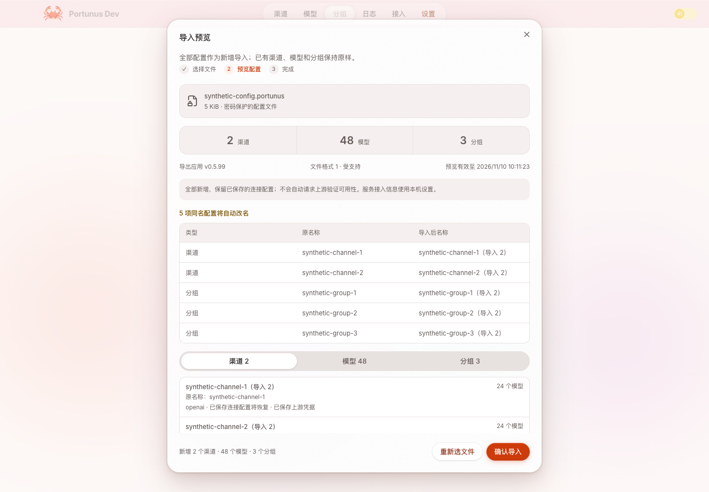
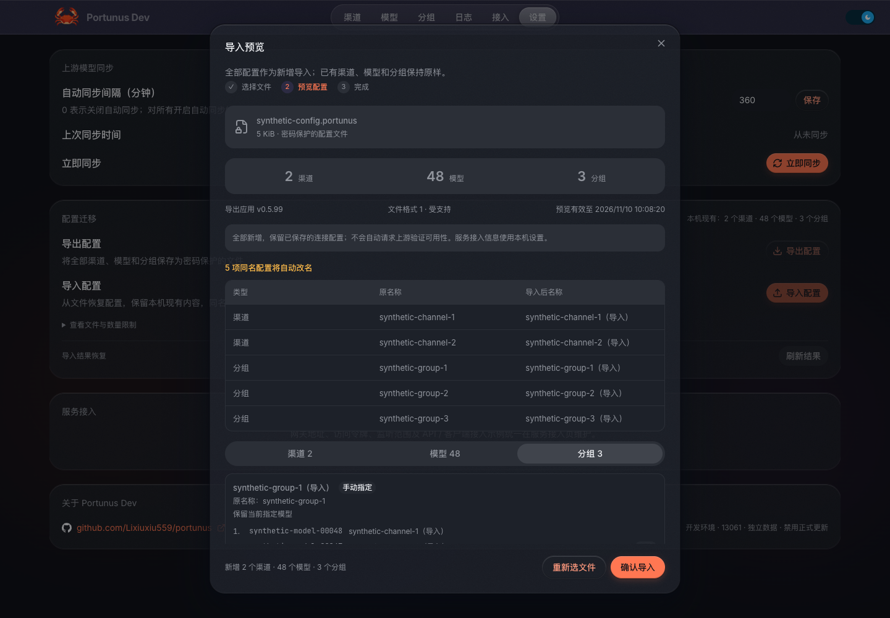
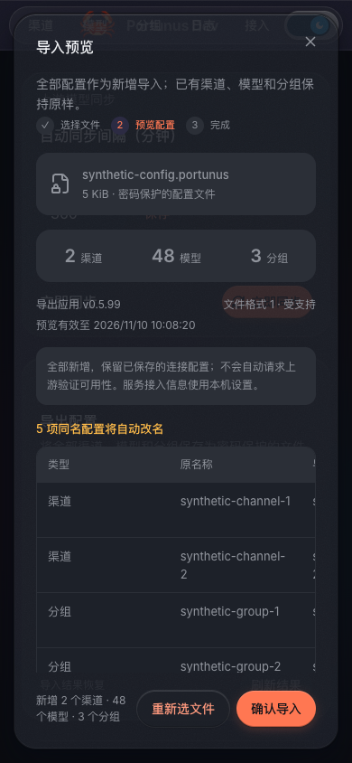

# 配置导入导出实施记录

日期：2026-11-10。工作区：`dev`，起点 `a6bb26aa7c8b4dade3fab0dbf7c9b49f13fa03c5`。

用户已审核通过 [PRD](prd.html)、[原型](prototype/index.html) 和 [Spec CT-1](spec.html)，并授权实施。本轮完成本地代码、集成、验证及评审；未提交、合并、安装、调整正式版本或发布。验证只使用合成凭据和临时库，没有读取或修改正式版、Dev 或客户端的实际配置。

## 交付与执行方式

功能入口为“设置 → 配置迁移”，使用说明见 [配置导入与导出](../../config-transfer.md)。

| 可验收任务 | 执行与状态 | 主要落点 |
| --- | --- | --- |
| 加密文件、完整快照、名称计划、原子恢复及持久回执 | 后端子任务；完成 | `backend/configtransfer/`、`backend/api/config_transfer.go`、`main.go` |
| 系统文件桥、窄 IPC、实例绑定、安全保存和结果核实 | Main 子任务；完成 | `web/src/main/config-transfer.js`、preload、sidecar、Main 装配 |
| 设置入口、密码表单、详情分页、结果恢复、缓存和新增分组跳转 | Renderer 子任务；完成 | `web/src/renderer/components/config-transfer/`、Settings、Groups、导航保护 |
| 跨模块集成、原生 IPC、真实浏览器、崩溃与容量验证、质量门 | 主任务；完成 | 现有 Go/Node 测试与下述合成验收 |

共享 HTTP、IPC 和 DTO 先按 Spec 冻结，三个文件范围互斥的实施任务并行执行，随后由主任务集成。三轴评审分别使用独立上下文。最终修改包含 11 个已有文件及 25 个新增源码／测试文件；原有设计资产和用户 `.claude/settings.json` 不计入实施源码。

保留全量导出、密码保护、全部新增、同名自动改名、格式 1 严格匹配、离线校验和先预览再确认。全部业务配置与成功回执同事务提交；同次确认只返回原结果，主动再次导入生成新副本。端口、服务接入 Key、全局设置、客户端文件、日志、旧计价和独立余额来源均不迁移。

本次仅补齐两个不改变业务语义的契约细节，并同步至 Spec：`discard({preview_id?})` 可释放尚未形成预览的文件令牌；结构化错误允许安全的 `field` 路径，便于定位字段。

## 实际验证

Go 命令使用以下环境，依赖版本未升级，`x/crypto v0.48.0` 只由间接改为直接依赖：

```sh
export GOPROXY=off GOSUMDB=off GOTOOLCHAIN=local GOFLAGS=-mod=readonly
export GOCACHE=/private/tmp/portunus-implementation-gocache
go test ./... -count=1
go vet ./...
go build ./...
go test -race ./backend/configtransfer ./backend/api
```

| 检查 | 结果与范围 |
| --- | --- |
| 全量 Go 测试、vet、build | 最终版本全部退出 0；全量测试包含网关、协议、路由、余额及旧管理接口回归 |
| 完整迁移领域/API race | 通过，领域 72.767s、API 4.620s；包含关停竞争、同操作并发、双连接池 DELETE/WAL fencing、恢复清理 |
| `cd web && pnpm test` | 最终 **292/292** 通过，无跳过 |
| `pnpm typecheck`、`pnpm build:renderer` | 通过；没有安装应用或构建正式安装包 |
| 三层桥接回归 | 真实 renderer 适配器 → 实际 preload VM → Main handler：无参方法通过，显式非法额外参数仍拒绝 |
| 原生 Electron 42.3.3 IPC | 独立隐藏窗口 fixture 加载实际 renderer 桥模块、preload、contextBridge 和 Main handler，连接真实回环 Go/SQLite；10 个固定方法均验证，完成文件导出、选择、预览、提交、结果核实、恢复列表、ACK 和清理 |
| 真实浏览器 | 实际 renderer 构建配合 Main handler 与 Go 合成服务；空密码／不一致后可修正，错误密码可重试，48 模型可翻到第 3 页，查看手动非首项激活、同优先级顺序及空组；成功后重载回放结果、数量不重复，跳转仅显示本次新增组 |
| 浅／深色、窄屏 | 浅色与深色桌面预览已查看；390px 页面无整体横向溢出，弹窗正文可滚动、确认按钮在视口内，表格局部滚动 |
| 真实 HTTP 与文件系统 | Main 实际 transport 与 Go 串联；完整文件不含明文假密钥，错误密码、预览不写业务、同名新增、响应丢失、同操作重放、ACK、主动重复导入、新名称被占用后再次确认均通过 |
| 真实进程中断 | 在临时库渠道已插入、正在写模型的事务中精确 SIGKILL 测试进程；新 owner 重启后回执为 aborted/SESSION_LOST，新增数量为 0，已有 2/48/3 保持；另验证已提交未 ACK 后重启仍回放成功，不重复恢复 |
| 图标与旧值 | 自定义 256×256 PNG 完整往返；坏 base64、坏 PNG／缺 IEND、257px 拒绝。false、0、空 Key、零 options、未知展示元数据、空组／未激活和 int64 priority 均覆盖 |

所有真实监听都绑定自建的随机回环端口；首次默认沙箱禁止 `httptest`/HTTP 监听，随后以同一合成测试范围取得本机监听权限，最终套件通过。未重写 `HOME`，未接管 13060/13061，也未关闭任何正式或 Dev 进程。独立 Electron fixture 使用自己的临时应用数据，不加载 Portunus 正式启动入口。

本轮还进行了严格解析器 3 秒 fuzz，退出 0，但仅执行 6 次，不能视为深入模糊验证。Go 构建曾输出模块版本缓存写入权限诊断；原生 Electron 输出 macOS sandbox extension 诊断，相关命令均退出 0 且断言完成，不计作跳过或通过替代证据。

## 容量样本

一次真实 HTTP 合成迁移包含 **2 个渠道、50,000 个模型、3 个分组、10,000 个成员**，导出、预览及提交全部完成。文件 3,869,027 字节，Preview 4,026,690 字节。该次观测导出 202ms、预览 233ms、提交 852ms；100ms 间隔采样的两个 Go 进程最高 RSS 分别为 142,176／181,280 KiB。

这些是 Darwin arm64 本机的单次样本，不是时延 SLA、精确峰值或全部上限可同时达到的保证；不包含 Electron 的总内存。文件／实体／Preview／Result 限制同时生效，超过任一限制整体拒绝。没有进行真实上游调用或负载压测。

## 质量门与修正

| 审计 | 初始发现与处理 | 最终结论 |
| --- | --- | --- |
| Correctness 独立轴 | 1 条 P1：无参调用被适配器变成一个 undefined 实参；改为原样传递 rest args，并新增真实三层回归 | 原复现与新增回归通过，增量复核无残留 |
| Standards 独立轴 | 硬性违规 0、smell 判断项 0；复核桥接及后续 Recover 窄变更 | 无 finding |
| Spec 独立轴 | 1 条高严重度：上述无参问题使摘要／文件选择契约不可用 | 修复后复核符合契约；Recover 释放语义增量也通过 |
| 生命周期尾部补测 | confirmed-idle 的 Recover 终结后保留秘密预览至 TTL；旧实现先红，新实现仅在证明终态后清理同 op 全部引用并归还名额 | 两槽回收、残留清零、prepared/running 保护及 race 通过，三轴增量复核完成 |

集成过程中另修复了成功后再次选择文件被 410 旧预览阻挡、表单错误触发原生校验锁死、关停时提前释放运行中载荷等问题，并完成相应回归。修复均在已授权功能范围内。

`agentforge:complexity-audit` 实际等级为 **file-level-risk**（[记录](implementation/coverage-risk.json)）：仓库与环境没有 gocyclo/gocognit、ESLint complexity/escomplex 配置，未安装新工具，未计算或编造 CRAP。使用 Go 内置覆盖率和 Node 内置测试覆盖率核对新增模块：

- 领域及 HTTP 合并执行的 `backend/configtransfer` 语句覆盖率 **79.8%**；Recover **84.2%**、PNG 校验 **92.3%**。仍有数据库不可读／错误结算等分支未完全覆盖，不能由总体覆盖率推断全部异常已证明。
- 迁移核心 JS（Main、桥适配器、controller、model）行覆盖率 **96.64%**、分支 **81.44%**；这不包含 JSX 视觉组件。JSX 行为另由实际浏览器走查，不能等同完整自动化覆盖。
- 突变测试跳过：项目没有已配置的 go-mutesting／Stryker 工具链，没有自动安装依赖。上述测试结果不能被称为突变审计通过。

2026-11-10 后续：用户另行授权安装和适配后，已接入 Gremlins 与 Stryker 并实际执行、补测、复跑。最新分类、剩余缺口与工具验证见 [突变审计记录](mutation-report.md)；本节保留首次实施时的状态。

覆盖率命令：

```sh
go test ./backend/configtransfer ./backend/api -coverpkg=./backend/configtransfer \
  -coverprofile=/private/tmp/portunus-ct-go-cover.out -count=1
go tool cover -func=/private/tmp/portunus-ct-go-cover.out
cd web
node --test --experimental-test-coverage \
  --test-coverage-include='src/main/config-transfer.js' \
  --test-coverage-include='src/renderer/components/config-transfer/*.js' \
  --test-coverage-include='src/renderer/api/configTransfer.js' \
  src/main/config-transfer.test.js \
  src/renderer/components/config-transfer/*.test.js \
  src/renderer/api/configTransfer.test.js
```

## 证据、边界与状态

源文件指纹见 [validated-source-manifest.json](implementation/validated-source-manifest.json)，合成集成记录见 [evidence.json](implementation/evidence.json)。临时 fixture 源及日志位于 `/private/tmp/portunus-config-transfer-fixture/`、`/private/tmp/portunus-ct-*.log`；测试已退出，历史记录不依赖这些临时文件永久保留。

- 原生系统文件对话框使用依赖注入，未进行 macOS GUI 手动选取；Windows/Linux 的原生文件流程、ACL 和完整打包应用没有实测。
- 未测试真实断电持久性。原子替换、事务与受控进程 SIGKILL 的通过，不等于断电后零丢失承诺。
- 没有未解决的业务／集成阻塞；没有真实数据库迁移、正式应用更新或远端发布。后续启动当前代码时才会按设计创建本环境的回执表。

实际构建界面截图（均为合成数据）：






