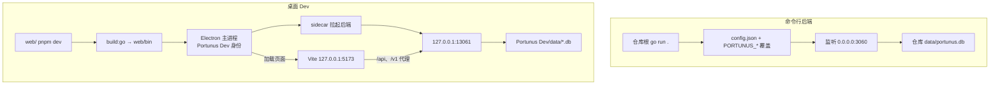

# 本地开发与测试

> 说明后端与桌面的本地启动、测试命令及 Dev/正式隔离；不覆盖正式打包发布与线上 CI 运行结果。

## 适用场景

- 第一次从源码启动命令行后端或桌面 Dev。
- 修改 Go、主进程或渲染层代码后，选择正确的启动与测试命令。
- 排查启动失败、端口占用或 Vite 代理连错后端。
- 前置条件：Go `1.26.6+`、Node.js 24、pnpm 10（[README](../../../README.md)、[go.mod](../../../go.mod#L3)）；桌面依赖在 `web/` 安装。
- 本页不覆盖正式安装包构建与发布（见[构建、发布与更新](构建发布与更新.md)），也不判断线上 CI 运行结果；系统组成见[系统架构](../系统架构.md)，桌面进程与 sidecar 状态机细节见[桌面主进程与 sidecar](../核心模块/桌面主进程与sidecar.md)，配置与数据库细节见[运行入口与基础设施](../核心模块/运行入口与基础设施.md)。Wiki 入口与模块导航见[开发知识库](../README.md)。

## 步骤

### 1. 命令行后端：`go run .`

在仓库根执行：

```bash
go mod download
go run .
```

- `main.go` 以相对路径 `config.json` 加载配置（[main.go](../../../main.go#L29)）；文件不存在时使用默认值，相对路径按启动时工作目录解析（[config.go](../../../backend/shared/config.go#L84-L90)）。
- 默认监听 `0.0.0.0:3060`，SQLite 默认 `data/portunus.db`（[config.go](../../../backend/shared/config.go#L72-L75)），两者都相对工作目录。
- 可用 `PORTUNUS_SERVER_HOST`、`PORTUNUS_SERVER_PORT`、`PORTUNUS_DATABASE_PATH`、`PORTUNUS_DATABASE_LOG_PATH` 覆盖（[config.go](../../../backend/shared/config.go#L151-L167)）。
- 同一进程装配 `/v1` 网关与 `/api` 管理接口（[main.go](../../../main.go#L72-L90)），收到 `SIGINT`/`SIGTERM` 后最多 5 秒优雅关闭（[main.go](../../../main.go#L91-L109)）。
- 这是命令行后端模式，不是桌面 Dev：不经过 Electron，没有 13061，也不读写 `Portunus Dev` 数据目录（[DEVELOPMENT](../../product/DEVELOPMENT.md)）。请求链路见[一次请求的生命周期](请求生命周期.md)。

Go 模块下载超时（例如访问 `proxy.golang.org` 失败）时，仓库约定可改用国内镜像（[CLAUDE.md](../../../CLAUDE.md)）：

```bash
GOPROXY=https://goproxy.cn,direct go mod tidy
```

### 2. 桌面 Dev 热开发：`pnpm dev`

```bash
cd web
pnpm install
pnpm dev
```

`pnpm dev` 实际执行（[package.json](../../../web/package.json#L63-L65)）：

1. `pnpm run build:go`：交叉编译当前平台到 `web/bin/<mac|win|linux>/portunus`，默认保留调试信息；macOS 同时构建 `portunus-updater`（[build-go.mjs](../../../web/scripts/build-go.mjs#L16-L55)）。
2. 并行启动 Vite 开发服务器（`127.0.0.1:5173`，`strictPort`）与 `NODE_ENV=development electron .`；Electron 在 `wait-on tcp:127.0.0.1:5173` 成功后启动（[vite.config.mjs](../../../web/vite.config.mjs#L32-L36)）。
3. 主进程先初始化 Dev 身份与独立 `userData`，再获取单实例锁（[runtime-profile.js](../../../web/src/main/runtime-profile.js#L12-L23)、[main.js](../../../web/src/main/main.js#L40)）。
4. 主进程用 `web/bin/...` 拉起自己的 Go 后端：端口 `13061`，工作目录 `Portunus Dev/backend`，数据库在 `Portunus Dev/data/`（[main.js](../../../web/src/main/main.js#L50-L61)）。
5. 窗口加载 `http://localhost:5173` 并打开 DevTools（[main.js](../../../web/src/main/main.js#L67-L71)）；Vite 将 `/api`、`/v1` 代理到 13061（[vite.config.mjs](../../../web/vite.config.mjs#L9)、[代理配置](../../../web/vite.config.mjs#L36-L55)）。

注意：

- `pnpm dev` 已自行构建并拉起 Dev 后端，不要再以 `go run .` 充当它的后端；Vite 代理固定指向 13061（[DEVELOPMENT](../../product/DEVELOPMENT.md)）。
- `build:go` 只在 `pnpm dev` 启动时执行一次；改 Go 代码后需重新 `pnpm build:go` 并重启 Electron，或重新执行 `pnpm dev`（推断：由脚本步骤得出）。
- `dev:web` 使用 `vite --open`，会额外打开默认浏览器（[package.json](../../../web/package.json#L64)）；单独运行 `dev:web` 时，`/api` 仍要求 13061 上已有 Dev 后端（[README](../../../README.md)）。
- Dev 首次启动是空库、新令牌，不复制正式渠道与凭据（[DEVELOPMENT](../../product/DEVELOPMENT.md)）。
- `web/.npmrc` 把 Electron 二进制镜像指向 npmmirror（[.npmrc](../../../web/.npmrc#L1)）；安装依赖统一在 `web/` 执行，CI 使用 `--frozen-lockfile`。

### 3. Dev 目录包：`build:dev` 与 `preview:dev`

```bash
cd web
pnpm build:dev
pnpm preview:dev
```

- `build:dev` 依次执行 `build:go`、`build:renderer`（`VITE_BASE=./`）和 `electron-builder --dir --config electron-builder.dev.cjs`，产物在 `web/dist-dev/`（[build-dev.mjs](../../../web/scripts/build-dev.mjs#L10-L12)）。
- Dev 构建配置覆盖 `appId: com.portunus.app.dev`、`productName: Portunus Dev`、`output: dist-dev`，并烘焙 `portunusProfile=development`；更新源为 `null`（[electron-builder.dev.cjs](../../../web/electron-builder.dev.cjs#L5-L13)）。
- `preview:dev` 先确认 13061 空闲，再启动已有 `dist-dev` 产物；macOS 路径为 `dist-dev/mac-arm64/Portunus Dev.app`（Intel 为 `dist-dev/mac/`），Windows/Linux 使用对应的 unpacked 路径（[preview-dev.mjs](../../../web/scripts/preview-dev.mjs#L7-L17)）。
- 不安装到 `/Applications`，也不覆盖正式 `Portunus.app`（[DEVELOPMENT](../../product/DEVELOPMENT.md)）。
- 预览前需退出已有 Dev：未打包的 `pnpm dev` 与打包 Dev 共用 `Portunus Dev` 名称和 `userData`，端口也只有 13061，单实例锁会让第二个实例退出（[runtime-profile.js](../../../web/src/main/runtime-profile.js#L12-L23)、[server-address.js](../../../web/src/main/server-address.js#L9-L10)）。
- Bundle ID `com.portunus.app.dev` 只存在于打包 Dev 产物；未打包的 `pnpm dev` 使用 Electron 默认 bundle，但运行身份和数据目录仍是 Dev。

### 4. 测试与静态检查

仓库根：

```bash
go test ./...
go vet ./...
go build ./...
```

`web/`：

```bash
pnpm test
pnpm typecheck
pnpm test:e2e
```

- `pnpm test` 用 `node --test "src/**/*.test.js"` 跑离线单元测试（[package.json](../../../web/package.json#L73)）。
- `pnpm typecheck` 执行 `tsc --noEmit`（[package.json](../../../web/package.json#L74)）。
- `pnpm test:e2e` 执行 `scripts/startup-race-check.mjs`（[package.json](../../../web/package.json#L75)）：先检查 13061 与 CDP 9333 空闲，默认重建 Dev 目录包，以 `PORTUNUS_SIDECAR_DELAY_MS=3000` 启动，统计窗口内 `[HTTP Error]` 与成功 `/api` 请求；normal 模式要求 0 次 `[HTTP Error]` 且至少 1 次 `/api` 成功（[startup-race-check.mjs](../../../web/scripts/startup-race-check.mjs#L36-L38)、[判据](../../../web/scripts/startup-race-check.mjs#L191-L197)）。
- 该脚本只查找 macOS 的 `dist-dev/*/Portunus Dev.app`（[startup-race-check.mjs](../../../web/scripts/startup-race-check.mjs#L47-L57)）；在当前实现下不是跨平台 E2E 套件。
- 先退出已有 Dev，再运行 `pnpm test:e2e`（[DEVELOPMENT](../../product/DEVELOPMENT.md)）；脚本只结束自己启动的进程（[startup-race-check.mjs](../../../web/scripts/startup-race-check.mjs#L200-L212)）。

CI 定义与本组命令对齐：Go 任务执行 `go test ./... -count=1`、`go vet ./...`、`go build ./...`；Web 任务用 Node 24、pnpm 10，执行 `pnpm install --frozen-lockfile`、`pnpm test`、`pnpm run typecheck`、`pnpm run build:renderer`，并跳过 Electron 运行时下载（[ci.yml](../../../.github/workflows/ci.yml#L18-L72)）。线上 CI 的实际运行结果不在本页核验范围。

### 5. Dev 与正式版隔离

| 项目 | 正式安装版 | Portunus Dev |
|---|---|---|
| 应用与更新 | `Portunus`；启用正式更新 | `Portunus Dev`；禁用更新检查、下载与安装 |
| Bundle ID | `com.portunus.app` | `com.portunus.app.dev`（打包 Dev） |
| 后端端口 | `13060` | `13061` |
| macOS 数据根 | 正式版原有目录 | `~/Library/Application Support/Portunus Dev` |
| 数据库 | 正式数据 | `Portunus Dev/data/portunus.db`、`portunus-log.db` |
| 构建产物 | `web/dist-electron/` | `web/dist-dev/` |

表格依据：[server-address.js](../../../web/src/main/server-address.js#L9-L10)、[runtime-profile.js](../../../web/src/main/runtime-profile.js#L15-L20)、[sidecar.js](../../../web/src/main/sidecar.js#L114-L122)、[package.json](../../../web/package.json#L7-L23)、[electron-builder.dev.cjs](../../../web/electron-builder.dev.cjs#L5-L13)、[DEVELOPMENT](../../product/DEVELOPMENT.md)。

- Dev 的 `userData`、`session/`、`logs/`、`backend/` 均在 `Portunus Dev` 下（[runtime-profile.js](../../../web/src/main/runtime-profile.js#L15-L20)）；后端 `cwd` 指向 `Portunus Dev/backend`，因此不读仓库根 `config.json`（[main.js](../../../web/src/main/main.js#L46-L55)）。
- 默认仅本机访问；切到局域网时后端监听 `0.0.0.0`，但界面与客户端连接的内部 URL 仍是 `127.0.0.1:<port>`（[server-address.js](../../../web/src/main/server-address.js#L13-L24)）。
- 正式版可以一直运行；两种 Dev 启动方式之间需先退出当前 Dev（[DEVELOPMENT](../../product/DEVELOPMENT.md)）。
- 「服务接入 → 客户端配置」在 Dev 与正式版都会读写真实的 `~/.claude/settings.json`，首次写入前生成 `.portunus.bak`；开发验收建议设置 `PORTUNUS_CLIENT_HOME=/tmp/portunus-client-home`（[DEVELOPMENT](../../product/DEVELOPMENT.md)、[client-config.js](../../../web/src/main/client-config.js#L17)）。

### 6. 停止与端口边界

- `pnpm dev` 用 `Ctrl+C` 结束；Electron 退出时只停止本次主进程创建的后端子进程（[sidecar.js](../../../web/src/main/sidecar.js#L174-L179)、[main.js](../../../web/src/main/main.js#L249-L260)）。
- `preview:dev` 通过 `open -n` 启动 Dev，停止时从 Dev 界面或托盘退出，不对其他进程做批量处理（[preview-dev.mjs](../../../web/scripts/preview-dev.mjs#L17-L19)）。
- 13061 被占用时，sidecar 拒绝启动（[sidecar.js](../../../web/src/main/sidecar.js#L106-L110)），Dev 停在错误页、不加载业务界面（[main.js](../../../web/src/main/main.js#L113-L119)）；`preview:dev` 与 `test:e2e` 也会在预检阶段退出（[preview-dev.mjs](../../../web/scripts/preview-dev.mjs#L7-L11)、[startup-race-check.mjs](../../../web/scripts/startup-race-check.mjs#L63-L70)）。
- 不按进程名结束应用，不使用 `killall`/`pkill`；不覆盖 `/Applications/Portunus.app`，不把 `dist-dev` 产物拖入 `/Applications`（[DEVELOPMENT](../../product/DEVELOPMENT.md)、[预览路径说明](../../product/DEVELOPMENT.md)）。
- 不通过 `HOME`、任意数据目录覆盖参数或正式数据库副本实现隔离（[DEVELOPMENT](../../product/DEVELOPMENT.md)）。

## 流程图



两条路径互不依赖：命令行后端使用仓库配置与 `data/`，桌面 Dev 使用独立身份、`Portunus Dev` 数据目录和 13061。

## 排障

| 现象 | 原因 | 处理 |
|---|---|---|
| `go run .` 报 `启动失败: listen tcp 0.0.0.0:3060: bind: address already in use`（推断：未实际复现监听失败） | 3060 已被其他进程占用 | 停止自己启动的旧后端，或改用 `PORTUNUS_SERVER_PORT`；不要把桌面 Dev 的后端当成本进程（[main.go](../../../main.go#L97-L111)） |
| 浏览器或 Electron 中 `/api` 连接失败 | 只运行了 `go run .`（3060），而 Vite 代理指向 13061 | 启动桌面 Dev；命令行后端与 Vite 开发服务器不是一套地址（[vite.config.mjs](../../../web/vite.config.mjs#L9)） |
| 主进程日志报 `后端二进制缺失: .../web/bin/.../portunus` | 未执行 `build:go` 或产物缺失 | `cd web && pnpm build:go` 后重启，或完整执行 `pnpm dev`（[sidecar.js](../../../web/src/main/sidecar.js#L106-L108)） |
| `后端端口 13061 已被占用` | 已有 Dev（`pnpm dev` 或预览包）或其他进程占用 | 从已有 Dev 界面退出；不要按进程名清理，正式版 13060 不受影响（[sidecar.js](../../../web/src/main/sidecar.js#L109)） |
| Dev 窗口显示「Portunus Dev 启动失败」 | sidecar 未就绪：端口占用、二进制缺失或启动超时 | 查看 `[backend]`/`[sidecar]` 日志，确认 13061 空闲且已构建 `web/bin`（[main.js](../../../web/src/main/main.js#L113-L119)、[sidecar.js](../../../web/src/main/sidecar.js#L149-L164)） |
| `pnpm preview:dev` 报 `找不到 Portunus Dev，请先执行 pnpm build:dev` | `dist-dev` 无产物 | 先执行 `pnpm build:dev`（[preview-dev.mjs](../../../web/scripts/preview-dev.mjs#L16)） |
| `pnpm test:e2e` 以退出码 2 结束并提示端口占用 | 13061 或 CDP 9333 被占用 | 退出已有 Dev；该脚本仅针对 macOS 的 `dist-dev` 产物（[startup-race-check.mjs](../../../web/scripts/startup-race-check.mjs#L63-L70)） |
| Vite 未启动，提示 5173 端口被占用 | `strictPort: true` | 停止自己启动的旧 Vite/Dev 后重新执行 `pnpm dev`（[vite.config.mjs](../../../web/vite.config.mjs#L32-L36)） |
| 真实客户端配置被 Dev 修改 | 「服务接入」读写真实 `~/.claude/settings.json` | 验收时设置 `PORTUNUS_CLIENT_HOME`，或从 `.portunus.bak` 回滚（[DEVELOPMENT](../../product/DEVELOPMENT.md)） |

<details><summary>来源</summary>

- [README.md](../../../README.md)
- [docs/product/DEVELOPMENT.md](../../product/DEVELOPMENT.md)
- [main.go](../../../main.go)
- [go.mod](../../../go.mod)
- [web/package.json](../../../web/package.json)
- [web/vite.config.mjs](../../../web/vite.config.mjs)
- [web/scripts/build-go.mjs](../../../web/scripts/build-go.mjs)
- [web/scripts/build-dev.mjs](../../../web/scripts/build-dev.mjs)
- [web/scripts/preview-dev.mjs](../../../web/scripts/preview-dev.mjs)
- [web/src/main/runtime-profile.js](../../../web/src/main/runtime-profile.js)
- [web/src/main/server-address.js](../../../web/src/main/server-address.js)
- [web/src/main/sidecar.js](../../../web/src/main/sidecar.js)
- [.github/workflows/ci.yml](../../../.github/workflows/ci.yml)

核验范围：核验基线 `3d63c30`（`dev`，2026-10-30）。已在当前工作区实际执行并通过 `go test ./...`、`go vet ./...`、前端 245 项测试和 `pnpm typecheck`；未启动桌面应用、未构建安装包、未访问真实上游。
</details>
