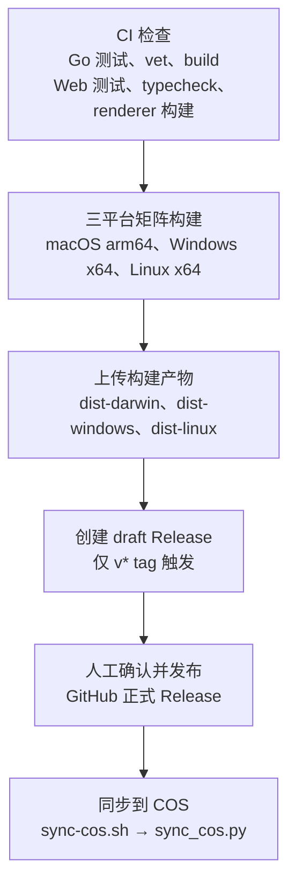

# 构建、发布与更新

> 说明安装包构建、CI/Release 工作流、更新签名与客户端更新链路；不证明线上工作流或某个安装包已经验证。

## 适用场景

- 从源码构建正式安装包（macOS DMG/ZIP、Windows NSIS/ZIP、Linux AppImage），或在本地生成独立的 Portunus Dev 预览包。
- 打 tag 发版，核对 GitHub Actions 的检查、三平台矩阵构建、draft Release 与人工发布流程。
- 排查 macOS 更新签名、更新源切换、更新包校验失败或安装回滚。
- 正式 Release 发布后，把安装包与更新清单同步到 COS。
- 前置条件：Go 1.26.6（[go.mod](../../../go.mod#L3)）、Node.js 24、pnpm 10（[ci.yml](../../../.github/workflows/ci.yml#L52-L60)）；发布需要仓库 tag 权限与 Actions Secret `PORTUNUS_UPDATE_SIGNING_KEY`；COS 同步需要已登录的 `gh` 与 COS 凭证。
- 分支与发布节奏见[开发说明](../../product/DEVELOPMENT.md)：日常在 `dev` 开发，只在明确合并或发布时把验证过的 `dev` 合入 `main` 并打标签。
- 本页只描述仓库脚本与工作流定义。2026-10-30 当前工作区已实际执行并通过 `go test ./...`、`go vet ./...`、前端 245 项测试与 `pnpm run typecheck`；这不等于 GitHub Actions 线上已通过，也不代表任何安装包已验证。桌面 Dev 的启动细节见[本地开发与测试](本地开发与测试.md)。

## 步骤

### 1. 本地正式构建

在 `web/` 下执行（首次构建前先 `pnpm install`）：

```bash
pnpm build        # 当前平台
pnpm build:mac    # macOS arm64：DMG + ZIP
pnpm build:win    # Windows x64：NSIS + ZIP
```

- `pnpm build` 依次执行 `build:go:release`、`VITE_BASE=./ vite build` 和 `electron-builder`，产物输出到 `web/dist-electron/`（[package.json](../../../web/package.json#L68)、[构建配置](../../../web/package.json#L7-L14)）。它没有显式指定目标，由 electron-builder 按当前平台和 `package.json` 的 `mac` / `win` / `linux` 配置生成安装包。
- `pnpm build:mac` 执行 `build:go:release` → `build:renderer` → `electron-builder --mac dmg zip --arm64`（[package.json](../../../web/package.json#L70)）；`pnpm build:win` 先交叉编译 `windows amd64`，再 `build:renderer` 和 `electron-builder --win nsis zip --x64`（[package.json](../../../web/package.json#L71)）。两者同样输出到 `web/dist-electron/`。
- `build:renderer` 固定带 `VITE_BASE=./`，否则打包后的 `file://` 页面会按绝对路径找资源（[package.json](../../../web/package.json#L69)）。
- 安装包文件名固定为 `Portunus-<version>-mac-<arch>.<ext>`、`-windows-`、`-linux-`（[package.json](../../../web/package.json#L34)、[Windows](../../../web/package.json#L42)、[Linux](../../../web/package.json#L54)）。更新签名、Release 资产收集和 COS 同步都依赖这个命名。

`web/scripts/build-go.mjs` 负责把 Go 后端放进 `web/bin/`：

- 参数优先于当前平台：`node scripts/build-go.mjs <goos> <goarch> --release`；不带参数时按当前系统和架构（[build-go.mjs](../../../web/scripts/build-go.mjs#L19-L22)）。
- 输出目录键与 electron-builder 的 `${os}` 宏对齐：`darwin → mac`、`windows → win`、`linux → linux`，文件名为 `portunus` 或 `portunus.exe`（[build-go.mjs](../../../web/scripts/build-go.mjs#L24-L31)）。
- `--release` 追加 `-trimpath -ldflags="-s -w"`；构建固定 `CGO_ENABLED=0`，通过 `GOOS` / `GOARCH` 交叉编译（[build-go.mjs](../../../web/scripts/build-go.mjs#L35-L43)）。
- macOS 目标额外从 `./cmd/portunus-updater` 构建 `portunus-updater`，与后端输出到同一目录（[build-go.mjs](../../../web/scripts/build-go.mjs#L46-L55)）。
- electron-builder 的 `extraResources` 把 `web/bin/${os}` 复制到应用的 `resources/bin`（配置写为 `bin/${os}`，[package.json](../../../web/package.json#L21-L26)）。打包态主进程从 `resources/bin/portunus[.exe]` 启动后端，macOS 更新时从 `resources/bin/portunus-updater` 调用准备助手。
- 推断：`build:mac` 固定打包 `--arm64`，而 `build:go:release` 按当前机器架构编译；在 Intel Mac 上会出现 Go 二进制为 `amd64`、应用包为 `arm64` 的不一致，脚本没有显式对齐。
- 未验证：`build`、`build:win`、`build:dev` 内部的 `VITE_BASE=./` 命令前缀在原生 Windows 的 npm 脚本 shell 中是否可用，本轮没有执行验证；Release 工作流改用 env 块正是为了避开 Windows runner 的 shell 差异（[release.yml](../../../.github/workflows/release.yml#L69-L71)）。

### 2. Dev 构建

```bash
cd web
pnpm build:dev
pnpm preview:dev
```

- `build:dev` 执行 `build-dev.mjs`：`build:go`（保留调试信息）→ `build:renderer` → `electron-builder --dir --config electron-builder.dev.cjs -c.electronDist=node_modules/electron/dist`，并设置 `CSC_IDENTITY_AUTO_DISCOVERY=false`（[build-dev.mjs](../../../web/scripts/build-dev.mjs#L10-L12)）。
- `electron-builder.dev.cjs` 继承正式的 `build` 配置，但改为 `appId: com.portunus.app.dev`、`productName: Portunus Dev`、输出 `dist-dev`、`compression: store`、`publish: null`，并写入 `extraMetadata.portunusProfile=development`；mac 使用 `identity: null` 且只出 `dir`，Linux 可执行名为 `portunus-dev`，Windows 也只出 `dir`（[electron-builder.dev.cjs](../../../web/electron-builder.dev.cjs#L5-L13)）。
- Dev 包不签名、不发布，也不接入正式更新链路；`updater.js` 在 Dev 直接切换到 `disabled-updater`，不加载 `electron-updater`（[updater.js](../../../web/src/main/updater.js#L4-L6)）。
- `preview:dev` 先确认 13061 空闲，再启动已有的 `dist-dev` 产物；macOS 用 `open -n` 打开 `dist-dev/mac-arm64/Portunus Dev.app`，不会覆盖 `/Applications/Portunus.app`（[preview-dev.mjs](../../../web/scripts/preview-dev.mjs#L7-L17)）。
- Dev 与正式的运行身份、数据目录和端口隔离见[本地开发与测试](本地开发与测试.md)与[桌面主进程与 sidecar](../核心模块/桌面主进程与sidecar.md)。

### 3. CI

`.github/workflows/ci.yml`：

- 触发：任意分支 push、PR、`workflow_dispatch`、`workflow_call`；权限只读，PR 的旧运行会被同组新运行取消（[ci.yml](../../../.github/workflows/ci.yml#L3-L15)）。
- `Go checks`（ubuntu-latest）：Go 版本取自 `go.mod`，依次运行 `go test ./... -count=1`、`go vet ./...`、`go build ./...`（[ci.yml](../../../.github/workflows/ci.yml#L18-L37)）。
- `Web checks`（ubuntu-latest，工作目录 `web`）：pnpm 10、Node 24、`pnpm install --frozen-lockfile`，然后 `pnpm test`、`pnpm run typecheck`、`pnpm run build:renderer`（[ci.yml](../../../.github/workflows/ci.yml#L39-L72)）。
- 设置 `ELECTRON_SKIP_BINARY_DOWNLOAD=1`，任务只检查源码与渲染层，不启动 Electron 或下载其运行时（[ci.yml](../../../.github/workflows/ci.yml#L46-L48)）。
- CI 不运行 `electron-builder`，也不读取更新签名或 COS 凭证；它只定义仓库内检查，不代表线上运行结果。

### 4. Release 工作流

`.github/workflows/release.yml`：

- 触发：推送 `v*` 标签或手动 `workflow_dispatch`（[release.yml](../../../.github/workflows/release.yml#L7-L10)）。
- `checks` 任务通过 `uses: ./.github/workflows/ci.yml` 复用 CI，`build` 依赖它，检查不通过不会进入打包（[release.yml](../../../.github/workflows/release.yml#L13-L20)）。
- `build` 使用 `fail-fast: false` 的三平台矩阵（[release.yml](../../../.github/workflows/release.yml#L21-L36)）：

| 平台 | runner | Go 目标 | electron-builder 参数 |
|---|---|---|---|
| macOS | `macos-latest` | `darwin/arm64` | `--mac dmg zip --arm64` |
| Windows | `windows-latest` | `windows/amd64` | `--win nsis zip --x64` |
| Linux | `ubuntu-latest` | `linux/amd64` | `--linux AppImage --x64` |

- 每个平台先运行 `node scripts/build-go.mjs <goos> <goarch> --release`，再 `pnpm install --frozen-lockfile`，最后 `pnpm exec vite build` 与 `pnpm exec electron-builder <args> --publish never`（[release.yml](../../../.github/workflows/release.yml#L55-L74)）。Go 后端在安装依赖之前构建，因此该步骤不依赖 `web/node_modules`。
- 构建环境固定 `CSC_IDENTITY_AUTO_DISCOVERY=false`（不使用 Apple Developer ID）、注入 `PORTUNUS_UPDATE_SIGNING_KEY`，并用 env 块设置 `VITE_BASE=./`；注释说明 Windows runner 默认 PowerShell 不支持 `VAR=x cmd` 前缀写法（[release.yml](../../../.github/workflows/release.yml#L65-L74)）。
- 产物以 `dist-${goos}` 上传 `web/dist-electron/*`，找不到文件直接失败，保留 7 天（[release.yml](../../../.github/workflows/release.yml#L76-L82)）。
- `release` 任务只在 `github.ref` 以 `refs/tags/v` 开头时运行；普通手动触发只构建并上传 Actions artifact，不创建 Release（[release.yml](../../../.github/workflows/release.yml#L84-L90)）。
- 资产收集只拷贝 `*.exe`、`*.dmg`、`*.zip`、`*.AppImage`、`*.blockmap`、`*.zip.sig`、`latest.yml`、`latest-mac.yml`、`latest-linux.yml`，并排除 `*unpacked*`；避免把 Electron 运行时杂散文件和几百 MB 的解包目录传给 GitHub（[release.yml](../../../.github/workflows/release.yml#L96-L107)）。
- 额外生成固定文件名副本 `Portunus-mac-arm64.zip` 和 `Portunus-linux-x64.AppImage`，让 README 依赖的 `releases/latest/download/<固定名>` 始终指向最新版，Linux 下载说明也使用固定文件名；electron-builder 在 Linux 输出 `x86_64`，所以副本需要重命名（[release.yml](../../../.github/workflows/release.yml#L108-L111)、[README](../../../README.md)）。
- 最后用 `softprops/action-gh-release@v2` 创建 `draft: true` 的 Release 并自动生成发布说明（[release.yml](../../../.github/workflows/release.yml#L114-L119)）。草稿必须人工检查后点 publish，避免错误 tag 直接把坏包推给客户。
- 版本一致性：electron-builder 用 `web/package.json` 的 `version` 生成文件名和 `latest*.yml`；`sign-mac-update.mjs` 只接受 `x.y.z` 形式的版本，`sync_cos.py` 要求清单版本等于 tag 去掉 `v`。因此 tag 必须与 `web/package.json` 的版本一致，且不能带预发布后缀，否则签名或 COS 同步会失败（由脚本校验推出）。
- 差异：Release 的 Go 版本写死为 `'1.26'`（[release.yml](../../../.github/workflows/release.yml#L41-L43)），CI 则读取 `go.mod`（[ci.yml](../../../.github/workflows/ci.yml#L25-L28)）。

### 5. macOS 更新签名与安装准备

签名在构建产物生成后由 electron-builder 钩子完成：

- `package.json` 的 `afterAllArtifactBuild` 指向 `scripts/after-artifacts.cjs`（[package.json](../../../web/package.json#L11)）。
- 该钩子只处理 `-mac-(arm64|x64).zip`；没有 mac ZIP 时直接返回。CI 中若既没有 `PORTUNUS_UPDATE_SIGNING_KEY` 也没有 `PORTUNUS_UPDATE_SIGNING_KEY_FILE`，直接抛错 `macOS 更新包签名缺少 PORTUNUS_UPDATE_SIGNING_KEY Secret`（[after-artifacts.cjs](../../../web/scripts/after-artifacts.cjs#L5-L9)）。
- 公钥固定读取仓库内 `cmd/portunus-updater/public-key.pem`；私钥优先取环境变量，其次读文件，本机回退到 `~/.config/portunus/update-signing-key.pem`（[after-artifacts.cjs](../../../web/scripts/after-artifacts.cjs#L11-L13)）。
- 每个 ZIP 生成同名 `.sig` JSON，包含 `version`、`arch`、`size`、`sha512` 和 `signature`（[after-artifacts.cjs](../../../web/scripts/after-artifacts.cjs#L15-L24)）。私钥不进入仓库或安装包。

`sign-mac-update.mjs` 定义签名格式：

- 版本必须是纯 `x.y.z`，架构只允许 `arm64` 或 `x64`（[sign-mac-update.mjs](../../../web/scripts/sign-mac-update.mjs#L9)）。
- 私钥必须是 Ed25519，且由它导出的公钥要与应用内置公钥相等，否则报 `签名私钥与应用内置公钥不匹配`（[sign-mac-update.mjs](../../../web/scripts/sign-mac-update.mjs#L10-L11)）。
- 被签内容是 `portunus-mac-update-v1`、bundle ID `com.portunus.app`、版本、架构、大小和 SHA-512 组成的多行文本（[sign-mac-update.mjs](../../../web/scripts/sign-mac-update.mjs#L12-L16)）；Go 侧 `verifyArchive` 用同一格式校验（[verify.go](../../../cmd/portunus-updater/verify.go#L36-L38)、[verify.go](../../../cmd/portunus-updater/verify.go#L74-L111)）。
- 也可单独运行：`node scripts/sign-mac-update.mjs <ZIP路径> <版本> [arm64|x64]`，私钥来源与钩子一致（[sign-mac-update.mjs](../../../web/scripts/sign-mac-update.mjs#L19-L28)）。

客户端安装由 `mac-update-installer.js` 和内置的 `portunus-updater` 协作：

- 下载完成后，`PortunusMacUpdater.updateDownloaded` 通过 HTTPS 拉取 `<下载地址>.sig`（只接受 HTTPS，超过 16 KiB 拒绝），写入 0600 权限的 `.sig` 文件（[mac-update-installer.js](../../../web/src/main/mac-update-installer.js#L7-L25)）。
- 随后调用 `resources/bin/portunus-updater --prepare --archive <ZIP> --signature <SIG> --target <应用路径> --version <新版本> --current <当前版本>`，超时 180 秒，并从 stdout 读取事务目录 `root`（[mac-update-installer.js](../../../web/src/main/mac-update-installer.js#L62-L72)）。
- `--prepare` 校验目标必须是绝对路径、非符号链接的 `.app`，校验应用标识、版本和 CPU 架构，校验归档签名；已有可复用的准备包会直接返回。否则在应用同级创建 0700 的 `.portunus-update-*` 目录，复制归档与签名并再次校验，解压 `Portunus.app`，移除 quarantine、ad-hoc 重签并 `codesign --verify`，最后复制自身为 `installer` 并写入带 64 个十六进制字符随机 token 的 `job.json`（[install.go](../../../cmd/portunus-updater/install.go#L41-L116)）。助手只支持 macOS（[main.go](../../../cmd/portunus-updater/main.go#L13-L16)）。
- 用户确认安装时，`quitAndInstall` 启动 `installer --install <root> --parent <pid>`；助手在替换前再次校验签名、应用和暂存目录，打印 `{"ready":true}` 后应用才退出（[mac-update-installer.js](../../../web/src/main/mac-update-installer.js#L28-L56)、[install.go](../../../cmd/portunus-updater/install.go#L183-L220)）。
- 替换流程：等待旧进程退出（最多 30 秒），把旧应用改名为 `Previous.app`，把暂存应用移到目标位置，再带 `--portunus-update-root` 与 `--portunus-update-token` 启动新版；90 秒内读到匹配 token 的 `healthy` 文件就删除备份并写入 `result.json`，否则把新版移到 `Failed.app`、恢复旧版并重新启动，错误信息包含 `已恢复旧版`（[install.go](../../../cmd/portunus-updater/install.go#L222-L272)）。
- 新版渲染层挂载时调用 `window.api.confirmRendererReady()`（[App.jsx](../../../web/src/renderer/App.jsx#L21-L26)、[preload.js](../../../web/src/main/preload.js#L23)）；主进程只在 macOS、窗口未销毁、后端 `ready`、事件来自主 frame 且页面是打包后的 `index.html` 时才转交健康检查（[main.js](../../../web/src/main/main.js#L167-L171)）。`mac-update-health.js` 再校验事务目录、token、目标应用和版本，写入 `healthy`（[mac-update-health.js](../../../web/src/main/mac-update-health.js#L6-L29)）。
- `mac-update-smoke.mjs` 是手动验收脚本：只在 macOS 运行，使用临时目录、本地 HTTPS 服务和 fixture 应用，场景为 `success`、`tamper`、`rollback`；tamper 要求退出前拒绝，rollback 要求恢复旧版，用户数据哨兵必须不变（[mac-update-smoke.mjs](../../../web/scripts/mac-update-smoke.mjs#L1-L19)、[判定逻辑](../../../web/scripts/mac-update-smoke.mjs#L129-L174)）。它不在 `package.json` 的脚本列表中，本轮未执行。

### 6. 客户端更新链路

- `updater.js` 先判运行身份：Dev 导出 `disabled-updater`，所有检查、下载和安装都抛 `Portunus Dev 禁用正式更新，请重新构建开发预览`，且不加载 `electron-updater`（[updater.js](../../../web/src/main/updater.js#L4-L6)、[disabled-updater.js](../../../web/src/main/disabled-updater.js#L7-L13)）。
- 正式版 macOS 使用 `createMacUpdater` 包装的 `MacUpdater`，Windows/Linux 使用 `electron-updater` 的 `autoUpdater`，两者都交给 `createUpdateService`（[updater.js](../../../web/src/main/updater.js#L8-L13)）。
- 主源为 COS `https://portunus-1321735248.cos.ap-shanghai.myqcloud.com/releases/`（generic），备用源为 GitHub `Lixiuxiu559/portunus`；注释说明 electron-builder 会在运行时移除 `build` 字段，所以备用源必须独立写在代码里（[update-service.js](../../../web/src/main/update-service.js#L3-L9)）。
- 服务强制 `autoDownload=false`，由检查结果触发后台下载；`autoInstallOnAppQuit` 在 `supportsInstallOnQuit !== false` 时开启，macOS 自定义更新器把 `supportsInstallOnQuit` 设为 `false`，因此必须显式安装（[update-service.js](../../../web/src/main/update-service.js#L12-L15)、[mac-update-installer.js](../../../web/src/main/mac-update-installer.js#L58-L61)）。
- 检查：先查 COS，失败时记录 `[updater] COS 检查失败，切换 GitHub:` 并改用 GitHub（[update-service.js](../../../web/src/main/update-service.js#L92-L102)）。检查成功且发现新版本后立即启动下载，但不阻塞检查返回（[update-service.js](../../../web/src/main/update-service.js#L104-L134)）。
- 下载：先在主源下载；只有仍在主源且不是 `ERR_CANCELLED` 时才切换 GitHub，并重新检查同一版本；备用源没有该版本时报 `GitHub 备用源尚未提供版本 <version>，请稍后重新检查更新`（[update-service.js](../../../web/src/main/update-service.js#L136-L164)）。
- 状态：每次变更递增 `revision` 并推送 `update:state`；事件在服务创建时注册，窗口隐藏期间完成的下载仍能在新窗口恢复（[update-service.js](../../../web/src/main/update-service.js#L43-L81)）。IPC 入口为 `update:get-state`、`update:check`、`update:download`、`update:install`（[update-service.js](../../../web/src/main/update-service.js#L208-L213)）。
- 主进程在页面 `loadFile` 成功后才检查更新，且 `runtime.updatesEnabled` 为假时跳过；注释说明提前检查会让事件发到尚未注册监听器的页面（[main.js](../../../web/src/main/main.js#L73-L83)）。
- 非 macOS 的安装走 electron-updater 默认逻辑；macOS 走上一节的 `--prepare` 与 `installer` 事务。更新状态由渲染层通过同一组 `update:*` channel 展示，渲染层细节不在本页展开。

### 7. 发布后 COS 同步

GitHub Release 发布后，用脚本把最新正式版复制到 COS。COS 的 `releases/` 正是客户端更新的主源，清单文件名与 Release 资产一致。

```bash
scripts/sync-cos.sh                    # 同步 GitHub 最新正式版
scripts/sync-cos.sh --tag v0.5.4       # 指定版本（仍必须是最新正式版）
scripts/sync-cos.sh --download-only    # 只下载并校验，不连接 COS
scripts/sync-cos.sh --assets-dir DIR   # 使用已有目录，不重新下载
```

- `sync-cos.sh` 先检查 `gh` 已安装、Python 3.11+；在 `${TMPDIR:-/tmp}/portunus-cos-sync-venv` 创建或修复虚拟环境（`python3 -m venv --clear`，可修复中断残留的假 venv），安装 `scripts/cos-requirements.txt`（`cos-python-sdk-v5==1.9.44`、`PyYAML==6.0.3`），然后执行 `sync_cos.py`（[sync-cos.sh](../../../scripts/sync-cos.sh#L4-L14)）。
- 凭证：优先读环境变量 `COS_SECRET_ID` / `COS_SECRET_KEY`（也接受 `TENCENTCLOUD_SECRET_ID` / `TENCENTCLOUD_SECRET_KEY`），其次读仓库根 `.env`（不覆盖已有环境变量）；都没有且不是交互终端时直接失败，交互终端会隐藏输入提示（[sync_cos.py](../../../scripts/sync_cos.py#L178-L206)）。
- 只允许同步正式 Release：`gh release view` 后拒绝 `draft` 和 `prerelease`，并校验 tag 以 `v` 开头、没有路径成分，再确认它就是 GitHub 最新正式版（[sync_cos.py](../../../scripts/sync_cos.py#L220-L232)、[check_latest](../../../scripts/sync_cos.py#L31-L38)）。
- 下载：清单用 `--clobber` 覆盖，安装包用 `--skip-existing` 复用已有文件；后续 SHA-512 校验会阻止损坏文件上传（[sync_cos.py](../../../scripts/sync_cos.py#L235-L241)）。
- 上传前校验（[sync_cos.py](../../../scripts/sync_cos.py#L41-L87)）：清单 `version` 必须等于 tag 去掉 `v`；`files` 非空；引用地址必须是同目录相对路径；每个安装包的 SHA-512 和大小必须与清单一致；`latest*.yml` 的 `path` 必须指向 `files` 之一；0.5.0 之后的 macOS ZIP 必须有 `.sig`，且 `version` / `arch` / `size` / `sha512` 与包一致、签名字节为 64 字节。
- 上传顺序（[sync_cos.py](../../../scripts/sync_cos.py#L103-L118)）：先上传全部安装包，再复查一次最新版本，最后上传 `latest*.yml`（`Cache-Control: no-cache`、`Content-Type: application/yaml`）。这样客户端不会在新清单出现时拿到还没上传完的包。
- 清理：同步成功后按 GitHub 正式发布时间保留最近 3 个版本（当前版本加 COS 中已有的最近两个正式版本），只删除匹配版本命名的旧安装包、`.blockmap` 和 `.sig`；固定文件名副本与更新清单不参与清理，每次会被覆盖（[sync_cos.py](../../../scripts/sync_cos.py#L152-L175)）。删除前会再次确认当前 tag 仍是最新正式版（[sync_cos.py](../../../scripts/sync_cos.py#L170)）。
- 清理失败不回滚已上传的新版本，脚本以 `新版本已同步，但旧版本清理失败；请根据错误原因处理后重试` 结束（[sync_cos.py](../../../scripts/sync_cos.py#L261-L267)）。

## 流程图



普通手动触发（分支 ref）只完成到「上传构建产物」；只有 `v*` tag 触发才会进入 draft Release 与后续步骤。

## 排障

| 现象 | 原因 | 处理 |
|---|---|---|
| `macOS 更新包签名缺少 PORTUNUS_UPDATE_SIGNING_KEY Secret` | macOS 构建产出了 ZIP，但 CI 没有注入签名私钥 | 在仓库 Actions secrets 配置 `PORTUNUS_UPDATE_SIGNING_KEY`（Ed25519 私钥 PEM）或设置 `PORTUNUS_UPDATE_SIGNING_KEY_FILE`；本机可放到 `~/.config/portunus/update-signing-key.pem`。不要把私钥写入仓库。 |
| `签名私钥与应用内置公钥不匹配` | 私钥与 `cmd/portunus-updater/public-key.pem` 不是一对 | 换回配套私钥；如确需轮换公钥，要同步重新构建 `portunus-updater`，旧版本无法验证新签名。 |
| `更新包签名校验失败` 或 `更新包内容校验失败` | 归档或 `.sig` 被篡改、下载截断，或签名元数据与包不一致 | 保留错误并重新检查更新；`mac-update-smoke.mjs` 的 `tamper` 场景要求退出前拒绝，且旧应用不退出。 |
| `GitHub 备用源尚未提供版本 <version>` | COS 下载失败后切到 GitHub，但该版本资产还没发布或还没同步 | 确认 draft Release 已发布且 `latest*.yml` 与安装包齐全，再重新检查；备用源缺同一版本时不会降级安装别的版本。 |
| `更新程序准备超时` 或 `更新程序在替换前退出 (<code>)` | `portunus-updater --prepare` 失败，或 `installer` 在替换前退出 | 按错误中的诊断目录查看 `install.log`、`job.json`；确认 `resources/bin/portunus-updater` 存在且可执行。 |
| `新版未确认启动，已恢复旧版（...）` | 新版 90 秒内没有写出匹配 token 的 `healthy` 标记 | 旧版已自动恢复；检查新版启动日志、后端是否 `ready`、渲染层是否调用 `confirmRendererReady`。不要手工伪造 `healthy`。 |
| `更新尚未下载完成` | 在下载完成前触发安装 | 等状态变为 `downloaded` 后再安装。 |
| `请先安装 GitHub CLI 并运行 gh auth login` | 本机找不到 `gh` | 安装 GitHub CLI 并登录后重跑 `scripts/sync-cos.sh`。 |
| `AssertionError: 需要 Python 3.11+` 或虚拟环境无法创建 | 本机 Python 过旧，或 venv 目录残留损坏 | 安装 Python 3.11+；脚本会用 `venv --clear` 重建 `portunus-cos-sync-venv`，必要时手动删除 `${TMPDIR:-/tmp}/portunus-cos-sync-venv` 后重跑。 |
| `本机尚未配置 COS 凭证。请在本地终端运行脚本...` | 非交互终端且没有环境变量或 `.env` 凭证 | 在本机终端运行 `scripts/sync-cos.sh`，或在仓库根 `.env` 填写 `COS_SECRET_ID` / `COS_SECRET_KEY`。 |
| `vX.Y.Z 不是 GitHub 最新正式版（vA.B.C），停止同步` | 指定了旧 tag，或 GitHub 最新正式版已变化 | 同步最新正式版；`--tag` 只能指向当前 `releases/latest`。 |
| `latest-mac.yml 版本与 vX.Y.Z 不一致` | tag 与 `web/package.json` 的 `version` 不一致，或资产来自旧构建 | 先改 `web/package.json` 版本、重新构建并重新打 tag，再发布。 |
| `新版本已同步，但旧版本清理失败...` | 安装包和清单已上传，但删除旧版本失败 | 按错误原因修复后重跑同一命令；重跑会重新校验并再次清理。 |
| GitHub Release 一直是 draft，客户端检查不到更新 | draft 不进入 `releases/latest`，COS 同步也会拒绝草稿 | 人工检查资产后发布 Release，再运行 `scripts/sync-cos.sh`。 |
| 手动触发的 workflow 没有生成 draft Release | `release` 任务只在 `refs/tags/v` 下运行 | 用 `v*` tag 触发；手动触发时到 Actions 页面下载 `dist-*` artifact 验证。 |

<details><summary>来源</summary>

- [scripts/sync-cos.sh](../../../scripts/sync-cos.sh)
- [.github/workflows/ci.yml](../../../.github/workflows/ci.yml)
- [.github/workflows/release.yml](../../../.github/workflows/release.yml)
- [web/package.json](../../../web/package.json)
- [web/scripts/build-go.mjs](../../../web/scripts/build-go.mjs)
- [web/scripts/after-artifacts.cjs](../../../web/scripts/after-artifacts.cjs)
- [web/scripts/sign-mac-update.mjs](../../../web/scripts/sign-mac-update.mjs)
- [web/scripts/mac-update-smoke.mjs](../../../web/scripts/mac-update-smoke.mjs)
- [web/src/main/updater.js](../../../web/src/main/updater.js)
- [web/src/main/update-service.js](../../../web/src/main/update-service.js)
- [web/src/main/mac-update-installer.js](../../../web/src/main/mac-update-installer.js)
- [web/src/main/mac-update-health.js](../../../web/src/main/mac-update-health.js)
- [web/electron-builder.dev.cjs](../../../web/electron-builder.dev.cjs)
- [scripts/sync_cos.py](../../../scripts/sync_cos.py)

以当前工作区 HEAD `3d63c30` 的源码与工作流定义静态核对；2026-10-30 已实际执行并通过 `go test ./...`、`go vet ./...`、前端 245 项测试与 `pnpm run typecheck`。未实际运行 GitHub Actions、未构建安装包、未执行 `mac-update-smoke.mjs`，也未验证草稿 Release 已发布或 COS 已同步。

</details>
