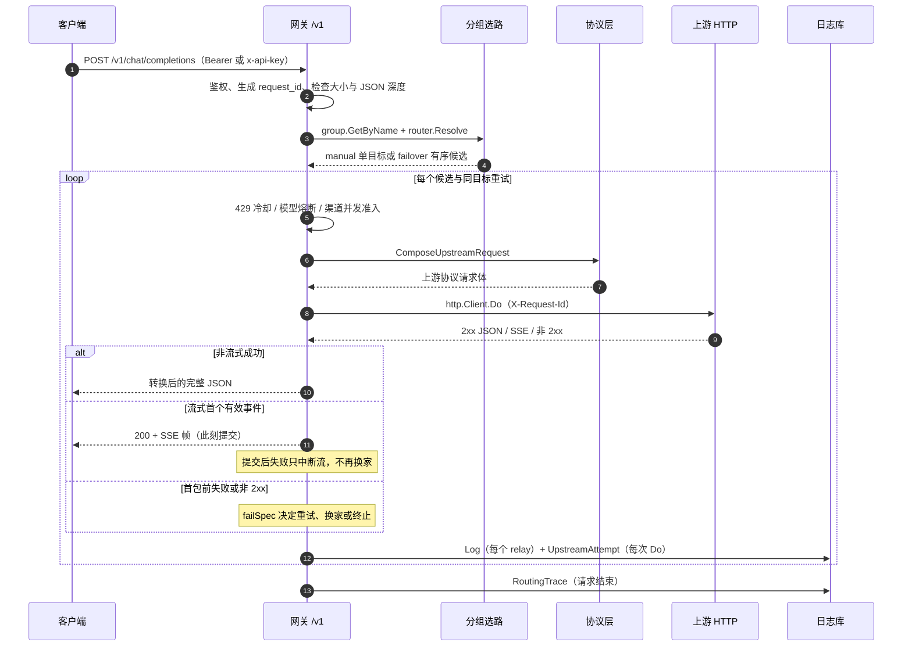

# 一次请求的生命周期

> 串起 /v1 请求从鉴权、分组解析、目标循环到协议转换、交付与记录的完整链路；不重复各模块的配置项全集。

## 适用场景

- 第一次阅读 Portunus，想知道一个客户端请求从进入 `/v1` 到写入日志库经过了哪些判断。
- 排障时看到 401、413、404、429、502、503、504，或发现“请求失败但没有调用日志”，需要定位失败发生在链路的哪一段。
- 修改网关重试、换家、流式交付或日志字段前，先确认当前调用顺序和边界。
- 前置概念见[核心概念](../核心概念.md)；模块职责与配置见[网关转发与保护](../核心模块/网关转发与保护.md)、[协议转换与流式交付](../核心模块/协议转换与流式交付.md)、[调用观测与日志](../核心模块/调用观测与日志.md)；启动与配置默认值见[运行入口与基础设施](../核心模块/运行入口与基础设施.md)。

本页只讲主链路。主动调用验证 `ProbeConnection` 虽然复用单目标转发函数，但不经过正常 `/v1` 分组选路，不在此展开。

## 步骤

### 1. 入口与 API Key 鉴权

`/v1` 由 [gateway.Register](../../../backend/gateway/gateway.go#L16) 注册，三个生成入口各自绑定客户端协议：

| 路径 | 客户端协议 | 处理函数 |
|---|---|---|
| `POST /v1/chat/completions` | `openai` | `handleRelay(protocol.ProviderOpenAI)` |
| `POST /v1/responses` | `openai_responses` | `handleRelay(protocol.ProviderOpenAIResponses)` |
| `POST /v1/messages` | `anthropic` | `handleRelay(protocol.ProviderAnthropic)` |

同一组还注册了 `GET /v1/models`，它只列出非空分组的名称，不经过 relay，因此不产生调用日志、显式尝试或路由诊断（[路由注册](../../../backend/gateway/gateway.go#L18)、[listModels](../../../backend/gateway/gateway.go#L78)）。

鉴权中间件 [authMiddleware](../../../backend/gateway/gateway.go#L29) 的判定顺序：

1. 从 `Authorization` 头提取 `Bearer ` 前缀后的 Key；没有就用 `x-api-key` 头（[extractKey](../../../backend/gateway/gateway.go#L62)）。
2. Key 为空返回 401 `missing api key`；Key 校验失败返回 401 `invalid api key`。
3. 优先调用注入的 `Deps.AuthIdentity`，一次取得稳定 ID 与名称快照；为空才回退旧的 `Deps.Auth`（[鉴权实现选择](../../../backend/gateway/gateway.go#L44)）。
4. 成功后把 `api_key_id`、`api_key_name` 放进 Gin 上下文，后续日志使用该名称快照（[上下文注入](../../../backend/gateway/gateway.go#L55)）。

401 发生在 `handleRelay` 之前，所以**鉴权失败不会写调用日志、显式尝试或路由诊断**。错误体按请求路径推断的客户端协议渲染：`/v1/messages` 用 Anthropic 形状，其余用 OpenAI 形状（[clientProtoFromPath](../../../backend/gateway/relay_error.go#L64)）。

### 2. 请求前置：读取、限额与元数据

进入 [handleRelay](../../../backend/gateway/relay.go#L56) 后，先为本次请求复制一份 `relayServer`，并包装 `LogWrite`，让同一请求的所有成功、失败、重试日志都带上鉴权时的 `api_key_name`（[请求级 LogWrite](../../../backend/gateway/relay.go#L58)）。随后生成请求关联 ID 与路由诊断：

- [newRequestID](../../../backend/gateway/relay.go#L39) 读取 8 字节随机数转成 16 位十六进制；失败时退回纳秒时间戳。
- 请求一开始就设置响应头 `X-Request-Id`，即使在参数检查阶段失败也会带上（[设置响应头](../../../backend/gateway/relay.go#L72)）。
- 每个上游尝试都复用同一个 `requestID`，并把它作为 `X-Request-Id` 发给上游，便于和上游自己的调用日志对齐（[上游请求头](../../../backend/gateway/relay.go#L445)）。
- `routingDiagnostics` 在进入 handler 时创建，`defer` 在请求结束时刷写一条 `RoutingTrace`（[创建诊断](../../../backend/gateway/relay.go#L68)、[刷写诊断](../../../backend/gateway/routing_diagnostics.go#L133)）。

请求体检查和元数据解析依次是：

1. 按 `Content-Length` 与 `ResourceLimits.MaxRequestBytes` 检查；超限返回 413 `请求体超过资源上限`（[大小预检](../../../backend/gateway/relay.go#L74)）。
2. 用 `resource.ReadAll` 最多读取 `max+1` 字节，覆盖分块传输或未知长度；超限同样返回 413，其余读取失败返回 400 `读取请求体失败`（[读取请求体](../../../backend/gateway/relay.go#L80)、[ReadAll](../../../backend/resource/limits.go#L71)）。
3. 在解码路由元数据之前做 JSON 深度检查，超过 `MaxJSONDepth` 返回 413 `请求结构超过资源上限`（[深度检查](../../../backend/gateway/relay.go#L94)、[CheckDepth](../../../backend/resource/limits.go#L96)）。
4. 只解码最小公共字段 `model`、`stream`、`thinking`；JSON 非法或 `model` 为空返回 400 `缺少 model 字段`（[relayMeta](../../../backend/gateway/relay.go#L30)、[元数据解码](../../../backend/gateway/relay.go#L99)）。`thinking` 保存为 `json.RawMessage`，非对象形状不会让整个请求失败，只有带 `-thinking` 后缀时才按需解析。

默认资源上限是请求体 32 MiB、JSON 深度 128（[Defaults](../../../backend/resource/limits.go#L26)）。完整的上限清单与保护机制见[网关转发与保护](../核心模块/网关转发与保护.md)，配置项与覆盖方式见[运行入口与基础设施](../核心模块/运行入口与基础设施.md)。

元数据通过后，`meta.Stream` 写入路由诊断，并决定请求级控制 `requestControl` 使用首内容期限还是非流式处理期限；该控制覆盖选路和所有尝试，直到交付或非流式响应就绪（[流式标记与请求控制](../../../backend/gateway/relay.go#L106)、[期限与预算](../../../backend/gateway/request_control.go#L46)）。

### 3. `-thinking` 后缀、分组解析与选路

`-thinking` 是对外模型名的保留后缀：客户端请求 `model: "group-thinking"` 时，网关先剥掉后缀得到真实分组名，再生成“本次要开思考”的意图（[后缀处理](../../../backend/gateway/relay.go#L116)）。客户端协议是 Anthropic 时，`protocol.ThinkingEnabledIntent` 会复用顶层 `thinking.budget_tokens`（若有）；**这个由后缀生成的意图是否写进上游请求体由目标协议决定**，只有 OpenAI Chat 上游消费，Anthropic / Gemini / Responses 不会仅因 `-thinking` 后缀被追加新字段（[ThinkingEnabledIntent 的消费位置](../../../backend/protocol/convert.go#L122)、[意图构造](../../../backend/protocol/openai.go#L56)）。

接下来两步都可能在前置阶段拒绝请求：

- [group.GetByName](../../../backend/group/service.go#L106) 按名称查分组并预加载分组项；不存在返回 404 `分组不存在: <name>`（[分组查询](../../../backend/gateway/relay.go#L123)）。
- [router.Resolve](../../../backend/router/router.go#L26) 把分组成员的模型与渠道解析成有序目标：
  - `manual` 只返回 `ActiveItemID` 对应的单个目标；没有激活项返回 `分组未指定激活项`。
  - `failover` 返回全部目标，按 `Priority` 升序、同优先级按分组项 `ID` 升序（[failover 排序](../../../backend/router/router.go#L42)）。
  - 空分组返回 `分组没有可用模型`；任一成员引用的模型或渠道缺失会让整个解析失败，而不是跳过该项（[resolveTarget](../../../backend/router/router.go#L64)）。

分组与选路失败返回 400/404。整段前置阶段（请求体、元数据、分组、选路）的失败都**不写调用日志和显式尝试**。由于 `routingDiagnostics` 已经创建，生产装配下仍会写一条路由诊断，`stop_reason` 可能是 `resource_limit`、`request_read_failed`、`request_invalid`、`group_not_found` 或 `route_unresolved`（[诊断停止原因](../../../backend/gateway/routing_diagnostics.go#L129)）。

### 4. 候选循环：跳过、同目标重试与换家

目标循环是“外层候选、内层重试”的两层结构（[目标循环](../../../backend/gateway/relay.go#L147)）：

```text
for 每个候选 target:
    检查请求控制是否已终止
    检查 429 冷却、模型熔断、渠道并发；命中则跳过
    for attempt = 0..RetryCount:
        真正发请求前再次检查请求控制；重试前再次检查熔断
        调用 relayToTarget
        成功则返回
        失败则交给 failSpec 决定：重试 / 换家 / 终止
```

每个候选进入前有三道保护，命中时只跳过候选，**不消耗 HTTP 尝试预算**：

- **429 冷却**：`RateLimitStore.Check` 返回冷却错误时记录 `candidate_skipped / rate_limit_cooldown` 并跳过。冷却键包含渠道 ID、连接指纹、作用域和按模型作用域时的模型名；渠道级冷却覆盖该渠道全部模型（[冷却检查](../../../backend/gateway/relay.go#L154)、[RateLimitStore.Check](../../../backend/gateway/rate_limit.go#L79)）。
- **模型熔断**：模型级熔断开路，或半开状态已有探测租约时跳过，事件原因分别为 `circuit_open`、`probe_busy`（[熔断检查](../../../backend/gateway/relay.go#L164)、[unavailable](../../../backend/gateway/circuit_breaker.go#L97)）。
- **渠道并发**：渠道在途 relay 达到 `max_concurrent_requests` 时跳过；上限为 0 表示不限但仍计数，没有排队（[并发检查](../../../backend/gateway/relay.go#L171)、[ChannelConcurrencyStore.Check](../../../backend/gateway/channel_concurrency.go#L22)）。

对每个真正执行的 relay，网关记录尝试序号与原因：

- `reason`：首次为 `initial`，换目标后为 `failover`，同目标重试为 `retry`（[原因判定](../../../backend/gateway/relay.go#L192)）。
- `selectReason`：候选顺序为 `primary` 或 `backup`，重试为 `retry`，写入路由诊断的 `candidate_selected` 事件（[选择事件](../../../backend/gateway/relay.go#L200)）。
- 同时更新诊断行的最终候选、渠道和模型，并创建本轮 `relayAttemptTrace`（[诊断赋值](../../../backend/gateway/relay.go#L209)、[尝试跟踪](../../../backend/gateway/relay.go#L210)）。

失败后的分支由 [failSpec](../../../backend/gateway/fail.go#L139) 统一决定：

- `StopRequest` 为真：立即结束所有候选，不再重试或换家（[终止判断](../../../backend/gateway/relay.go#L241)）。
- `Retryable` 为假，或 `StallNoHeader` 为真：跳出同目标重试。后者是“等响应头假死”，再等一轮大概率还是超时，直接换下一家（[停止重试](../../../backend/gateway/relay.go#L244)）。
- 其余可重试失败：继续同目标重试，直到 `RetryCount` 用完。

`RetryCount` 是单个目标内的重试次数，默认 2，即单目标最多 3 次；`MaxHTTPAttempts` 是整个请求的总尝试预算，默认 4，跨目标、跨重试，也包含预算字段兼容重试（[默认值](../../../backend/shared/config.go#L46)）。因此“配置了多个候选”不保证每个候选都会被尝试，预算耗尽会直接终止。

### 5. 全部候选被跳过：合成日志与统一的 503/429

如果循环结束时 `anyAttempted == false` 且没有产生错误，说明所有候选都在准入阶段被跳过。此时按优先级返回：

1. 有冷却目标：429 `目标正在限流冷却，请稍后重试`，`Retry-After` 取冷却剩余秒数，并写一条合成调用日志，`ErrKind = rate_limit_cooldown`（[冷却出口](../../../backend/gateway/relay.go#L258)）。
2. 有并发满的目标：503 `渠道并发已满，请稍后重试`，`Retry-After: 1`，合成日志 `ErrKind = channel_capacity`（[并发出口](../../../backend/gateway/relay.go#L267)）。
3. 其余情况视为全部熔断开路：503 `所有渠道暂不可用`，合成日志 `ErrKind = circuit_open`；`Retry-After` 取所有开路目标剩余冷却时间的最小值（[熔断出口](../../../backend/gateway/relay.go#L275)）。

这三条路径**没有真正发出 HTTP 请求，但会写调用日志**，用于在管理端留下排障痕迹；它们不会写 `UpstreamAttempt`（没有显式 `Client.Do`）。

### 6. 单目标：装配上游请求

[relayToTarget](../../../backend/gateway/relay.go#L358) 是“一次目标尝试”的完整编排。它的 `defer` 顺序固定，且先释放健康准入与并发名额，再写观测：

1. 计算耗时、`failSpec` 决定、首包耗时。
2. 结算熔断 permit（成功 / 失败 / 假死 / 中性）。
3. 释放渠道并发名额。
4. 写路由诊断的 `relay_finished`。
5. 写显式 HTTP 尝试。
6. 若本次已观察到 429 且尚未记录，补记冷却。
7. 写调用日志。
8. 失败时输出 stderr 诊断（`quiet` 模式除外）。

见 [relayToTarget 的 defer](../../../backend/gateway/relay.go#L382)。

装配阶段调用 [protocol.ComposeUpstreamRequest](../../../backend/protocol/convert.go#L91)：

- 同协议直通时，除 Gemini 外只做字段级改写：替换顶层 `model`，必要时注入 OpenAI 形状的 `thinking`，其余未知字段保留（[rewriteSameProtocol](../../../backend/protocol/convert.go#L150)）。
- 跨协议时，经 OpenAI canonical 结构解析再渲染到目标协议；托管工具声明发往 OpenAI 上游时会被剥离并计入诊断（[composeParsedUpstream](../../../backend/protocol/convert.go#L112)）。
- 客户端看到的模型名是分组名，真正发给上游的是 `target.Model.Name`；Gemini 的模型名在 URL 中，替换为 no-op。
- 返回的 `ComposeStats` 只用于调用日志的诊断遥测，不参与请求语义。

装配失败（例如目标协议无法渲染请求）会返回 `convertError`，**不产生 HTTP 尝试**；调用日志仍会写一条 `status=0` 的记录，`ErrKind` 按 `failSpec` 归因（转换类为 `convert_error`，资源上限类为 `resource_limit`）（[装配失败](../../../backend/gateway/relay.go#L417)）。

### 7. 重放安全、连接与显式 HTTP 尝试

装配之后、发请求之前还有三个关键动作：

1. **重放安全判断**：[StreamRequestReplaySafe](../../../backend/protocol/stream_replay.go#L8) 把带 `previous_response_id`、会话续接、原生工具或未知工具形状的请求视为不可安全重放；只有函数工具和已知搜索工具等保守场景才允许自动重试/换家（[调用位置](../../../backend/gateway/relay.go#L423)）。
2. **打开上游连接**：[upstream.Open](../../../backend/gateway/relay.go#L425) 只校验并构建协议接入器，不做网络 I/O；端点与鉴权头由 `protocol.Upstream` 提供。连接配置构建失败不会产生 HTTP 尝试，但会产生一条失败的调用日志（[Open 实现](../../../backend/upstream/connection.go#L148)）。
3. **绑定上下文**：把限流目标、熔断 permit、渠道并发 permit 放进请求上下文；流式请求额外创建 `streamWatchdog`，负责首包与静默超时（[上下文绑定](../../../backend/gateway/relay.go#L431)、[看门狗创建](../../../backend/gateway/relay.go#L435)）。

随后用目标渠道的 `ChatHeaders()` 和 `ChatURL(t.Model.Name, stream)` 发起请求，并补上 `X-Request-Id`（[请求头与 URL](../../../backend/gateway/relay.go#L444)）。

真正执行 HTTP 的入口是 [doRequestWithChatBudgetFallback](../../../backend/gateway/upstream.go#L134)，它内部调用 [doRequest](../../../backend/gateway/upstream.go#L32)。`doRequest` 的顺序是固定的：

1. 对装配后的请求体再做大小与 JSON 深度复查。
2. 构造带上下文的 POST 请求。
3. 检查请求控制（取消、期限）。
4. 检查 429 冷却。
5. 校验熔断 permit。
6. 执行可取消退避等待（首次 Do 不等待；等待期间不占预算、不持锁）。
7. 再次检查冷却。
8. 原子获取渠道并发名额。
9. 获取熔断租约。
10. 预留一次 HTTP 尝试预算（`control.reserve()`）。
11. 记录尝试开始与 `http_attempt` 诊断事件，`HTTPAttempts` 加一。
12. 调用注入的 `http.Client.Do`。

见 [doRequest 的准入顺序](../../../backend/gateway/upstream.go#L40)。在 `reserve()` 之前失败的准入（冷却、熔断、并发、退避、请求控制）**不消耗尝试预算**；一旦 `reserve()` 成功，即使 `Do` 失败也计入一次尝试（[reserve](../../../backend/gateway/request_control.go#L127)）。

上游 HTTP 客户端由 [NewHTTPClient](../../../backend/gateway/upstream.go#L23) 构建：连接超时和等响应头超时来自配置，不设置总 `Timeout`，避免截断长流式响应。等响应头超时会被转换为 `upstreamHeaderTimeoutError`，由 `failSpec` 归为“等头假死”，返回 504 并跳过同目标重试（[超时转换](../../../backend/gateway/upstream.go#L107)、[等头假死处置](../../../backend/gateway/fail.go#L234)）。

**预算字段兼容重试**只在“客户端不是 OpenAI Chat、目标上游是 OpenAI Chat”时启用：上游返回 400/422 且错误明确表示不接受 `max_tokens` 时，把字段改名为 `max_completion_tokens`，再执行一次 `reason=budget_compat` 的显式 `Do`（[兼容重试入口](../../../backend/gateway/upstream.go#L134)、[字段改写](../../../backend/gateway/upstream.go#L155)）。每个目标最多触发一次，普通重试不会重复触发；第二次 `Do` 同样消耗总尝试预算。

### 8. 非 2xx：读取、包装与冷却

上游返回非 2xx 时（[非 2xx 分支](../../../backend/gateway/relay.go#L471)）：

1. 用 `readUpstreamBody` 按 `MaxResponseBytes` 读取错误体；读取后先检查请求控制，避免已经取消的请求继续处理。
2. 读取超限返回 `resource.LimitError`，终止请求。
3. 构造 `upstreamStatusError`，携带状态码、响应体和上游 `Retry-After`（[错误类型](../../../backend/gateway/fail.go#L27)）。
4. 如果状态码是 5xx 或 429，且本次请求不可安全重放，则包装为 `streamReplayUnsafeError`，禁止自动重试/换家（[重放安全包装](../../../backend/gateway/relay.go#L484)）。
5. 429 在拿到响应头时就记录冷却，不等错误体读完（[立即记录冷却](../../../backend/gateway/relay.go#L465)）。

`failSpec` 对上游状态错误的裁决是：5xx 可重试并计入熔断；429 不重试同目标，只记录冷却；其余 4xx 不可重试（[上游状态错误](../../../backend/gateway/fail.go#L254)）。流内错误由 `protocol.StreamFailureError` 表达，429 会通过 `OnRateLimit` 回调补记冷却（[流内限流](../../../backend/gateway/relay.go#L502)、[StreamFailureError 裁决](../../../backend/gateway/fail.go#L226)）。

所有候选都失败后，网关用最后一次错误经 `failSpec` 得到客户端状态码、错误类别和 `Retry-After`，再按客户端协议输出错误体；上游有回话时尽量提取其中的 `message`，网关自身超时/网络故障使用通用文案，不暴露内部细节（[最终失败出口](../../../backend/gateway/relay.go#L309)、[错误体渲染](../../../backend/gateway/relay_error.go#L17)）。错误消息会追加 `(request id: ...)`，方便客户端粘贴报错原文对齐日志。

### 9. 非流式：转换、提交与写回

非流式 2xx 的路径是“先完整读、再转换、最后提交”：

1. 按 `MaxResponseBytes` 读取上游响应体；读取后检查请求控制。
2. 调用 `ConvertResponseWithReport` 把上游协议响应转换为客户端协议，同时得到响应侧兼容性摘要（[非流式转换](../../../backend/gateway/relay.go#L540)、[ConvertResponse](../../../backend/protocol/convert.go#L42)）。
3. 再次检查请求控制。
4. 从原始上游响应提取 token 与缓存用量（[UsageFromResponse](../../../backend/protocol/convert.go#L233)）。
5. 调用 `requestControl.commit()`，在锁内仲裁“响应已就绪”与“请求期限已到”；提交成功后停止期限计时（[commit](../../../backend/gateway/request_control.go#L210)）。
6. 标记 `success = true`，把转换后的 `out` 返回给目标循环（[成功返回](../../../backend/gateway/relay.go#L560)）。

目标循环只有在 `relayToTarget` 返回成功后，才写 `Content-Type: application/json`、上游 2xx 状态码和响应体（[写回客户端](../../../backend/gateway/relay.go#L223)）。因此非流式请求可以在候选之间缓冲切换：客户端在成功前看不到任何响应内容。

一个容易忽略的边界：客户端写失败发生在 `relayToTarget` 返回之后，此时调用日志已经按成功写入；目标循环会把路由诊断改记为 `client_write` 并设置 `StopErrKind`，但调用日志的 `success` 仍是 `true`（[客户端写失败](../../../backend/gateway/relay.go#L227)）。判断“客户端是否真正收到”不能只看调用日志。

### 10. 流式：首包、提交与失败语义

流式路径先创建转换器：

- `NewStreamConverter(t.Channel.Type, clientProto, ...)` 创建上游协议到客户端协议的有状态转换器；同协议直通仍会提取 usage（[NewStreamConverter](../../../backend/protocol/stream.go#L51)）。
- Anthropic 客户端需要 `message_start` 的 `input_tokens` 时，才惰性调用 `EstimateRequestTokens` 估算输入；其他协议不付全量 body 解析开销（[输入估算](../../../backend/protocol/convert.go#L247)）。

[relayStream](../../../backend/gateway/stream.go#L133) 的交付语义分为“提交前”和“提交后”：

**提交前**：首个有效事件或终态之前，`deliveryGate` 把无意义且非终态的帧，或尚无输出帧的批次先缓存，默认上限 256 KiB / 128 个事件；超限返回 `precommitBufferError`，属于请求级终止（[预提交缓存](../../../backend/gateway/stream_delivery.go#L78)、[默认上限](../../../backend/gateway/stream_delivery.go#L14)）。此时还没有向客户端写任何响应头，所以失败仍可重试或换家（重放不安全的请求除外，见第 7 节）。

**提交**：当批次包含有效内容或终态、并且有可写帧时，`deliveryGate` 先调用 `requestControl.commit()` 与期限仲裁，再写 200、`text/event-stream` 头、缓存帧并 flush；`Started` 和首包时刻在这一刻确定（[提交点](../../../backend/gateway/stream_delivery.go#L107)、[SSE 响应头](../../../backend/gateway/stream.go#L221)）。提交后 `delivered=true`，请求控制会阻止再发起新的 HTTP 尝试，**流已提交就不能换家**。

**看门狗**：拿到上游响应头后启动“首包”阶段计时；提交后切换到“静默”时限；观察到终态后进入有界的收尾窗口，避免心跳无限延长（[Arm](../../../backend/gateway/stream.go#L40)、[UseIdle](../../../backend/gateway/stream.go#L58)、[UseTerminalGrace](../../../backend/gateway/stream.go#L73)）。只有提交后的正常内容读取会重置静默计时，元数据/心跳不会延长首内容期限（[读取进度](../../../backend/gateway/stream_delivery.go#L172)）。看门狗触发与客户端主动取消通过 `Fired()` 区分。

**提交后失败**：断连、静默、转换错误或客户端写失败会返回 `streamCommittedError`。`relayToTarget` 识别到已提交后：

- 保留已累计的 usage，记录真实失败原因，对上层返回 `nil` 错误，避免目标循环继续换家；
- 调用日志写 `success=false`，状态码通常仍是 200，`ErrKind = stream_interrupted`（客户端取消或写失败会分别归为 `client_cancel` / `client_write`）；
- 若尚未写终态、不是客户端取消/写失败，尽量补一个协议形状的流内错误帧；OpenAI/Responses 没有标准流内错误形状时表现为流截断。

见 [已提交分支](../../../backend/gateway/relay.go#L509)、[finishStreamError](../../../backend/gateway/stream_delivery.go#L191)、[提交后失败归因](../../../backend/gateway/fail.go#L143)。

**终态语义**：上游没有合法终态时，网关不会伪造 `end_turn` / `completed` / `[DONE]`；`StreamSession.Finish()` 返回 `ErrStreamIncomplete`，记录 `truncated` / `missing_terminal`（[Finish](../../../backend/protocol/stream_session.go#L208)）。`streamSucceeded` 同时要求观察到终态且状态为 `completed`、`incomplete` 或 `blocked`（[streamSucceeded](../../../backend/gateway/stream_delivery.go#L187)）。

### 11. 三类记录：Log、UpstreamAttempt、RoutingTrace

三类记录共享 `request_id`，但含义和粒度不同：

- **调用日志 `shared.Log`**：每个 `relayToTarget` 写一条，普通重试或换家会产生多行；同一目标内的预算字段兼容重试仍只写一条调用日志，但会多写一条显式尝试。记录 API Key 名称快照、分组/渠道/模型、状态码与成功标记、流式标记、token 与缓存用量、耗时、首包耗时、失败类别与截断原文、客户端入口协议、请求/响应转换摘要、流终态与交付状态（[logCall](../../../backend/gateway/log.go#L18)、[Log 实体](../../../backend/shared/log.go#L11)）。全部候选被跳过时写一条合成日志；鉴权失败与前置参数拒绝不写。
- **显式 HTTP 尝试 `shared.UpstreamAttempt`**：每次实际 `http.Client.Do` 写一条，包括连接失败和取消；按 `request_id + sequence` 关联，`reason` 区分 `initial`、`retry`、`failover`、`budget_compat`。记录状态码、成功标记、失败类别、耗时、预算字段；不记录正文、URL 或鉴权头（[begin](../../../backend/gateway/attempt.go#L23)、[finishAttempt](../../../backend/gateway/attempt.go#L35)、[UpstreamAttempt 实体](../../../backend/shared/upstream_attempt.go#L10)）。写入失败只记 stderr，不触发上游重试。
- **路由诊断 `shared.RoutingTrace`**：生产装配下每个进入 `handleRelay` 的请求一条，事件包括候选跳过、候选选择、HTTP 尝试、准入阻塞、并发获取/释放、半开探测、目标结束、relay 结束等；每请求最多 256 条事件，超出计入 `DroppedEvents`。记录停止原因、结果、是否已开始交付、HTTP 尝试数、最终候选/渠道/模型（[routingDiagnostics](../../../backend/gateway/routing_diagnostics.go#L17)、[RoutingTrace 实体](../../../backend/shared/routing_trace.go#L33)）。前置参数拒绝也会留下一条 `Outcome=rejected` 的路由诊断；鉴权失败发生在 handler 之前，没有这条记录。写入失败只记 stderr，不影响转发或重试。

记录边界可以归纳为：

| 场景 | `Log` | `UpstreamAttempt` | `RoutingTrace` |
|---|---|---|---|
| 鉴权失败（401） | 不写 | 不写 | 不写 |
| 请求体/深度/`model`/分组/选路拒绝 | 不写 | 不写 | 写（鉴权后） |
| 全部候选冷却/并发/熔断跳过 | 写一条合成日志 | 不写 | 写 |
| 单目标 relay 失败 | 每个 relay 一条 | 仅真正 `Do` 的 | 写 |
| 流已提交后失败 | 一条 `success=false`，状态常为 200 | 对应 `Do` 一条 | 写，`DeliveryStarted=true` |

这些数字不能互相替代：`Log` 行数不是客户端请求数，`UpstreamAttempt` 数不是上游物理发送数，`RoutingTrace` 只描述网关选路，不代表客户端收到完整响应。还要注意：`relayToTarget` 在未拿到上游响应时写入的 `Log.Status` 与对应 `UpstreamAttempt.Status` 是 0；全部候选被跳过时的合成日志则直接使用 429/503。客户端状态码由 `failSpec` 另行决定，不能把 0 当成上游返回的状态码。查询口径见[调用观测与日志](../核心模块/调用观测与日志.md)。

## 流程图



## 排障

| 现象 | 原因 | 处理 |
|---|---|---|
| `401 missing api key` / `401 invalid api key` | 鉴权中间件在 `handleRelay` 之前失败；没有调用日志、尝试或路由诊断（[authMiddleware](../../../backend/gateway/gateway.go#L29)） | 检查 `Authorization: Bearer <key>` 或 `x-api-key`，以及 Key 是否已禁用；不要用日志缺失判断网关未收到请求 |
| `413 请求体超过资源上限` / `413 请求结构超过资源上限` | 请求体超过 `MaxRequestBytes`，或 JSON 嵌套超过 `MaxJSONDepth`（[前置检查](../../../backend/gateway/relay.go#L74)） | 检查 `resource_limits` 配置与请求体；前置拒绝不写调用日志，但鉴权后会有 `resource_limit` 路由诊断 |
| `400 缺少 model 字段` | 请求体 JSON 非法或 `model` 为空（[元数据解码](../../../backend/gateway/relay.go#L99)） | 检查客户端 payload；不会写调用日志 |
| `404 分组不存在: xxx` | 分组名拼写错误，或 `-thinking` 后缀剥离后找不到对应分组（[分组查询](../../../backend/gateway/relay.go#L123)） | 核对分组名；`-thinking` 是保留后缀，不能作为真实分组名的一部分 |
| `400 分组未指定激活项` / `400 分组没有可用模型` | `manual` 分组没有有效 `ActiveItemID`，或分组为空 / 成员引用缺失（[router.Resolve](../../../backend/router/router.go#L26)） | 在管理端设置激活项或修复成员引用；不会写调用日志 |
| `429 目标正在限流冷却，请稍后重试` | 所有候选都被 429 冷却跳过，没有真正发请求（[冷却出口](../../../backend/gateway/relay.go#L258)） | 查看合成日志的 `ErrKind=rate_limit_cooldown` 与 `Retry-After`；确认上游是否限流，或调整 `rate_limit_scope` / 增加候选 |
| `503 所有渠道暂不可用` | 所有候选都处于熔断开路，`ErrKind=circuit_open`（[熔断出口](../../../backend/gateway/relay.go#L275)） | 查看路由诊断的 `candidate_skipped` 原因与 `Retry-After`；等待熔断重置或修复上游后由半开探测恢复 |
| `503 渠道并发已满，请稍后重试` | 渠道在途 relay 达到 `max_concurrent_requests`（[并发出口](../../../backend/gateway/relay.go#L267)） | 提高渠道并发上限、增加渠道或减少并发调用；该拒绝不产生 HTTP 尝试 |
| `502 上游调用失败` | 上游 5xx、网络错误或网关内部错误；具体看日志的 `err_kind` 与 `err_msg`（[failSpec](../../../backend/gateway/fail.go#L139)） | 结合 `UpstreamAttempt` 与路由诊断定位目标；5xx/网络错误可能已按策略重试或换家，其余 4xx 不重试同目标（429 记录冷却后换候选） |
| `504 上游 Ns 未返回响应头` | 等响应头超时（`StallNoHeader`），不重试同目标，直接换下一家并快速熔断（[等头假死](../../../backend/gateway/fail.go#L234)） | 检查上游延迟与 `first_byte_timeout_seconds`；不要期待同目标立即重试 |
| 流式响应中途断开，日志出现 `status=200 success=false` | 需要先区分阶段：`StreamDeliveryStarted=true` / 路由诊断 `DeliveryStarted=true` 才是流已提交后失败，`ErrKind=stream_interrupted`，按设计不再换家；若尚未交付，则可能只是首包前失败并已重试/换家（[已提交分支](../../../backend/gateway/relay.go#L509)、[交付报告](../../../backend/gateway/log.go#L52)） | 查看 `stream_outcome`、`stream_terminal_observed`、`stream_reason`、`stream_delivery_started`；已提交时客户端可能只看到截断或流内错误帧 |
| 上游流结束但没有结束标记 | `StreamSession.Finish()` 返回 `ErrStreamIncomplete`，记录 `truncated` / `missing_terminal`（[Finish](../../../backend/protocol/stream_session.go#L208)） | 这是上游流不完整，网关不会伪造终态；检查上游 SSE 是否缺少 `message_stop` / `response.completed` / `[DONE]` |
| 同一 `request_id` 出现多条 `Log` | 普通重试或换家每次写一条；同一目标内的预算字段兼容重试不额外写 `Log`，只多一条 `UpstreamAttempt`。这是“上游尝试日志”而非客户端请求计数（[logCall](../../../backend/gateway/log.go#L18)） | 用 `request_id` 关联查看尝试时间线；不要用行数统计客户端请求量或最终成功率 |
| 非流式客户端断开后日志仍为成功 | 客户端写发生在 `relayToTarget` 返回之后，调用日志已写成 `success=true`；路由诊断会改记 `client_write`（[客户端写失败](../../../backend/gateway/relay.go#L227)） | 以路由诊断或客户端侧观测判断交付；不要把调用日志的成功标记当作客户端已收到 |

## 未解决问题

- 本次核验未启动桌面应用、未访问真实上游，流提交后断连、看门狗触发和客户端写失败只按代码路径描述，未做故障注入或真实网络验证。
- 推断：`RoutingTrace.HTTPAttempts` 在 `Client.Do` 之前自增，而 `UpstreamAttempt` 写入失败只记 stderr；两者数量不一致时，现有记录无法区分“观测写入失败”和“实际发送差异”，需要结合 stderr 与日志库排查（[HTTPAttempts 自增](../../../backend/gateway/upstream.go#L98)、[写入失败日志](../../../backend/gateway/attempt.go#L55)）。
- 推断：非流式响应在调用日志写入后才写客户端，若需要“客户端实际收到响应”的强口径，当前实体没有交付确认字段，只能依赖路由诊断 `DeliveryStarted` / `StopReason` 或客户端侧观测。

<details><summary>来源</summary>

- [backend/gateway/gateway.go](../../../backend/gateway/gateway.go)
- [backend/gateway/relay.go](../../../backend/gateway/relay.go)
- [backend/gateway/upstream.go](../../../backend/gateway/upstream.go)
- [backend/gateway/fail.go](../../../backend/gateway/fail.go)
- [backend/gateway/stream.go](../../../backend/gateway/stream.go)
- [backend/gateway/stream_delivery.go](../../../backend/gateway/stream_delivery.go)
- [backend/gateway/log.go](../../../backend/gateway/log.go)
- [backend/gateway/attempt.go](../../../backend/gateway/attempt.go)
- [backend/router/router.go](../../../backend/router/router.go)
- [backend/protocol/convert.go](../../../backend/protocol/convert.go)
- [backend/protocol/stream.go](../../../backend/protocol/stream.go)
- [backend/shared/log.go](../../../backend/shared/log.go)
- [backend/shared/upstream_attempt.go](../../../backend/shared/upstream_attempt.go)

核验范围：以当前工作区 HEAD `3d63c30` 的代码为准。2026-10-30 已实际执行并通过 `go test ./...`、`go vet ./...`、前端 245 项测试与 `pnpm typecheck`；未启动桌面应用，未访问真实上游。

</details>
