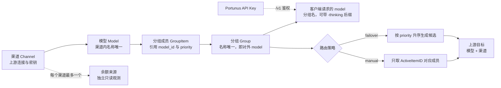

# 核心概念

> 统一渠道、模型、分组、凭据与调用记录的口径及跨模块边界；不替代各模块的操作步骤与实现细节。

## 概述

Portunus 是本地运行的多上游 API 聚合网关，把不同渠道的模型组织为模型分组，统一向客户端和应用提供服务（[产品定位](../product/PRODUCT.md)）。本页定义这些对象在代码中的归属、唯一约束和证据边界，供各模块页与排障共用；具体操作见[资源模块](核心模块/渠道模型与分组.md)、[网关模块](核心模块/网关转发与保护.md)、[观测模块](核心模块/调用观测与日志.md)与[余额与额度](核心模块/余额与额度.md)。

最容易混淆的是三组关系：

- 上游模型 ID 与分组名不是一回事：客户端请求里的 `model` 是分组名，只有解析分组后才落到具体渠道模型（[PRODUCT.md](../product/PRODUCT.md)）。
- 上游密钥与 Portunus API Key 不是一回事：前者访问供应商，后者访问本网关的 `/v1`（[验收标准](../product/PRODUCT.md)）。
- 配置存在、模型发现成功、一次调用成功是三种不同证据，不能互相替代。

## 概念关系

| 概念 | 实体 | 唯一约束 / 关键语义 |
|---|---|---|
| 渠道 | [`channel.Channel`](../../backend/channel/channel.go#L11) | `name` 唯一；一条记录代表一个上游账户连接 |
| 模型 | [`model.Model`](../../backend/model/model.go#L14) | `(channel_id, name)` 唯一；同名模型跨渠道是不同资源 |
| 分组成员 | [`group.GroupItem`](../../backend/group/group.go#L35) | `(group_id, model_id)` 唯一；同一模型不能重复加入同组 |
| 分组 | [`group.Group`](../../backend/group/group.go#L24) | `name` 唯一；分组名就是客户端使用的 model |
| Portunus API Key | [`shared.APIKey`](../../backend/shared/apikey.go#L16) | `key` 唯一；稳定 `ID` 用于用量归属 |
| 余额来源 | [`quota.Source`](../../backend/quota/types.go#L60) | `channel_id` 唯一；一个渠道最多一个查询来源 |
| 调用日志 | [`shared.Log`](../../backend/shared/log.go#L11) | 无请求级唯一约束；同一 `request_id` 可有多行 |
| 上游尝试 | [`shared.UpstreamAttempt`](../../backend/shared/upstream_attempt.go#L10) | `(request_id, sequence)` 唯一；一行对应一次显式 `Do` |
| 路由诊断 | [`shared.RoutingTrace`](../../backend/shared/routing_trace.go#L33) | `request_id` 唯一；每个请求最多一条 |

## 上游资源：渠道、模型与分组

### 渠道（Channel）

渠道是一个上游供应商的连接配置，保存协议类型、基础地址、上游密钥、厂商/配置档/适配器标识和连接级选项；它不保存模型，模型通过 `channel_id` 归属渠道（[Channel 字段](../../backend/channel/channel.go#L11)）。

- 渠道名全局唯一（[Name](../../backend/channel/channel.go#L19)），创建和更新都必须通过基础字段校验（[Channel.Valid](../../backend/channel/channel.go#L35)）。
- `base_url` 只保存基础地址，具体接口路径由协议层补全（[BaseURL](../../backend/channel/channel.go#L22)）。
- 厂商预设、配置档和协议相互独立：同一厂商可以建立多个独立渠道，接入官方 API、中转站或自建实例使用同一套流程。
- `auto_sync` 决定是否参与自动模型同步；`max_concurrent_requests`、`rate_limit_scope` 是连接级运行控制，不是模型或分组属性。修改地址、密钥或协议会影响基于该连接的所有模型发现与生成调用。

### 模型（Model）

模型是某个渠道下的上游资源目录条目，名称通常是上游的模型 ID（[Model 字段](../../backend/model/model.go#L14)）。数据库用 `(channel_id, name)` 复合唯一索引区分资源（[唯一索引](../../backend/model/model.go#L16)），因此同名模型在不同渠道是两条不同记录；这是“模型 ID 不等于分组名”的第一层含义。

- 模型可由渠道发现导入，也可手动新增；删除模型或渠道前应先通过引用影响预览确认受影响的分组（见[资源模块](核心模块/渠道模型与分组.md)）。
- 模型同步只新增本地缺失项，冲突不覆盖，保留既有 ID、分组引用和历史数据（[ImportNamesTx](../../backend/model/import.go#L18)、[SyncFromChannel](../../backend/model/sync.go#L13)）。同步成功不等于生成调用成功（[产品规则](../product/PRODUCT.md)）。
- `currency`、`input_price` 等是保留的历史列，不参与当前模型配置或调用处理，管理接口和统计也不再使用（[历史计价列](../../backend/model/model.go#L18)）。产品不提供价格配置或费用计算（[产品规则](../product/PRODUCT.md)）。

### 分组（Group）与分组成员（GroupItem）

分组是客户端看到的稳定模型服务：分组名唯一（[Group.Name](../../backend/group/group.go#L26)），就是请求体里的 `model`。网关收到请求后按 `model` 查分组，再按策略解析目标（[GetByName](../../backend/gateway/relay.go#L123)、[Resolve](../../backend/router/router.go#L26)）。因此改名会改变调用入口，而更换成员不要求客户端修改分组名（[PRODUCT.md](../product/PRODUCT.md)）。

分组成员是分组对某个模型的引用，不复制模型数据：

- 引用字段是 `model_id`，`(group_id, model_id)` 唯一，防止同一模型在同一分组内重复出现（[GroupItem 唯一索引](../../backend/group/group.go#L37)）。
- `priority` 只影响 `failover` 的候选顺序；同优先级按成员 ID 升序（[GroupItem.Priority](../../backend/group/group.go#L39)、[排序规则](../../backend/router/router.go#L44)）。
- `ModelName`、`ChannelID` 是查询时从 `models` 表联接得到的只读元数据，不写入分组项（[元数据字段](../../backend/group/group.go#L41)、[itemsWithMetadata](../../backend/group/service.go#L269)）。
- `ActiveItemID` 只对 `manual` 有路由意义；更新时如果非 0，必须属于该分组（[Update 校验](../../backend/group/service.go#L188)）。删除被引用的模型时，相关分组项会被清理，指向它们的激活项被清零（[DeleteItemsByModelIDsTx](../../backend/group/service.go#L251)）。

## 路由策略

每个分组必须配置且只能配置一种策略，枚举只有 `manual` 与 `failover`（[Strategy](../../backend/group/group.go#L5)、[常量](../../backend/group/group.go#L8)）。启动迁移会把已移除的历史 `round_robin` 收敛为 `failover`，当前接口不再接受旧策略（[MigrateLegacyStrategies](../../backend/group/migrate.go#L5)）。

| 策略 | 解析结果 | 失败时行为 |
|---|---|---|
| `manual` | 只返回 `ID == ActiveItemID` 的那一个目标（[Resolve manual](../../backend/router/router.go#L31)） | 不会自动换成员；没有有效激活项返回 `ErrNoActiveItem`（[定义](../../backend/router/router.go#L19)） |
| `failover` | 返回全部目标，按 `priority` 升序、同优先级按成员 ID 升序（[Resolve failover](../../backend/router/router.go#L42)） | 网关按失败处置和交付状态决定是否继续下一个目标；不是所有错误都无条件切换，流式内容已交付后也不能无损重放（[产品规则](../product/PRODUCT.md)） |

两种策略最终都通过 [`resolveTarget`](../../backend/router/router.go#L64) 加载具体的模型和渠道，形成“模型 + 渠道”目标；分组为空返回 `ErrEmptyGroup`，成员引用的模型或渠道缺失会在解析时报错，而不是把分组名直接交给上游。熔断、429 冷却、半开探测和渠道并发准入属于运行态控制，不是第三种用户路由策略（见[网关模块](核心模块/网关转发与保护.md)）。

分组名还支持一个命名约定：对外模型名带 `-thinking` 后缀时，网关先剥掉后缀再查分组，并把思考意图交给协议层处理（[thinkingSuffix](../../backend/gateway/relay.go#L47)、[后缀处理](../../backend/gateway/relay.go#L118)）。该后缀不是独立分组，也不改变分组唯一约束。

## 凭据：上游密钥与 Portunus API Key

| 凭据 | 保存位置 | 用途 | 边界 |
|---|---|---|---|
| 上游密钥 | 渠道的 `key` 字段（[Channel.Key](../../backend/channel/channel.go#L23)） | 访问供应商 API；余额来源可选择继承或使用专用凭据 | 只在网关向上游发请求时使用，管理接口返回时脱敏（[maskKey](../../backend/channel/service.go#L91)），不交给客户端 |
| Portunus API Key | `api_keys` 表（[APIKey](../../backend/shared/apikey.go#L16)） | 客户端鉴权 `/v1`，把调用归属到稳定 Key ID | 不授予管理权限；服务令牌不能替代本机管理访问 |

Portunus API Key 的关键语义：

- 生成格式为 `sk-` 加随机串（[GenerateAPIKey](../../backend/shared/apikey.go#L25)），数据库唯一约束保证凭据不重复（[Key 唯一](../../backend/shared/apikey.go#L19)）。
- 支持多个命名 Key；`ID` 是稳定的用量归属，名称只是显示信息（[实体注释](../../backend/shared/apikey.go#L14)）。
- 禁用是可恢复的 `revoked`，删除是软删除 `deleted_at`（[禁用字段](../../backend/shared/apikey.go#L20)、[软删除字段](../../backend/shared/apikey.go#L22)）。鉴权只接受未禁用的 Key，禁用、删除或重置后的旧值立即拒绝新请求（[AuthenticateAPIKeyIdentity](../../backend/shared/apikey.go#L184)、[鉴权语义](../../backend/shared/apikey.go#L192)）。
- 网关兼容 `Authorization: Bearer <key>` 和 `x-api-key` 两种携带方式（[authMiddleware](../../backend/gateway/gateway.go#L29)）。
- 日志保存鉴权时的 Key ID 与名称快照；旧日志没有名称快照时保持为空，不回填当前名称（[Log.APIKeyName](../../backend/shared/log.go#L14)）。

管理接口的访问边界与 API Key 完全分离：`/api` 中间件检查真实 TCP 对端必须是回环地址，同时校验本机 Host 和允许的 Origin，不信任可伪造的转发头（[localManagementOnly](../../backend/api/local_access.go#L14)、[判定条件](../../backend/api/local_access.go#L17)）。打包版 Electron 以 `file://` 加载时，`Origin: null` 还要求 `X-Portunus-Local: 1`（[Origin 规则](../../backend/api/local_access.go#L51)）。本机反向代理仍在管理信任边界内，不能把 `/api` 暴露给远端。

## 余额来源

余额来源是挂在渠道上的独立只读观测配置，用来查询上游账户余额或额度；它不参与生成协议、路由或计费（[quota 包说明](../../backend/quota/types.go#L1)）。

- 每个渠道最多一个来源，由 `channel_id` 唯一索引保证（[Source.ChannelID](../../backend/quota/types.go#L62)）；重复创建会失败，而不是在同一渠道下并存多个账户口径。
- 凭据模式只有继承渠道密钥、专用凭据、无凭据三种（[凭据模式](../../backend/quota/source.go#L9)）；自动刷新间隔限制在 0–60 分钟（[校验](../../backend/quota/source.go#L44)）。
- 新厂商通过配额适配器注册表扩展（[LookupAdapter](../../backend/quota/registry.go#L26)、[Adapter 接口](../../backend/quota/types.go#L243)）；自定义来源只声明结构化请求和字段映射，不执行脚本（[CustomConfig](../../backend/quota/types.go#L20)）。
- 余额仅作观测，不改变路由、熔断或费用统计（[PRODUCT.md](../product/PRODUCT.md)）；正常成功的旧值保留真实查询时间，失败与身份失效分开表达（[查询语义](../product/PRODUCT.md)）。具体查询、缓存与调度见[余额与额度](核心模块/余额与额度.md)。

## 调用记录：Log、UpstreamAttempt 与 RoutingTrace

三类记录都按 `request_id` 关联，但粒度、写入时机和能证明的事实不同。`request_id` 在每次客户端请求开始时生成，同一次请求的所有上游尝试共用，并以 `X-Request-Id` 透传上游（[newRequestID](../../backend/gateway/relay.go#L39)、[Log.RequestID](../../backend/shared/log.go#L22)）。

| 记录 | 粒度 | 保存内容 | 不能证明 |
|---|---|---|---|
| [`shared.Log`](../../backend/shared/log.go#L11) | 一条 relay 日志；一次请求可因重试或切换产生多行 | 分组、渠道、模型、状态、成功标记、token 与缓存用量、耗时、失败类别和截断原文（[gateway.logCall](../../backend/gateway/log.go#L18)） | 日志行数不是客户端请求数；`success` 只描述该行对应的尝试 |
| [`shared.UpstreamAttempt`](../../backend/shared/upstream_attempt.go#L10) | 一次应用显式发起的 `http.Client.Do` | 请求内序号、尝试原因、客户端/上游协议、预算字段、状态、错误和耗时；唯一键 `(request_id, sequence)`（[唯一索引](../../backend/shared/upstream_attempt.go#L12)） | 不是 Transport 的物理发送次数，也不保证上游实际收到；不重复记录 token |
| [`shared.RoutingTrace`](../../backend/shared/routing_trace.go#L33) | 每个请求一条，`request_id` 唯一（[唯一索引](../../backend/shared/routing_trace.go#L35)） | 候选、准入、探测、切换、停止原因、结果和 HTTP 尝试计数；事件最多 256 条（[MaxRoutingEvents](../../backend/shared/routing_trace.go#L13)） | 不是客户端完整接收凭证，也不代表跨表采集完整 |

写入路径由 `main` 显式装配（[main.go](../../main.go#L79)）：`LogWrite` 写 `shared.Log`，`AttemptWrite` 写 `UpstreamAttempt`，`RoutingWrite` 写 `RoutingTrace`。`RoutingTrace` 在请求结束时由 defer 落库（[flush](../../backend/gateway/routing_diagnostics.go#L133)），只保存路由元数据，不保存上游正文、URL 或凭据（[RoutingEvent](../../backend/shared/routing_trace.go#L15)）；`UpstreamAttempt` 的 `ErrMsg` 最多保留 256 个字符（[WriteUpstreamAttempt](../../backend/shared/upstream_attempt.go#L35)）。历史请求没有尝试或诊断记录，表示未采集，不能据此推断尝试次数为零（[实体注释](../../backend/shared/upstream_attempt.go#L7)、[GetRoutingTrace](../../backend/shared/routing_trace.go#L75)）。

`Log.ErrKind` 是失败归因词表，取值集中在 `shared`，但“错误值 → 类别”的判定归网关的失败处置模块，查询和界面按词表过滤（[归因词表](../../backend/shared/log.go#L66)）。因此不要把词表当成分散在各模块的判断逻辑。

**统计口径**：日志行数、关联项数、已采集的显式 `Do` 数都不能称为准确的客户端请求数、最终成功率或物理上游发送数；空尝试列表也不能证明调用数为 0。产品在补齐请求终态与完整性凭证前，明确保留这一限制（[产品规则](../product/PRODUCT.md)、[后续事项](../product/PRODUCT.md)）。查询合并与展示细节见[观测模块](核心模块/调用观测与日志.md)。

## 配置存在、发现成功与调用成功

这三层证据分别回答不同问题，页面和排障不能混用：

| 判断 | 证据 | 能说明 | 不能说明 |
|---|---|---|---|
| 配置存在 | 分组有成员记录；`GET /v1/models` 返回该分组名（[listModels](../../backend/gateway/gateway.go#L78)） | 用户已经配置了对外入口和至少一个成员 | 激活项有效、成员引用可解析、上游健康或调用已验证（[产品规则](../product/PRODUCT.md)） |
| 发现成功 | 渠道 `FetchModels` 返回模型名并完成导入（[SyncFromChannel](../../backend/model/sync.go#L16)、[ImportNamesTx](../../backend/model/import.go#L20)） | 该次模型列表读取成功，缺失项已按只新增规则落库 | 每个模型都能生成；同步不执行生成验证，也不会删除上游已消失的旧模型 |
| 调用成功 | 一次真实请求落到具体“模型 + 渠道”并返回成功结果（[gateway.logCall](../../backend/gateway/log.go#L18)） | 这一次请求、这条路径在当前时刻可用 | 其他成员、其他协议或其他时间同样可用；一次连通验证不能扩展成整体承诺 |

`/v1/models` 跳过空分组（[listModels 空组判断](../../backend/gateway/gateway.go#L87)），所以“出现在模型列表”只等于配置存在，不等于可调用。反过来，运行态的熔断、限流冷却、并发准入或客户端取消也不能被描述成“配置不完整”；配置不完整指没有成员、`manual` 没有有效激活项，运行态不可用指目标暂时被熔断或限流。两类问题在日志里的区分依据是 `ErrKind` 与 `RoutingTrace.StopReason`。

## 修改须知

- **名称即入口**：改分组名会改变客户端 `model`，旧名字立即失效；改模型名会改变发给上游的模型 ID，但不改变分组名。两个名称的唯一约束分别在分组表和 `(channel_id, name)` 上。
- **删除要级联**：删除模型或渠道会清理分组项并清零激活项；先看引用影响预览，再执行事务删除（[DeleteItemsByModelIDsTx](../../backend/group/service.go#L251)）。
- **不要新增第三种用户策略**：熔断、冷却和并发是运行态控制；策略枚举、迁移和前端说明要同步修改。
- **不要复用历史计价列**：`price`/`currency`/`cost` 只保留存量值；新功能不得重新启用价格配置、默认价格或费用统计（[模型历史列](../../backend/model/model.go#L18)）。
- **不要混用计数**：新增记录类型或统计字段时，保持 `Log`、`UpstreamAttempt`、`RoutingTrace` 的职责边界，不把任一数量改称客户端请求数或最终成功率。
- **不要在管理面放松边界**：`/api` 只允许真实回环对端；API Key 只用于 `/v1`，不能作为管理认证（[localManagementOnly](../../backend/api/local_access.go#L14)）。
- **保持诊断安全**：路由诊断和尝试记录不保存正文、完整 URL 或凭据；错误原文截断后再落库（[WriteUpstreamAttempt](../../backend/shared/upstream_attempt.go#L35)）。
- **测试基线**：涉及分组解析、日志与诊断的改动，至少覆盖 `backend/group`、`backend/router`、`backend/gateway`、`backend/shared` 的相关测试；完整启动与发布验证见[本地开发与测试](指南/本地开发与测试.md)。

来源

- [backend/channel/channel.go](../../backend/channel/channel.go)
- [backend/model/model.go](../../backend/model/model.go)
- [backend/group/group.go](../../backend/group/group.go)
- [backend/shared/apikey.go](../../backend/shared/apikey.go)
- [backend/shared/log.go](../../backend/shared/log.go)
- [backend/shared/upstream_attempt.go](../../backend/shared/upstream_attempt.go)
- [backend/shared/routing_trace.go](../../backend/shared/routing_trace.go)
- [backend/gateway/gateway.go](../../backend/gateway/gateway.go)
- [backend/router/router.go](../../backend/router/router.go)
- [backend/api/local_access.go](../../backend/api/local_access.go)
- [docs/product/PRODUCT.md](../product/PRODUCT.md)

核验基线：当前 `dev` 分支 HEAD `3d63c30`；2026-10-30 已实际执行并通过 `go test ./...`、`go vet ./...`、Web 前端 245 项测试与 `pnpm typecheck`。本次未启动桌面应用，未访问真实上游。

