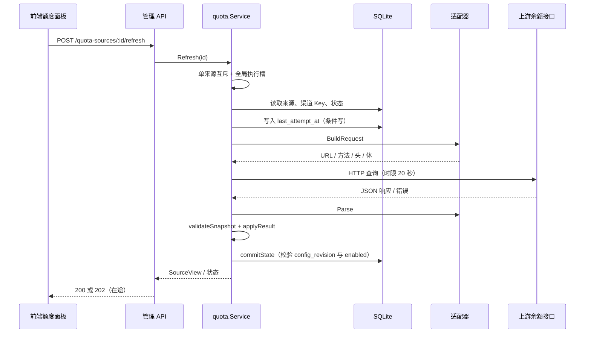

# 余额与额度

> 说明独立余额来源、适配器、缓存状态、有界调度与前端查询语义；不参与路由、鉴权或调用费用计算。

## 概述

`backend/quota` 负责查询渠道对应上游账户的余额与额度，并把结果整理成统一的条目和状态视图。它不参与模型生成、协议转换、路由、熔断、API Key 鉴权、token 聚合或费用计算；查询结果仅供观测，不是调用一定成功、账户仍然有效或实际扣费顺序的证明。

核心约束：

- **一个渠道就是一个上游账户，只允许一个查询来源。** `channel_quota_sources.channel_id` 有唯一索引；创建第二个来源返回 409，只能编辑现有来源。多账户应分别建立渠道。
- `quota.Service` 统一管理配置版本、来源互斥、执行、结果归一化、缓存状态和有界调度；适配器只负责构造请求和解析响应；管理 API 只做 HTTP 适配；前端只读取缓存快照并显式触发查询。
- 余额接口只挂在 `/api`，沿用本机管理访问限制，不暴露到 `/v1`。管理响应只返回是否已保存凭据，不返回 Token。

当前边界之外的能力：OAuth、登录、签名计算、多步请求串联、任意脚本或表达式、余额历史曲线、Sub2API Key 限额、厂商套餐专属适配。真实的模型调用费用仍由上游账单决定，余额不等于可用调用额度。

## 核心流程

## 关键实现

| 职责 | 位置 |
|---|---|
| 来源实体与 `channel_id` 唯一索引 | [`Source`](../../../backend/quota/types.go#L60)、[唯一索引](../../../backend/quota/types.go#L62) |
| 适配器注册表（5 个） | [`registry`](../../../backend/quota/registry.go#L12)、[`LookupAdapter`](../../../backend/quota/registry.go#L26) |
| 查询地址与来源校验 | [`validateBase`](../../../backend/quota/registry.go#L35)、[`validateAdapterSource`](../../../backend/quota/registry.go#L56) |
| 输入归一与凭据解析 | [`sourceFromInput`](../../../backend/quota/source.go#L17)、[`resolvedSource`](../../../backend/quota/source.go#L88) |
| 创建/更新/删除/读取 | [`Create`](../../../backend/quota/service.go#L98)、[`Update`](../../../backend/quota/service.go#L124)、[`Delete`](../../../backend/quota/service.go#L170)、[`List`](../../../backend/quota/service.go#L186) |
| 草稿测试与主动刷新 | [`Preview`](../../../backend/quota/service.go#L245)、[`Refresh`](../../../backend/quota/service.go#L293)、[`refresh`](../../../backend/quota/service.go#L296) |
| 写回校验与结果应用 | [`commitState`](../../../backend/quota/service.go#L352)、[`applyResult`](../../../backend/quota/service.go#L375) |
| 状态视图 | [`makeView`](../../../backend/quota/view.go#L5) |
| 执行与 HTTP 边界 | [`Execute`](../../../backend/quota/execute.go#L23)、[`executeRequest`](../../../backend/quota/execute.go#L58) |
| 渠道失效与删除 | [`InvalidateInheritedSourcesTx`](../../../backend/quota/repository.go#L8)、[`DeleteByChannelTx`](../../../backend/quota/repository.go#L23) |
| 有界调度 | [`RunScheduler`](../../../backend/quota/scheduler.go#L36) |
| NewAPI 查询与单位识别 | [`executeNewAPI`](../../../backend/quota/newapi_query.go#L32)、[`DetectNewAPIUnits`](../../../backend/quota/newapi_detection.go#L15) |
| 自定义结构化查询 | [`customAdapter`](../../../backend/quota/adapter_custom.go#L11)、[`validateCustom`](../../../backend/quota/custom_config.go#L118) |
| 管理 API | [`registerQuotaRoutes`](../../../backend/api/quota.go#L16) |

## 适配器与凭据

适配器注册表当前有 5 个条目：4 个厂商内置适配器加 1 个结构化自定义适配器。执行与配置元数据共用同一份注册表。

| 适配器 ID | 查询口径 | 允许的凭据模式 | 查询地址与请求 |
|---|---|---|---|
| `deepseek.balance` | DeepSeek 官方账户余额，按币种分别展示；零余额不代表 Key 失效 | 继承渠道 Key、专用 Token | 固定根地址 `https://api.deepseek.com`，`GET /user/balance` |
| `siliconflow.balance` | 硅基流动中国站账户余额（含充值与赠金），不推断国际站 | 继承渠道 Key、专用 Token | 固定根地址 `https://api.siliconflow.cn/v1`，`GET /user/info` |
| `openrouter.account_balance` | 账户 credits 减 usage；需要 Management Key，普通推理 Key 可能无查询权限 | 仅专用 Token | 固定根地址 `https://openrouter.ai/api/v1`，`GET /credits` |
| `newapi.account` | NewAPI 站点钱包、生效订阅与计费偏好；模型调用 Key 不等于账户 Access Token | 仅专用 Token | 站点 API 根地址（可含部署前缀），由代码追加 `/api/user/self`、`/api/subscription/self`，有生效订阅时再追加 `/api/subscription/plans` |
| `custom.balance` | 声明一次 JSON 查询和字段映射，不执行脚本 | 继承渠道 Key、专用 Token、无鉴权 | 任意 HTTP(S) 根地址加站内路径；GET 或 POST JSON |

查询根地址必须是 HTTP(S) 根地址，拒绝 URL 凭据、查询参数、片段、`.`/`..` 路径段和双斜杠；DeepSeek、硅基流动中国站和 OpenRouter 还要求精确匹配各自官方根地址。NewAPI 面向自建站点，允许任意安全的 HTTP(S) 根地址（可含部署前缀）；自定义来源额外拒绝反斜杠和控制字符。

凭据规则：

- 专用 Token 保存在来源的 `credentials` 中，接口只暴露 `has_token`；留空表示保留既有 Token（切换适配器或自定义根地址变化时由后端清空），勾选清除才删除。
- 切换适配器会清空旧凭据；自定义来源根地址变化也会清空专用 Token，避免把旧 Token 发到新目标。
- 切换到继承渠道 Key 或无鉴权时，已保存的专用 Token 会被清空；继承模式每次查询通过 `main` 注入的 `ChannelLoader` 在事务内读取渠道 Key。
- DeepSeek、硅基流动中国站、OpenRouter 和 NewAPI 使用 `Authorization: Bearer <token>`；NewAPI 额外发送 `New-Api-User: <user_id>`。自定义查询的请求头由配置声明，只在请求头中展开 `{{token}}`，路径和请求体不允许模板占位符。
- 每个来源独立保存凭据，读取接口不返回 Token；继承模式只读取所属渠道的 Key，专用 Token 不会跨渠道复用。
- NewAPI 根地址变化在代码中不会自动清空专用 Token（界面会提示“凭据将发送到”新地址）；切换站点前应人工确认是否需要重新填写。

## 保存、测试与查询

| 操作 | 持久化 | 上游请求 | 关键条件 |
|---|---|---|---|
| 测试草稿（`POST /api/quota-sources/preview`） | 不保存来源或状态 | 发送一次只读查询 | 配置通过校验；非无鉴权模式即使未启用也必须能解析到 Token；编辑已有来源时校验归属 |
| 保存（创建/更新） | 保存来源 | 不发送查询 | 新建要求渠道没有来源；更新要求 `expected_revision` 大于 0 且与当前版本一致；启用来源时非无鉴权模式必须有 Token |
| 保存并查询 | 先保存，再单独调用刷新 | 保存本身不访问上游，随后发送一次主动查询 | 保存成功；来源已启用；未在途；不在冷却期；凭据可解析 |

补充说明：

- **测试草稿**在事务内读取渠道 Key 并把 `SourceInput` 解析为完整来源，然后在事务外调用 `Execute`。它不写 `channel_quota_states`，不更新 `last_attempt_at`，也不读取已保存来源的冷却窗口；只受单来源在途和全局并发槽限制。返回的是临时 `View`，用于展示一次查询结果。
- **保存**的创建路径在一个事务内检查渠道是否已有来源、读取渠道 Key、校验并插入；更新路径校验乐观修订号，配置未变化时直接返回当前视图并保留状态，配置变化时递增 `config_revision`、条件更新来源、删除旧状态。保存事务内没有网络请求；事务提交后才取消旧的在途查询。
- 输入校验包括：名称 1–200 字符；`schema_version` 缺省或为 0 时按 1 处理，其他值拒绝；自动刷新间隔 0–60 分钟；适配器存在；凭据模式被该适配器允许；启用或测试草稿时 Token 不能为空（无鉴权除外）；自定义配置通过结构校验。空根地址会回落到适配器的默认根地址；没有默认地址的 NewAPI/自定义来源仍需填写。
- **保存并查询**由前端先提交带 `enabled: true` 的保存请求，成功后使列表缓存失效，再对返回的来源 ID 调用 `POST /api/quota-sources/:id/refresh`。这是两个独立请求，查询在保存事务之外执行；保存已生效但立即查询失败时，界面提示“配置已保存，但立即查询未完成”，不会回滚配置。
- 来源默认不启用，自动刷新间隔默认 0。启用查询但间隔为 0 时只允许手动查询，不进入自动调度；完全停用需要取消“启用查询”。

## 查询执行、写回与状态

主动查询的实际步骤：

1. 以来源 ID 获取单来源互斥；同一来源已有任务时返回当前视图并标记 `in_progress`（API 返回 202），不重复发送。全局执行槽最多 2 个，槽满返回 429。
2. 在一个数据库事务中读取来源、渠道 Key 和状态；来源未启用返回 400；`next_allowed_at` 尚未到期返回 429；适配器不存在返回 400；非无鉴权模式 Token 为空返回 400。
3. 写入本次 `last_attempt_at`（条件写仍要求 `config_revision` 一致），然后在事务外执行 HTTP 查询。
4. `applyResult` 生成成功或失败状态，`commitState` 再次读取当前来源并校验 `config_revision` 与 `enabled`；条件更新来源行取得数据库写锁后再保存状态。配置在查询期间变化、来源被禁用或删除时返回 409（或 404），旧结果被丢弃，不写入状态。
5. 应用层取消（客户端断开、进程关闭）不会阻止清理当前尝试：提交阶段使用脱离取消的 2 秒上下文，尽量把 `last_attempt_at` 和结果写回。

自动调度复用同一 `refresh` 路径，但会额外检查 `due`；手动刷新不检查是否到期。自动刷新只对 `enabled = true` 且 `auto_refresh_minutes > 0` 的来源执行。

HTTP 执行边界：单次请求超时 15 秒、整次查询期限 20 秒、响应上限 1 MiB、禁止重定向；NewAPI 的多个查询请求共享同一个 1 MiB 预算。自定义 POST 只允许 JSON，请求体上限 16 KiB。失败不在当前请求中自动重发；前端额度 API 也关闭了通用网络层重试，避免一次主动查询被重复发送。后台调度是否再次尝试由状态和冷却决定。

适配器成功返回快照后，统一检查：条目数量上限（普通 100，NewAPI 额外允许钱包）、ID 非空且唯一、`kind`/`scope`/单位类型合法、`limit_state` 合法、至少有一个金额或百分比字段（或明确无限）、金额是可解析的十进制字符串、原始额度结构有效、`used_percent` 非 NaN/Inf。任何不符都转成 `invalid_response`。

### 快照状态与失败窗口

成功查询会保存 `snapshot`、`last_success_at`、`last_outcome = success`，清空失败、连续失败计数和冷却，并按间隔计算下一次自动查询时间。真实零值保留为 `0`，未返回的字段保持未知，不自动补零；`limit_state = unlimited` 表示上游明确标记的不限额。

失败按类别处理：

| 失败类别 | 典型来源 | 对当前快照的影响 |
|---|---|---|
| `authentication` | 上游 401 | 旧身份余额立即不再作为当前值展示；需一次成功查询才能恢复 |
| `permission` | 上游 403、无查询权限 | 同上 |
| `configuration` | 地址/参数无效、拒绝重定向 | 同上 |
| `rate_limited` | 上游 429 | 保留可用快照，设置冷却 `next_allowed_at` |
| `temporary` | 超时、网络错误、上游 5xx | 保留可用快照，按连续失败次数退避 |
| `business` | 其他 4xx、上游业务响应失败 | 保留可用快照 |
| `invalid_response` | 字段缺失、格式或上限不合法 | 保留可用快照 |
| `cancelled` | 应用取消 | 不算一次上游失败；保留快照，按正常间隔重新排期 |

视图状态由 `makeView` 计算：

| `status` | 含义 |
|---|---|
| `disabled` | 来源未启用；不展示当前金额，详情最多查看历史快照 |
| `never` | 已启用但尚未成功查询 |
| `fresh` | 有可用快照，且距上次成功未超过新鲜期 |
| `stale` | 有可用快照，但已超过新鲜期，或查询失败后仍处于失败保留窗口 |
| `unavailable` | 查询失败且没有可展示的当前快照 |
| `expired` | 查询失败且旧成功值已超出最长保留窗口；当前快照隐藏，历史快照仍可在详情查看 |
| `invalidated` | 状态与当前 `config_revision` 不一致，旧结果不能作为当前值 |

新鲜期：自动刷新关闭时按 5 分钟，开启时按配置间隔。查询失败后的旧值保留窗口为 `max(10 分钟, 2 × 新鲜期)`，从上次成功时间起算；失败不会把成功时间替换成失败时间。正常成功值即使闲置超过该窗口仍可展示（只会从 `fresh` 变为 `stale`），不能称为账户过期；只有失败后的旧值才受最长年龄约束。

冷却与退避：

- `rate_limited` 的等待时间取 `Retry-After`，未提供时默认 60 秒，上限 1 小时；NewAPI 多接口限流取相关接口的最长等待时间，冷却期间手动查询返回 429，自动调度也不会提前。
- `temporary` 连续失败按 1、2、5、10、30 分钟退避，只在自动刷新开启时排下一次；未开启自动刷新时不会因失败自行开始轮询。
- 鉴权、权限和配置失败不会自动反复重试；修正后需要一次成功查询。

身份与配置变更的隔离：

- 渠道 Key 变化时，`InvalidateInheritedSourcesTx` 在同一渠道事务内把继承模式来源的 `config_revision` 加 1 并删除状态；提交后 `CancelChannel` 取消该渠道的在途查询。旧响应因版本校验失败而丢弃。
- 编辑来源且保存内容发生变化、禁用或删除来源会删除状态并取消在途任务；未发生变化的保存不递增版本，也不清空已有快照。
- 切换适配器或自定义根地址变化会清空专用 Token；继承模式则始终使用当前渠道 Key。旧身份的成功值不会在后续临时网络失败时“复活”。

## NewAPI 与自定义查询

### NewAPI 钱包、订阅与单位识别

一次 NewAPI 查询分别读取 `/api/user/self`（钱包）和 `/api/subscription/self`（订阅）；存在生效订阅时再读取 `/api/subscription/plans` 获取套餐名称。钱包和订阅可以同时存在，钱包为 0 不代表没有订阅额度。

- 订阅只纳入 `status = active`、`end_time` 晚于当前时间且 `start_time` 不晚于当前时间的条目；最多 100 条。`amount_total = 0` 视为不限额；其余计算已用百分比和剩余额度。
- 钱包、订阅、套餐名称分别记录成功或失败。某个接口失败时保留本次成功部分；套餐名称失败仍保留额度并使用“套餐 #<plan_id>”展示。两个主要接口都失败时，优先返回鉴权/权限失败，其次返回等待时间最长的限流失败，否则返回钱包失败。
- 后端先按原始 QUOTA 累加钱包与订阅，再统一换算，得到 `newapi.account_summary`；`newapi.subscription_summary` 只汇总订阅，不包含钱包。含不限额订阅时合计标记为不限额，不伪造有限总额。
- 未配置换算比例时仍按原始 QUOTA 计数展示；配置换算后 `original` 保留原始额度，详情可展开核对。
- 订阅汇总、整体合计和套餐名称都保存为快照的一部分；整体合计已到期或旧缓存缺少合计字段时，前端提示待刷新/需刷新，订阅卡片在重置时间到达时提示刷新。实际扣费顺序由站点计费偏好和套餐规则决定。

单位自动识别：

1. 前端在 NewAPI 根地址输入失焦或打开已有来源时调用 `POST /api/quota/newapi/detect`；请求只带 `query_base_url`。
2. 后端校验根地址、取得全局查询槽、设置 20 秒期限，**不携带查询 Token**，读取站点公开的 `/api/status`；不读取凭据、不保存来源、不查询账户余额。
3. 读取 `quota_display_type`、`quota_per_unit`、`usd_exchange_rate`、`custom_currency_exchange_rate`、`custom_currency_symbol`，支持 USD、CNY、CUSTOM、TOKENS 四类换算；换算比例以精确分数表示，避免中间舍入。
4. 前端仅在 `quota_per_unit` 和 `display_unit` 都没有手动值时才自动填入；已有任一手动配置时保留原值，需用户点击“使用识别结果”才替换。识别失败、响应不完整或站点不支持时保留手动配置。

### 自定义结构化查询

`custom.balance` 的配置是声明式的 `CustomConfig`，由 `request`、可选 `success` 和 `items` 组成，不执行 JavaScript 或其他脚本。

请求约束：

- 方法只允许 GET 或 POST；GET 不允许请求体；POST 请求体必须是合法 JSON，上限 16 KiB，可留空。
- 站内路径必须以 `/` 开头，拒绝绝对 URL、主机、用户信息、反斜杠、`#`、双斜杠、`.`/`..` 段、控制字符和模板；查询参数键名含 `authorization`、`token`、`key`、`secret`、`password`、`signature`、`session` 等敏感词会被拒绝。
- 请求头最多 32 个、总大小 16 KiB；拒绝 Host、Connection、Content-Length、Transfer-Encoding、Trailer、Upgrade、Proxy-* 等传输控制头；敏感名请求头必须包含 `{{token}}` 占位符；`Content-Type` 若填写必须为 `application/json`；请求头值最多 4096 字符。
- `{{token}}` 只在请求头中展开；请求体、路径和查询参数不允许占位符。无鉴权模式不能引用 Token 占位符。
- 只发送一次请求；不跟随重定向，不重试，不支持多步请求、登录、签名或 OAuth 刷新。

结果映射约束：

- `items` 为 1–20 项，每项 ID 稳定且唯一，显示名称不超过 256 字符；`kind` 为 `balance`、`spending_limit`、`usage_window`；`scope` 为 `account`、`api_key`、`plan`；单位类型为 `money`、`count`、`tokens`、`percent`，单位代码 1–24 字符且不猜测默认币种。
- 路径使用 JSON Pointer：根路径为空字符串；数组首项写作 `/wallets/0/balance`；字段名中的 `/` 写作 `~1`、`~` 写作 `~0`。路径最长 1024 字符、最多 32 段，数组索引不允许前导零。
- 剩余、已用、总额路径均可选，但每项至少要有其中一个路径或“无限条件”。字段缺失或值为 `null` 表示未知，不自动补 0；数字或十进制字符串按精确十进制解析。
- `remaining_from_total_used` 勾选时必须同时配置总额和已用路径，且不能再配置剩余路径；剩余由总额减已用计算。
- 可选换算除数必须是正十进制数，且必须同时填写原始单位；换算前金额保存在 `original` 中，详情保留原始额度。
- 可选成功条件和每项的无限条件都使用“JSON Pointer + 等于 JSON 标量”表示；比较值保留 `null`、布尔、字符串或数字的类型，数字按精确十进制比较。
- 解析失败、类型不符或字段不满足快照校验时返回 `invalid_response`；不会把缺失字段当成 0，也不会用浏览器计算余额。

## 缓存、调度与前端

后端读取接口只读数据库，不访问上游：

- `GET /api/channels/:id/quota-sources` 读取该渠道的来源、配置和最新状态；会读取渠道 Key 仅用于计算 `has_token`，不返回 Key。
- `GET /api/quota/summaries?channel_ids=1,2` 批量读取缓存，1–100 个渠道 ID；重复 ID 去重，不存在的渠道返回空来源数组。为不加载渠道 Key，继承模式用占位值计算 `has_token`，这里的 `has_token` 表示凭据模式可提供凭据，不等同于实际渠道 Key 非空。
- 两个接口都不发起额度查询；打开列表、搜索、详情或切换页面都不会自动查询上游。

前端流程：

- 渠道卡片首帧可读取渲染进程内 `/quota/summaries` 响应缓存（最多 5 分钟），随后仍会请求后端；缓存只用于首帧，不掩盖请求失败。
- `useQuotaSummaries` 定期读取缓存：没有在途任务时约 30 秒一次，有 `in_progress` 时约 1.5 秒一次；页面隐藏时停止，恢复可见时重新读取。卡片刷新按钮和详情“立即查询”才调用 `POST /quota-sources/:id/refresh`。
- 余额面板的 `useQuotaSources` 按同样节奏轮询来源列表缓存；打开面板、切换来源或读取详情都不触发上游查询。
- 单个来源刷新期间禁用重复点击；API 返回 202 表示任务在途，前端依靠只读 GET 轮询终态，不通过反复 POST 轮询。刷新失败按 429、404、409 分别提示限流、来源变更、配置更新。
- `useQuotaDraft` 用请求代次和 `AbortController` 隔离草稿修改、关闭页面和迟到响应；适配器切换会重置草稿，自定义根地址变化会清空 Token 输入；保存成功后立即失效列表缓存，再执行可选的立即查询。
- `QuotaPanel` 只展示当前渠道唯一的来源，提供立即查询、编辑和移除；来源未启用、在途、有其他操作或处于冷却时禁用查询。
- 金额格式化不改变后端快照：详情使用完整十进制字符串；卡片金额仅对 `money` 单位做两位小数排版，正数不足 0.01 显示 `<0.01`，负数绝对值不足 0.01 显示 `>-0.01`，真实零显示 `0.00`；非 `money` 单位不套用该规则。

后台调度：

- `main` 在启动时创建 `quota.Service` 并执行 `go quotaService.RunScheduler(ctx)`；关闭信号会取消调度。
- 调度器只有一个 10 秒 ticker 和两个 worker，不为每个来源创建 goroutine。每轮扫描 `enabled = true AND auto_refresh_minutes > 0` 的来源，按 `due` 判断是否到期；冷却未结束、已有在途任务、失败且未到重新排期时间的来源跳过。
- 待执行任务进入容量为 2 的队列并去重；队列满时丢弃本轮任务，下一轮再判断。全局执行槽同样为 2，单来源同时只允许一个在途查询。
- 正常排期 `nextRegular` 会在间隔上叠加 `来源 ID % 11` 秒的固定抖动，避免同一时刻集中请求；冷却和退避时间不叠加该抖动。

## 删除与渠道变更影响

- **删除来源**（`DELETE /api/quota-sources/:id`）：事务内先删除该来源的状态，再删除来源；提交后取消该来源的在途查询。渠道和该渠道的模型保留，已保存的查询 Token 随来源删除。
- **删除渠道**：渠道删除事务内调用 `quota.DeleteByChannelTx`，先删除该渠道所有来源的状态，再删除来源，然后继续删除模型、分组项和渠道；提交后 `CancelChannel` 取消在途查询。前提是 `quota_service` 已注入管理 API（`main` 会注入）；未注入时渠道删除不会清理额度来源，删除影响预览也不会承诺清理。
- **修改渠道 Key**：同一渠道事务内对继承模式来源递增 `config_revision` 并删除状态，提交后取消该渠道在途查询；专用 Token 来源不受影响。
- **修改/禁用来源**：保存内容变化会递增版本并删除旧状态；禁用后不再调度，手动查询返回 400。未变化的保存保留状态和快照。
- **删除影响预览**：`GET /channels/:id/deletion-impact` 只在 `quota_service` 已注入且表存在时返回 `has_quota_source`，与真实删除路径使用同一判断。

## 管理 API

以下路径均位于 `/api`，受本机管理访问限制保护：

| 方法与路径 | 用途 | 常见状态 |
|---|---|---|
| `GET /quota/adapters` | 返回适配器、凭据模式和字段描述 | 200 |
| `GET /quota/summaries?channel_ids=…` | 批量读取缓存，1–100 个渠道 ID | 200、400 |
| `POST /quota/newapi/detect` | 读取公开站点配置识别单位；不保存、不查询余额 | 200、400、422、429 |
| `GET /channels/:id/quota-sources` | 读取渠道的来源配置和最新状态 | 200、404 |
| `POST /channels/:id/quota-sources` | 创建来源；已有来源返回 409；不主动查询 | 201、400、404、409 |
| `PUT /quota-sources/:id` | 更新来源；必须提交匹配的 `expected_revision` | 200、400、404、409 |
| `DELETE /quota-sources/:id` | 删除来源及其状态 | 200、404 |
| `POST /quota-sources/preview` | 测试草稿；不落配置或快照 | 200、202、400、404、429 |
| `POST /quota-sources/:id/refresh` | 主动查询一次；在途返回 202，不重复发送 | 200、202、400、404、409、429 |

约定：

- 已执行并完成写回的上游查询无论成功还是失败，统一返回 200 和状态视图；上游 HTTP 状态在 `failure.upstream_status`，与本机 API 的 400/404/409/429 配置、归属、冲突或并发限制区分。查询期间配置变化会使写回返回 409，旧结果被丢弃。202 表示任务在途，应继续读取缓存获取终态。
- `preview` 在途时返回 `{ status: "never", in_progress: true }`；`refresh` 在途时返回当前来源视图并标记 `state.in_progress`。两者都带 `Retry-After: 2`。
- 草稿测试和刷新在全局并发槽满时返回 429；刷新处于冷却期同样返回 429；来源未启用返回 400。

## 修改须知

- **新增适配器**：在 `registry` 增加实现 `Describe`、`Validate`、`BuildRequest`、`Parse` 的适配器，并声明允许的凭据模式与字段；适配器只构造请求和解析响应，不自己发网络请求、不执行脚本。同步检查 `Descriptor` 的地址限制、`validateSnapshot` 和前端 `quotaModel.js` 的展示映射。
- **修改状态或保留窗口**：`makeView` 决定 `fresh`/`stale`/`expired`/`invalidated`，`applyResult` 决定失败类别和冷却；不要因为成功值闲置较久就把它改称“账户过期”，也不要让失败覆盖上次成功时间。
- **修改保存/刷新事务**：保存事务内不得发起上游请求；刷新写回必须继续校验 `config_revision` 和 `enabled`，配置在查询期间变化时丢弃旧结果。开启立即查询是两个独立请求，失败不回滚已保存配置。
- **修改调度**：保持单 ticker、两个 worker、两个全局执行槽和容量 2 的队列；不要为每个来源创建 goroutine。`nextRegular` 的 `来源 ID % 11` 秒抖动只用于正常排期，不叠加到冷却/退避。
- **修改凭据语义**：切换适配器或自定义根地址时清空专用 Token；继承模式每次从渠道读取 Key；管理响应只返回 `has_token`，不得返回 Token。NewAPI 根地址变化目前不清空 Token，修改前先确认产品/安全要求。
- **相关测试**：`backend/quota/*_test.go`、`backend/api/quota_*_test.go` 以及前端 `pages/Channels/quota/*.test.js`。修改后至少执行 `go test ./...` 和 `go vet ./...`。

来源

- [backend/quota/registry.go](../../../backend/quota/registry.go)
- [backend/quota/service.go](../../../backend/quota/service.go)
- [backend/quota/source.go](../../../backend/quota/source.go)
- [backend/quota/execute.go](../../../backend/quota/execute.go)
- [backend/quota/view.go](../../../backend/quota/view.go)
- [backend/quota/repository.go](../../../backend/quota/repository.go)
- [backend/quota/scheduler.go](../../../backend/quota/scheduler.go)
- [backend/quota/adapter_custom.go](../../../backend/quota/adapter_custom.go)
- [backend/quota/custom_config.go](../../../backend/quota/custom_config.go)
- [backend/quota/custom_parse.go](../../../backend/quota/custom_parse.go)
- [backend/quota/adapter_newapi.go](../../../backend/quota/adapter_newapi.go)
- [backend/quota/newapi_query.go](../../../backend/quota/newapi_query.go)
- [backend/quota/newapi_detection.go](../../../backend/quota/newapi_detection.go)
- [backend/api/quota.go](../../../backend/api/quota.go)
- [web/src/renderer/pages/Channels/quota/QuotaPanel.jsx](../../../web/src/renderer/pages/Channels/quota/QuotaPanel.jsx)

