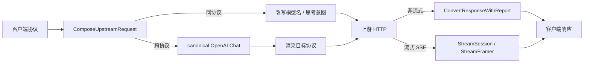

# 协议转换与流式交付

> 说明四种上游协议的请求/响应转换、流式事件与能力映射；不决定选路、重试和资源管理。

## 概述

`backend/protocol` 负责把客户端协议请求转换为目标上游协议，再把上游响应或 SSE 流转回客户端协议。它维护 OpenAI Chat Completions（`openai`）、OpenAI Responses（`openai_responses`）、Anthropic Messages（`anthropic`）和 Google Gemini（`gemini`）四种协议；其中 Gemini 只作为上游协议接入，没有对应的客户端 `/v1` 入口。

协议层只回答“字段如何映射、能力如何降级、流帧如何重装”，不决定选哪个分组或渠道、是否重试、何时熔断。这些属于网关的职责。协议转换也不保证能力等价：上下文长度、推理能力、托管工具和供应商扩展仍取决于实际上游。

两种转换形态并存：

- **同协议**：请求体基本直通，只替换上游模型名和注入必要的思考意图；响应保留原始字节（先做原生资源捕获与诊断）。直通仍可能改写请求，不是字节级不变。
- **跨协议**：经 OpenAI Chat 的 canonical 结构中转；流式使用类型化 `StreamEvent`，不经过 Chat JSON 中转，再按客户端协议装帧。只使用已有字段语义，不做无法证明的等价映射。

## 核心流程

一次请求的协议处理顺序：

1. 网关调用 `ComposeUpstreamRequest(clientProto, targetProto, body, UpstreamRequest{Model, Thinking, ThinkingCompat, Limits})`。
2. `CaptureRequest` 解析源协议，保留原生片段并做资源与深度检查；`PrepareTarget` 替换上游模型名、注入思考意图、处理托管工具与 reasoning 桥，再渲染目标协议。
3. 网关负责发送 HTTP；响应回来后，非流式调用 `ConvertResponseWithReport`，流式创建 `NewStreamConverter` 并由 `StreamSession` 处理。
4. 非流式响应经 canonical 转换为客户端协议，同时返回 `ConversionReport`；流式事件按客户端协议装帧，终态由 `StreamFramer` 和 `StreamSession` 共同确认。
5. usage 由各协议提取器归一为 `Usage`（非缓存输入、缓存读、缓存写、输出），随调用日志落库；缺失 usage 不等于零消耗。

### 转换阶段与能力边界

| 阶段 | 同协议 | 跨协议 |
|---|---|---|
| 非流式请求 | 原请求体直通；替换顶层 `model`；OpenAI 同协议按需写思考开关；未知字段按原始 JSON 片段保留（字段级保留，不是字节级不变） | 解析为 canonical OpenAI 请求 → 渲染为目标协议；托管工具声明发往 OpenAI Chat 上游时剥离并计入遥测 |
| 非流式响应 | 原响应体返回（先做原生资源捕获与诊断）；提取 usage | 解析为 canonical 响应 → 渲染为客户端协议；只使用已有语义映射 |
| 流式 | 原始 SSE 帧透传；仍按源协议提取 usage 和终态 | 类型化解码器 → `StreamEvent` → 目标编码器，不经过 Chat JSON 中转；按客户端协议装帧 |
| 错误体 | 统一按客户端协议形状输出，不按上游协议 | 同左 |

能力边界：

- 托管工具由支持的上游执行，Portunus 不在网关侧代跑搜索；`web_search_*` 可按既有规则透传或剥离，未知 hosted 类型、computer/MCP/code interpreter 等不能假设可重放。
- 思考/推理跨协议按已有字段映射；`-thinking` 后缀只表达本次调用意图，是否写入请求体由目标协议决定。thinking 垫片会改写历史 assistant 消息，影响上游前缀缓存。
- 同协议直通不等于“完全不动请求”：模型名替换、思考意图和预算字段处理仍可能发生；响应侧同协议返回原始字节。
- 协议转换不承诺任意工具、思考、缓存或供应商扩展等价；能映射的字段按语义转换，不能映射的字段记录诊断或保持未知，不伪造默认值。

## 关键实现

| 职责 | 位置 |
|---|---|
| 协议枚举与合法性 | [`Provider`](../../../backend/protocol/protocol.go#L3)、[`Valid`](../../../backend/protocol/protocol.go#L14) |
| 协议能力注册表 | [`providerImpls`](../../../backend/protocol/provider_registry.go#L46)、[`implFor`](../../../backend/protocol/provider_registry.go#L110) |
| 非流式请求/响应入口 | [`ConvertRequest`](../../../backend/protocol/convert.go#L14)、[`ConvertResponse`](../../../backend/protocol/convert.go#L42) |
| 上游请求装配 | [`ComposeUpstreamRequest`](../../../backend/protocol/convert.go#L91)、[`CaptureRequest`](../../../backend/protocol/native_request.go#L104)、[`PrepareTarget`](../../../backend/protocol/native_request.go#L167) |
| 上游响应捕获与渲染 | [`CaptureResponse`](../../../backend/protocol/native_response.go#L30)、[`ConvertResponseWithReport`](../../../backend/protocol/native_response.go#L375) |
| 流式转换器与会话 | [`NewStreamConverter`](../../../backend/protocol/stream.go#L51)、[`NewStreamSession`](../../../backend/protocol/stream_session.go#L53)、[`Process`](../../../backend/protocol/stream_session.go#L94)、[`Finish`](../../../backend/protocol/stream_session.go#L208) |
| 客户端装帧 | [`StreamFramer`](../../../backend/protocol/stream_frame.go#L17)、[`ErrorFrame`](../../../backend/protocol/stream_frame.go#L78) |
| 重放安全判断 | [`StreamRequestReplaySafe`](../../../backend/protocol/stream_replay.go#L8) |
| 思考与推理映射 | [`parseReasoning`](../../../backend/protocol/reasoning.go#L30)、[`renderReasoning`](../../../backend/protocol/reasoning.go#L118)、[`InjectReasoningPlaceholders`](../../../backend/protocol/thinking_compat.go#L47) |
| 预算字段兼容 | [`ChatTokenBudgetFallback`](../../../backend/protocol/token_budget.go#L15) |
| usage 归一 | [`Usage`](../../../backend/protocol/usage.go#L15)、[`newOpenAIUsageExtractor`](../../../backend/protocol/usage.go#L141) |
| 上游连接与模型列表 | [`NewUpstream`](../../../backend/protocol/upstream.go#L34)、[`FetchUpstreamModels`](../../../backend/protocol/upstream.go#L70) |

## 配置与扩展

协议层没有独立的配置文件；行为由渠道协议、请求体字段和网关传入的 `protocol.UpstreamRequest` 决定。`UpstreamRequest` 的字段：

| 字段 | 作用 |
|---|---|
| `Limits` | 转换链资源上限（请求体、响应体、原生片段、单工具参数、累计有状态片段、JSON 深度） |
| `Model` | 上游模型名；空值不替换；Gemini 的模型名在 URL 中，替换为 no-op |
| `Thinking` | `-thinking` 后缀驱动的思考意图；只有 OpenAI 兼容上游消费 |
| `ThinkingCompat` | 渠道级 thinking 垫片：为缺失 `reasoning_content` 的历史 assistant 注入占位，降低严格 thinking 上游的 400 |

新增协议需要在 `providerImpls` 增加完整注册项，并实现对应的请求解析/渲染、响应解析/渲染、两个方向的流式转换器、直通流 usage 提取器和上游接入器。注册项同时决定协议是否合法、能否分发；不要在转换器里散落新的 `switch`。

新增或调整协议能力时，还应核对 `capability_matrix_test.go`、`hosted_tool_matrix_test.go`、`reasoning_*_test.go`、`typed_stream_test.go` 等行为表，避免只改主路径而破坏边界语义。

## 修改须知

| 修改点 | 影响与约束 |
|---|---|
| 修改 canonical 请求/响应结构 | 影响所有跨协议方向；同协议直通可绕过部分逻辑，必须分别验证 |
| 新增字段映射 | 先确认源协议和目标协议是否都有等价字段；无法映射时记录兼容诊断，不要静默丢弃或伪造默认值 |
| 托管工具 | `web_search_*` 等已知托管工具可按既有规则透传或剥离；未知 hosted 类型、computer/MCP/code interpreter 等不能假设可重放 |
| 思考/推理 | `-thinking` 只表达本次调用意图；thinking 垫片会改写历史消息并影响上游前缀缓存，默认开启但不得无条件注入 |
| 流式终态 | 上游缺少合法终态时不得伪造 `end_turn` / `completed` / `[DONE]`；`ErrStreamIncomplete` 必须保留 |
| usage | 各协议归一必须区分非缓存输入、缓存读、缓存写；缺失字段保持未知，不补 0 |
| 资源上限 | 转换失败应归为 `resource_limit` / `convert_error`，不能计入上游故障或触发无意义重试 |
| 重放安全 | 带会话续接、原生工具、加密内容或未知工具形状的请求不得被标记为可安全重放 |

协议转换的逐字段细节仍在源码与测试中；本页只描述当前主链路、能力边界和修改影响。网关如何使用这些能力、如何决定重试与换家，见[网关转发与保护](网关转发与保护.md)；一次请求的端到端顺序见[一次请求的生命周期](../指南/请求生命周期.md)。

来源

- [backend/protocol/protocol.go](../../../backend/protocol/protocol.go)
- [backend/protocol/provider_registry.go](../../../backend/protocol/provider_registry.go)
- [backend/protocol/convert.go](../../../backend/protocol/convert.go)
- [backend/protocol/from_openai.go](../../../backend/protocol/from_openai.go)
- [backend/protocol/openai.go](../../../backend/protocol/openai.go)
- [backend/protocol/anthropic.go](../../../backend/protocol/anthropic.go)
- [backend/protocol/gemini.go](../../../backend/protocol/gemini.go)
- [backend/protocol/responses.go](../../../backend/protocol/responses.go)
- [backend/protocol/native_request.go](../../../backend/protocol/native_request.go)
- [backend/protocol/native_response.go](../../../backend/protocol/native_response.go)
- [backend/protocol/stream.go](../../../backend/protocol/stream.go)
- [backend/protocol/stream_session.go](../../../backend/protocol/stream_session.go)
- [backend/protocol/stream_frame.go](../../../backend/protocol/stream_frame.go)
- [backend/protocol/stream_replay.go](../../../backend/protocol/stream_replay.go)
- [backend/protocol/reasoning.go](../../../backend/protocol/reasoning.go)

