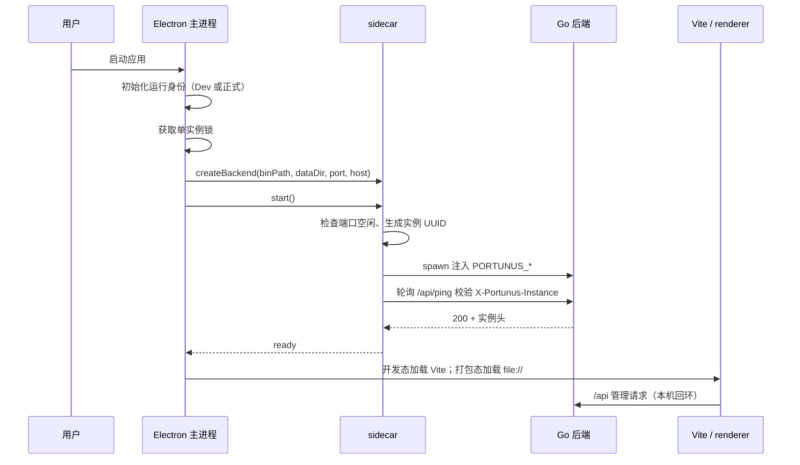

# 桌面主进程与 sidecar

> 说明 Electron 主进程、运行身份与数据隔离、sidecar 生命周期、IPC 和客户端配置读写；不实现网关业务与渲染层页面。

## 概述

Portunus 桌面端是本地网关的交付外壳：Electron 主进程负责应用身份、窗口与托盘、IPC、Go 后端守护（sidecar）和更新；React 渲染层提供管理界面；真正的模型聚合、路由和协议转换仍在 Go 后端。桌面壳不实现这些业务能力。

本页负责：

- 未打包、打包 Dev、正式安装包三种运行形态的身份、数据路径和端口隔离。
- 主进程拉起、健康检查、重启和停止自己创建的 Go 后端；不接管其他进程。
- 渲染层与主进程之间的固定 IPC 白名单，包括更新、监听范围、客户端配置和外部链接。
- Vite 开发代理、打包后 `file://` 页面加载，以及主进程与 sidecar 的装配。
- Claude Code 配置读写（`~/.claude/settings.json`）的备份、原子保存与回滚。

不负责或不在此展开：

- 网关路由、协议转换、余额查询、日志归并等后端能力，分别见[网关转发与保护](网关转发与保护.md)、[协议转换与流式交付](协议转换与流式交付.md)、[余额与额度](余额与额度.md)和[调用观测与日志](调用观测与日志.md)。
- 管理 API 的完整访问控制实现；桌面侧只说明它依赖真实回环连接，不能通过公开反向代理暴露。
- 正式构建、发布与更新签名链路，见[构建、发布与更新](../指南/构建发布与更新.md)。
- 渲染层页面与请求层，见[管理界面与请求层](管理界面与请求层.md)。

关键边界：

- 管理面 `/api` 仅供本机使用；局域网对外的是 `/v1` 服务面，仍需 API Key。
- Dev 不复制、不迁移、不读取正式数据库、上游密钥或设置。唯一共享的外部用户状态是用户主动编辑的 `~/.claude/settings.json`；构建脚本和更新验收脚本另用本机更新签名私钥，Dev 应用运行时不会读取它。
- 不能按进程名批量结束应用。代码只停止自己 spawn 的子进程，日常停止应走托盘退出、`Cmd+Q` 或应用菜单。
- `go run .` 是命令行后端模式，默认端口 3060、使用仓库 `data/`，不属于桌面 Dev；Vite 代理固定指向 Dev 的 13061。

## 核心流程

### 运行身份、端口与数据目录

`runtime-profile.js` 的 `profileFor` 决定身份：未打包一律为 `development`；打包后只有 `package.json` 带 `portunusProfile: "development"` 才是 Dev，否则为 `production`。Dev 包由 `web/electron-builder.dev.cjs` 通过 `extraMetadata` 写入该标记。`initializeProfile` 在单实例锁之前执行，Dev 会设置应用名、`userData`、`sessionData` 和日志目录；正式版不覆盖 Electron 默认目录。

`preloadProfile` 从窗口启动参数 `--portunus-profile=` 读取身份，缺少参数时默认 Dev，避免 preload 回退到正式端口。`main.js` 创建窗口时把 `--portunus-profile=${runtime.profile}` 传给 preload。

| 项目 | 正式安装版 | 开发调试版 |
|---|---|---|
| 名称 | Portunus | Portunus Dev（macOS Dock 显示 DEV 徽标） |
| Bundle ID / appId | `com.portunus.app` | `com.portunus.app.dev` |
| 后端端口 | 13060 | 13061 |
| `userData` | Electron 默认；开发说明记录 macOS 当前为 `~/Library/Application Support/@portunus/web` | `app.getPath('appData')/Portunus Dev`；macOS 即 `~/Library/Application Support/Portunus Dev` |
| 会话 / 日志 | 沿用默认路径 | `Portunus Dev/session/`、`Portunus Dev/logs/` |
| 后端工作目录 | 不额外覆盖 | `Portunus Dev/backend/`，不读仓库配置 |
| 数据库 | `userData/data/portunus.db` 等 | 独立 `Portunus Dev/data/`；首次启动新库、新令牌 |
| 更新 | 正式更新服务 | 禁用检查、下载和安装 |
| 构建产物 | `web/dist-electron/` | `web/dist-dev/` |

`server-address.js` 是端口与连接地址的单一来源：`DEV_PORT=13061`、`PROD_PORT=13060`；内部 URL 恒为 `http://127.0.0.1:<port>`，监听 host 另由 `networkMode` 决定。`local` 监听 `127.0.0.1`，`lan` 监听 `0.0.0.0`。因此“监听地址”和“界面连接地址”是两件事，LAN 模式也不会让界面改用 `0.0.0.0` 访问。

`app-config.js` 在 `userData/config.json` 保存 `networkMode`，默认 `local`；读取失败回退默认值，写入使用临时文件加 `rename` 原子替换。主进程只注册 `config:get-network-mode`；设置范围走 `config:set-network-mode`，由 `main.js` 写盘后调用 `backend.restart()`，只有当前主进程创建的后端会被重启。

单实例锁以当前 `userData` 为界。Dev 热启动和打包 Dev 共用同一身份，二者不能同时运行；第二次启动会退出并聚焦已有窗口。正式版与 Dev 使用不同身份和端口，可以同时运行。

### 启动、窗口、托盘与关窗差异

主流程位于 `main.js`：

1. 加载运行身份；开发态设置应用图标；忽略 electron-updater 的非致命 `HttpError`。
2. 获取单实例锁；失败直接退出。
3. 在 Dev 下创建 `userData/backend/`，组装 sidecar 参数；`binPath` 打包后取 `resources/bin/portunus[.exe]`，未打包取 `web/bin/{mac|win|linux}/portunus[.exe]`。
4. `app.whenReady()` 后创建托盘（Linux 除外）、创建窗口并 `backend.start()`。
5. 窗口等待 `backend.ready` 后再加载页面。Dev 后端失败时显示内联错误页，不加载会访问端口的业务页面；正式版保留既有降级行为。
6. 打包版在 `loadFile` 成功后检查更新；Dev 加载 Vite 页面并打开 Detached DevTools。

窗口使用 `contextIsolation: true`、`nodeIntegration: false`、`sandbox: false`。关闭 sandbox 是为了让 preload 能 `require('fs')/require('path')`，这是当前 preload 桥工作的前提。`did-finish-load` 后会执行一次 `typeof window.api !== "undefined"` 探测，只用于诊断。

平台关窗和退出行为由代码显式区分：

| 平台 | 点击窗口关闭 | `window-all-closed` | 真正退出 | 后端 |
|---|---|---|---|---|
| macOS | 关闭窗口，应用留在 Dock | 不退出 | `Cmd+Q`、托盘“退出”、Dock 右键退出 | 退出前 `before-quit` 拦截一次，`backend.stopAndWait()` 完成后再次 `app.quit()`；关窗期间后端继续服务 |
| Windows | 拦截 `close` 并隐藏到托盘，除非 `isQuitting` 已置位 | 不退出，托盘仍可恢复窗口 | 托盘“退出”或 `app.quit()` | 退出时 `backend.stop()`；点 X 不停止网关 |
| Linux | 关闭窗口 | 无托盘兜底，`backend.stop()` 后 `app.quit()` | 关窗即退出 | 关窗即停止后端 |

macOS 的 `activate` 会在无窗口时重新创建窗口；`second-instance` 和托盘“打开”共用 `showMainWindow`，最小化先还原，已销毁则重建。托盘只在 macOS 和 Windows 创建；Linux 不创建托盘，保持关窗退出。

不要使用 `killall`、`pkill Portunus` 或按进程名清理。后端是网关，终端里的客户端可能仍在调用；需要停止时使用应用内退出。

### sidecar 生命周期与注入环境

`sidecar.js` 是与 Electron 无关的状态机，`main.js` 注入二进制、数据目录、端口和 host 回调。虽然模块注释描述了 `binPath=null` 时只轮询外部后端的模式，但桌面 `main.js` 在 Dev 也传入 `web/bin/...` 二进制，因此桌面 Dev 会自行拉起后端，而不是依赖 `go run .`。

状态为 `stopped`、`starting`、`ready`、`failed`。`start()` 的步骤：

1. 已有 `starting/ready` 时直接返回；递增 generation，停止旧子进程。
2. 可选等待 `PORTUNUS_SIDECAR_DELAY_MS`（仅冷启动，重启不生效）。
3. 检查二进制存在；用 `net` 尝试绑定目标端口，端口已被占用时直接失败，不接管已有服务。
4. 生成随机 UUID 作为 `PORTUNUS_INSTANCE_ID`，注入环境变量并 spawn。
5. 轮询 `GET http://127.0.0.1:<port>/api/ping`，要求 HTTP 200 且响应头 `X-Portunus-Instance` 等于本次 UUID；默认 60 次、每 500ms，约 30 秒超时。
6. 每次轮询前后都核对 generation 和子进程仍存活；子进程退出或报错会把当前代标记为 `failed`。
7. 成功后进入 `ready`；`ready` 恒 settle，不 reject，调用方以 `state` 和 `error` 判断结果。

`restart()` 先停止当前子进程，再等待端口释放（默认 30 次、每 100ms），然后重新 spawn 和健康检查；切换监听范围走这条路径。`stop()` 只 kill 当前 `child` 并递增 generation；旧进程延迟退出不会清空新一轮状态。`stopAndWait()` 用于 macOS 退出/更新替换前等待后端退出：子进程 6 秒未退则 `SIGKILL`，最多等 8 秒，避免新版启动时端口仍被占用。

spawn 时注入的关键变量：

| 变量 | 来源 / 用途 |
|---|---|
| `PORTUNUS_INSTANCE_ID` | sidecar 每次启动生成的 UUID；`/api/ping` 用它校验“确实是本次实例” |
| `PORTUNUS_DATABASE_TYPE` | 仅 Dev 注入 `sqlite`；正式版不注入，使用后端自身默认配置 |
| `PORTUNUS_SERVER_HOST` | `hostFor(networkMode)`：`lan → 0.0.0.0`，`local → 127.0.0.1`；每次 spawn 现算 |
| `PORTUNUS_SERVER_PORT` | Dev 13061 / 正式 13060 |
| `PORTUNUS_DATABASE_PATH` | `<userData>/data/portunus.db` |
| `PORTUNUS_DATABASE_LOG_PATH` | `<userData>/data/portunus-log.db` |
| `PORTUNUS_SIDECAR_DELAY_MS` | `main.js` 读取并转换为 `delayMs`，供启动竞态检查放大窗口 |
| `PORTUNUS_CLIENT_HOME` | `client-config.js` 的 `homeDir` 覆盖，验收时可指向临时目录 |

后端 stdout/stderr 由主进程转发到 Electron 控制台，前缀为 `[backend]`；侧车退出日志为 `[sidecar]`。Dev 数据目录与正式隔离，但两者都使用各自的 `userData`，不通过复制正式数据库实现。

### preload 桥与 IPC

`preload.js` 通过 `contextBridge` 暴露 `window.api`，不暴露通用 `invoke`：

- 应用信息：`appName`、`isDevelopment`、`updatesEnabled`、`getAppVersion()`、`platform`。
- 更新：`checkForUpdate`、`downloadUpdate`、`installUpdate`、`getUpdateState`、`confirmRendererReady`、`onUpdateEvent(channel, callback)`。事件 channel 只接受 `update-channels.js` 中的白名单，返回取消订阅函数。
- 网络监听范围：`getNetworkMode`、`setNetworkMode(mode)`。
- 服务地址：`getServerUrl()` 返回 preload 计算出的回环 URL，渲染层不能改。
- 客户端配置：`getPaths`、`readClaude`、`readBackupClaude`、`saveClaude(text)`、`rollbackClaude`。只暴露这五个固定通道，渲染层不能传路径。
- 外部链接：`openExternal(url)`；主进程只接受 `http://` 或 `https://`。

主进程 IPC 注册位置：

- `updater.register(ipcMain)`：`update:get-state`、`update:check`、`update:download`、`update:install`。
- `app-config.register(ipcMain)`：`config:get-network-mode`；set 因需要重启后端而留在 `main.js`。
- `client-config.register(ipcMain)`：五个 `client-config:*` 通道，统一返回 `{ ok, data }` 或 `{ ok: false, error }`，避免主进程异常直接冒泡。
- `main.js`：`app:version`、`app:platform`、`open-external`、`config:set-network-mode`，以及 macOS 更新健康检查 `update:renderer-ready`。

`update:renderer-ready` 只在 macOS 处理：要求窗口未销毁、后端已 `ready`、事件来自主 frame、frame URL（去掉 hash）等于打包后的 `index.html` 文件 URL，再交给 `mac-update-health.confirmRendererReady`。它用于向更新事务标记“新版已成功拉起”，不是普通页面初始化。

### Vite 代理与页面加载

`vite.config.mjs`：

- `root: 'src/renderer'`，构建输出 `../../dist/renderer`，`@` 指向 renderer 根目录。
- `base` 默认 `/`，打包必须用 `VITE_BASE=./` 覆盖，否则 `file://` 下绝对资源路径会 404。
- 开发服务器绑定 `127.0.0.1:5173`，`strictPort: true`。
- `/api` 代理到 `serverAddress.addressOf({ profile: 'development' }).url`；代理前有 `bypass`，路径以 `.js` 或 `.mjs` 结尾的源码模块请求交回 Vite，避免 `/api/*.js` 被误转发。
- `/v1` 也代理到 Dev 后端，供本机客户端调试。
- `dev-management-access.mjs` 的 `localManagementProxyGuard` 在 Vite 开发服务器上拦截 `/api`：只允许真实回环对端（`::1`、`127.*`、IPv4-mapped 回环），其他来源直接 403。它不替代后端自己的管理访问检查。

开发模式下 `main.js` 加载 `http://localhost:5173`；`pnpm dev` 先用 `wait-on tcp:127.0.0.1:5173` 等 Vite 就绪，再以 `NODE_ENV=development electron .` 启动主进程。只有“未打包且 `NODE_ENV=development`”才使用 Vite；直接 `electron .` 且未设该变量时，会走打包后的 `dist/renderer/index.html`。

### Claude Code 客户端配置

`client-config.js` 只支持 Claude Code，目标固定为 `<homeDir>/.claude/settings.json`，备份为同目录 `settings.json.portunus.bak`。`homeDir` 默认 `os.homedir()`，可用 `PORTUNUS_CLIENT_HOME` 覆盖；渲染层不能传入路径。

读取与保存规则：

- 文件不存在时返回默认模板 `{ "env": {} }`，`exists: false`，不创建文件。
- 读取上限 512 KiB；超过时提示在外部编辑器处理。
- 保存前校验：必须是字符串、不超过上限、合法 JSON、顶层必须是对象（不能是数组或 `null`）。
- 首次写入前备份：只有原文件存在且 `.bak` 不存在时复制，`.bak` 始终保留“Portunus 首次改动前”的版本，后续保存不再覆盖。
- 写入使用同目录临时文件、`fsync`、`chmod`、`rename` 原子替换，保留原文件权限；失败删除临时文件，不留下半写配置。
- 如果 `settings.json` 是软链，先 `realpath` 取真实目标，避免 `rename` 把软链替换成普通文件。
- 回滚从 `.portunus.bak` 读取并重新校验，再原子写回当前真实目标；没有备份时明确报错。
- IPC 统一包装为 `{ ok, data | error }`；JSON 解析错误只回传原因，不把可能含令牌的原文带回渲染层。

关键边界：Dev 与正式版共享当前用户真实的 `~/.claude/settings.json`，这不属于应用数据隔离。开发验收应设置 `PORTUNUS_CLIENT_HOME=/tmp/...` 指向临时目录，避免改动真实客户端配置；不要靠复制正式配置来“测试”。

## 关键实现

| 职责 | 位置 |
|---|---|
| 主进程启动、窗口、托盘、退出 | [`main.js`](../../../web/src/main/main.js#L1)、[`createWindow`](../../../web/src/main/main.js#L86)、[`before-quit`](../../../web/src/main/main.js#L249) |
| 运行身份与 Dev 数据目录 | [`profileFor`](../../../web/src/main/runtime-profile.js#L5)、[`initializeProfile`](../../../web/src/main/runtime-profile.js#L12)、[`preloadProfile`](../../../web/src/main/runtime-profile.js#L24) |
| 端口与内部地址 | [`DEV_PORT/PROD_PORT`](../../../web/src/main/server-address.js#L9)、[`hostFor`](../../../web/src/main/server-address.js#L13)、[`addressOf`](../../../web/src/main/server-address.js#L18) |
| 网络监听模式持久化 | [`app-config.js`](../../../web/src/main/app-config.js#L14) |
| preload 白名单 | [`contextBridge.exposeInMainWorld`](../../../web/src/main/preload.js#L9) |
| sidecar 状态机 | [`createBackend`](../../../web/src/main/sidecar.js#L70)、[`spawnBackend`](../../../web/src/main/sidecar.js#L105)、[`stopAndWait`](../../../web/src/main/sidecar.js#L215)、[`restart`](../../../web/src/main/sidecar.js#L234) |
| 托盘 | [`createTray`](../../../web/src/main/tray.js#L14) |
| Claude Code 配置读写 | [`createClientConfig`](../../../web/src/main/client-config.js#L16)、[`saveClaude`](../../../web/src/main/client-config.js#L104)、[`rollbackClaude`](../../../web/src/main/client-config.js#L116) |
| Vite 代理与开发守卫 | [`vite.config.mjs`](../../../web/vite.config.mjs#L11) |
| Dev 打包配置 | [`electron-builder.dev.cjs`](../../../web/electron-builder.dev.cjs#L3) |

## 配置与扩展

| 配置/入口 | 当前行为 |
|---|---|
| `PORTUNUS_INSTANCE_ID` | sidecar 生成，Go `/api/ping` 回显；用于识别自己的子进程 |
| `PORTUNUS_SERVER_HOST` / `PORTUNUS_SERVER_PORT` | 监听 host 与端口；内部 URL 恒回环 |
| `PORTUNUS_DATABASE_PATH` / `PORTUNUS_DATABASE_LOG_PATH` | 主库与日志库路径；由主进程按 `userData` 计算 |
| `PORTUNUS_SIDECAR_DELAY_MS` | 冷启动延迟，供 e2e 放大竞态窗口 |
| `PORTUNUS_CLIENT_HOME` | 覆盖 Claude 配置的 home 目录，仅用于隔离验收 |
| `config:get-network-mode` / `config:set-network-mode` | 读写 `networkMode`；set 后重启自己的后端 |
| `update:*` | 更新状态、检查、下载、安装；Dev 实现直接报错“禁用正式更新” |

新增 IPC 能力时，应同时修改 `preload.js` 的固定白名单、主进程注册处和渲染层调用方；不要暴露通用 `invoke` 或让渲染层传入任意文件路径。新增启动参数或环境变量时，同步 sidecar 的 spawn 环境、e2e 脚本和本页表格。

## 修改须知

- **不要按进程名清理**：只停止当前主进程创建的子进程。macOS 退出会先 `stopAndWait()`，Windows 点 X 只隐藏窗口，Linux 关窗即退出；改动平台分支时要保持这些差异。
- **不要绕过身份隔离**：Dev 与正式版通过应用名、`userData`、端口和更新链路区分；不能通过复制正式数据库、覆盖 `HOME` 或直接把 Dev 产物放进 `/Applications` 来“测试”。
- **sidecar 端口检查是硬约束**：`start()` 前先绑定目标端口，已占用直接失败；不要改成“接管已有服务”，否则可能把正式版后端当成 Dev 子进程。
- **健康检查必须校验实例头**：只看 `/api/ping` 200 不判断归属；`X-Portunus-Instance` 与本次 UUID 不一致时不能进入 `ready`。
- **Claude 配置写入必须原子**：备份只在首次写入前创建，保存和回滚都要经过校验、临时文件、`fsync` 和 `rename`；软链要先解析真实目标。
- **preload 是安全边界**：`sandbox: false` 是为了 preload 能访问 Node 内建模块；新增通道时只暴露固定方法，不让渲染层传路径或任意命令。
- **改动 `main.js` 退出顺序**：`before-quit` 只拦截一次，用 `backendQuitPromise` 避免重复等待；`window-all-closed` 在 macOS/Windows 不退出，Linux 才退出。

来源

- [web/src/main/main.js](../../../web/src/main/main.js)
- [web/src/main/runtime-profile.js](../../../web/src/main/runtime-profile.js)
- [web/src/main/server-address.js](../../../web/src/main/server-address.js)
- [web/src/main/app-config.js](../../../web/src/main/app-config.js)
- [web/src/main/preload.js](../../../web/src/main/preload.js)
- [web/src/main/sidecar.js](../../../web/src/main/sidecar.js)
- [web/src/main/tray.js](../../../web/src/main/tray.js)
- [web/src/main/client-config.js](../../../web/src/main/client-config.js)
- [web/vite.config.mjs](../../../web/vite.config.mjs)
- [web/electron-builder.dev.cjs](../../../web/electron-builder.dev.cjs)
- [docs/product/DEVELOPMENT.md](../../product/DEVELOPMENT.md)

