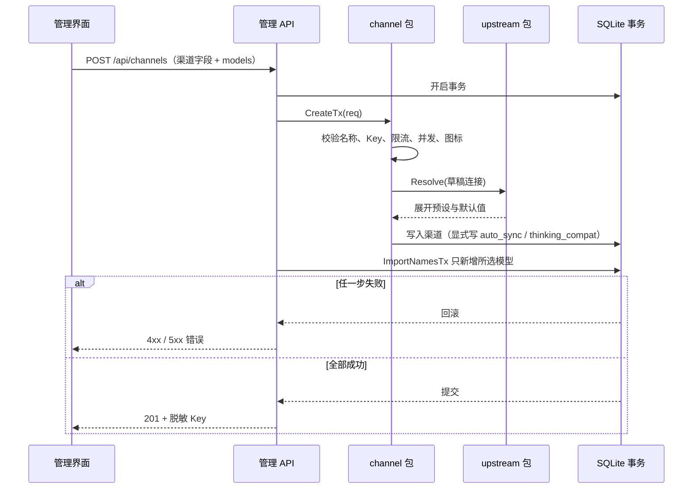
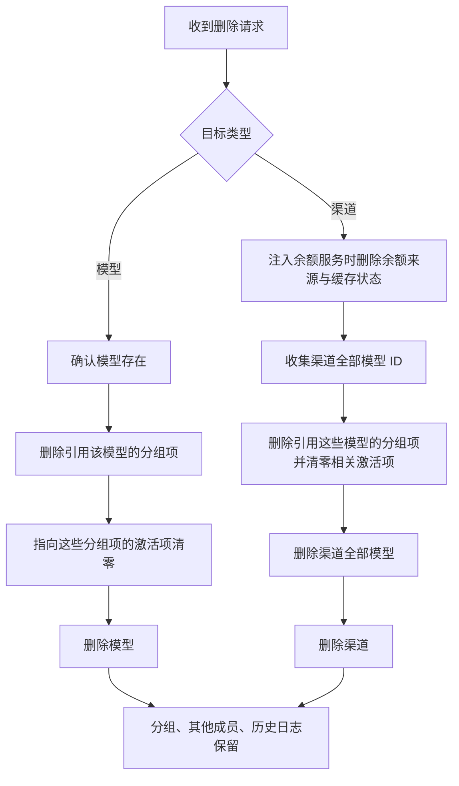

# 渠道、模型与分组

> 说明渠道接入与连接解析、模型导入和同步、分组策略与删除级联；不执行实际转发、余额查询和日志查询。

## 概述

本页覆盖管理面 `/api` 中渠道、模型、分组三类资源的当前实现规则：渠道保存一个上游账户的连接配置与凭据；模型是归属渠道的上游资源目录，按 `(channel_id, name)` 唯一；分组把多个渠道模型聚合成客户端可见的 `model` 名称，并配置 `manual` 或 `failover` 路由策略。`backend/router` 只负责把分组解析为有序目标列表，实际转发、协议转换和失败重试由网关执行。

本页直接负责：

- 渠道 CRUD、连接预设解析、保存渠道时选择性导入模型。
- 模型的批量导入、上游同步、手动增删改与分页查询。
- 分组 CRUD、成员优先级、手动激活项与故障转移顺序。
- 模型／渠道删除影响预览，以及删除时的分组成员、激活项和余额来源级联清理。
- `router.Resolve` 的只读选路解析。

不负责或需要到其他页面查看：

- `/v1` 鉴权、目标循环、重试与故障转移执行、限流冷却、熔断、并发准入：见[网关转发与保护](网关转发与保护.md)。
- 请求与响应的字段转换、流式事件和思考能力映射：见[协议转换与流式交付](协议转换与流式交付.md)。
- 余额查询的网络执行、适配器、缓存与调度：本页只在渠道 Key 变更或渠道删除时触碰余额来源生命周期，详见[余额与额度](余额与额度.md)。
- 调用日志与上游尝试的写入、查询和保留：删除资源不会删除历史记录，详见[调用观测与日志](调用观测与日志.md)。
- 管理 API 的本机回环限制、启动迁移、数据库与定时任务装配：见[运行入口与基础设施](运行入口与基础设施.md)。
- 页面、导航、删除确认弹窗与请求层：见[管理界面与请求层](管理界面与请求层.md)。

产品不提供价格、默认价格或费用计算；模型表中的 `price` / `currency` 列只为历史数据兼容保留，`json:"-"` 且在模型响应中隐藏（[Model](../../../backend/model/model.go#L14)）。术语口径见[核心概念](../核心概念.md)，完整请求链路见[一次请求的生命周期](../指南/请求生命周期.md)。

## 核心流程

### 渠道保存与连接解析

新建渠道由 `POST /api/channels` 处理：请求体同时包含渠道字段和可选的 `models` 数组。API 在单个事务中先调用 `channel.CreateTx`，再调用 `model.ImportNamesTx` 导入所选模型；任一步失败都会回滚，成功返回 `201` 和脱敏后的渠道响应（[createChannel](../../../backend/api/channel.go#L59)、[事务范围](../../../backend/api/channel.go#L69)）。

`CreateTx` 的校验顺序固定：名称和 Key 去空格后非空、限流范围、并发上限、图标，然后 `upstream.Resolve` 展开预设；上述字段或连接校验失败返回 `400`，数据库唯一冲突另行映射为 `409`（[CreateTx](../../../backend/channel/service.go#L131)、[字段校验](../../../backend/channel/service.go#L132)、[连接解析](../../../backend/channel/service.go#L141)）。写入时先按 `auto_sync=true`、`thinking_compat=true` 建实体，再由显式请求值覆盖；`model_discovery=manual` 会把 `auto_sync` 强制为 `false`（[默认值](../../../backend/channel/service.go#L145)、[manual 强制关闭](../../../backend/channel/service.go#L153)）。

GORM 的 `default:true` 会覆盖显式写入的 `false`，所以创建路径先 `Omit("AutoSync", "ThinkingCompat")`，再用 `Updates` 显式写回两个布尔值（[写入 workaround](../../../backend/channel/service.go#L156)）。`CreateTx` / `UpdateTx` 都接收调用方的 `*gorm.DB`，自身不开启事务；`Create` / `Update` 只是各自开启事务的便利包装（[Create](../../../backend/channel/service.go#L125)、[Update](../../../backend/channel/service.go#L200)）。

Key 只在响应中脱敏：长度不超过 8 时返回 `****`，否则保留前 4 位和后 4 位（[maskKey](../../../backend/channel/service.go#L91)）。列表和详情都经 `ToResponse` 输出脱敏值（[ToResponse](../../../backend/channel/service.go#L72)）。

编辑渠道由 `PUT /api/channels/:id` 处理。API 先在事务内读取旧 Key，用于判断凭据是否变化（[updateChannel](../../../backend/api/channel.go#L85)、[读取旧 Key](../../../backend/api/channel.go#L102)）。`UpdateTx` 只应用非 `nil` 字段：

- 显式传入空 `base_url`（去空格后为空）直接返回 `400`“API 根地址不能为空”（[UpdateTx](../../../backend/channel/service.go#L206)）。
- 空 Key 表示保留原凭据；若连接字段发生变化且最终 Key 为空，则返回 `400`（[连接叠加与校验](../../../backend/channel/service.go#L243)）。
- 名称去空格后为空返回 `400`，但存储的是请求原值（[名称检查](../../../backend/channel/service.go#L240)）。
- 只有连接配置实际变化时才重新 `Resolve`，纯名称、限流、并发等元数据编辑不会因历史地址被再次拦截（[条件校验](../../../backend/channel/service.go#L243)）。
- Key 变化且注入了余额服务时，`quota.InvalidateInheritedSourcesTx` 对继承渠道凭据的来源递增 `config_revision` 并删除缓存状态；事务提交后再取消该渠道进行中的余额查询（[余额来源失效](../../../backend/api/channel.go#L112)、[提交后取消](../../../backend/api/channel.go#L124)）。
- 同一事务内 `ImportNamesTx` 只新增本次 `models` 中的模型；未勾选的既有模型不会被删除（[模型导入](../../../backend/api/channel.go#L117)）。

渠道字段的当前规则：

| 字段 | 规则 |
|---|---|
| `name` | 创建和更新都要求去空格后非空；存储原值；数据库唯一，冲突映射为 `409`（[Channel](../../../backend/channel/channel.go#L11)） |
| `key` | 创建要求去空格后非空；更新时空字符串保留原值；连接变化后最终 Key 不能为空；响应只返回脱敏值 |
| `rate_limit_scope` | 空值归一化为 `model`，只接受 `model` / `channel`（[NormalizeRateLimitScope](../../../backend/channel/channel.go#L58)） |
| `max_concurrent_requests` | `0` 表示不限制渠道并发；必须非负且不超过 `9007199254740991`（[ValidMaxConcurrentRequests](../../../backend/channel/channel.go#L43)） |
| `icon` | 空值跟随厂商；内置名称匹配 `[a-z0-9][a-z0-9_-]{0,63}`（只校验格式，不校验是否存在于前端图标集）；自定义图标仅接受不超过 64 KiB、宽高 1–256 的 PNG data URI（[validateIcon](../../../backend/channel/icon.go#L23)） |
| `auto_sync` | 默认 `true`；显式 `false` 保留；`model_discovery=manual` 时强制 `false` |
| `thinking_compat` | 默认 `true`；显式 `false` 保留；实际垫片行为由网关和协议层消费，见[网关转发与保护](网关转发与保护.md) |
| `base_url` | 创建时为空则回落到预设默认地址（`generic` 没有默认地址，校验会失败）；更新时显式空值直接 `400`；统一去首尾空格和末尾 `/` 后交给 `validateRoot` |

#### 厂商预设与严格校验

`GET /api/upstream-presets` 直接返回 `upstream.Presets()`（[listUpstreamPresets](../../../backend/api/channel_connection.go#L79)、[Presets](../../../backend/upstream/presets.go#L25)）。目录每次调用返回独立切片，调用方修改不会影响其他渠道。当前预设与配置档：

| 预设 ID | 名称 | 配置档 | 默认档 |
|---|---|---|---|
| `generic` | 通用兼容服务 | `chat`、`responses`、`messages`、`generate_content` | `chat` |
| `openai` | OpenAI | `chat`、`responses` | `chat` |
| `anthropic` | Anthropic | `messages` | `messages` |
| `gemini` | Gemini | `generate_content` | `generate_content` |
| `deepseek` | DeepSeek | `chat` | `chat` |
| `openrouter` | OpenRouter | `chat` | `chat` |
| `siliconflow` | SiliconFlow | `chat` | `chat` |

所有配置档当前都使用 `adapter_id=generic` 和 `model_discovery=api`；`generic` 的四个配置档没有默认 `base_url`，其余预设带官方 API 根地址。预设还包含 `help` 与 `source_url`，但只提供配置参考，不代表账号可用或已经做过真实调用验证（[预设表](../../../backend/upstream/presets.go#L43)）。

`upstream.Resolve` 是新建和连接变更时的严格校验入口（[Resolve](../../../backend/upstream/connection.go#L41)）：

1. `provider_id` 为空按 `generic`；未知预设返回“未知厂商预设”。
2. `profile_id` 非空时精确匹配；为空时优先取预设的 `default_profile`，若同时给了 `type` 则按协议匹配。找不到返回“未知或不兼容的厂商配置档”。
3. `type` 为空时取配置档协议；与配置档不一致返回“协议与厂商配置档不匹配”。
4. `adapter_id` 为空时取配置档值；与配置档不一致返回“连接适配器与配置档不匹配”。
5. `base_url` 为空时取配置档地址；随后去空格、去掉末尾 `/`，并执行 `validateRoot`。
6. `model_discovery` 为空时取配置档值；`normalizeOptions` 再校验协议、适配器、`schema_version` 和发现模式（[normalizeOptions](../../../backend/upstream/connection.go#L121)）。

`validateRoot` 拒绝以下地址形态（[validateRoot](../../../backend/upstream/connection.go#L101)）：

- 不是有效的 HTTP/HTTPS 地址、主机名为空或为 opaque URL。
- 含 URL 凭据（userinfo）、查询参数、强制查询 `?`、片段或任意位置的 `#`。
- 路径（转小写后）以 `/chat/completions`、`/responses`、`/messages`、`/models` 结尾。
- 路径包含 `:generatecontent` 或 `:streamgeneratecontent`。

`upstream.Open` 只做选项规范化和协议接入器构建，不重新套用厂商预设，也不对已保存地址执行新建校验（[Open](../../../backend/upstream/connection.go#L148)）。这样升级后历史渠道的请求地址不会被静默改写；`FetchModels` 在 `manual` 发现模式下直接返回错误（[FetchModels](../../../backend/upstream/connection.go#L159)）。

#### 草稿解析、模型预览与调用验证

三个接口共用 `connectionDraft`（[connectionDraft](../../../backend/api/channel_connection.go#L17)）。带 `channel_id` 时先读取已保存渠道，草稿可以省略 `key` 复用已存凭据；显式提供的字段覆盖草稿。对已存渠道显式传空 `base_url` 会直接 `400`（[草稿配置](../../../backend/api/channel_connection.go#L32)）。只有新建渠道或连接字段实际变化时才执行严格 `Resolve`，未修改连接的已存渠道保留历史地址行为（[strict 判定](../../../backend/api/channel_connection.go#L50)、[按需 Resolve](../../../backend/api/channel_connection.go#L63)）。

| 接口 | 行为 | 网络与落库 | 结果判断 |
|---|---|---|---|
| `POST /api/channels/resolve` | 解析草稿并返回白名单字段：协议、预设、配置档、适配器、脱敏地址、Chat URL、发现模式 | 不访问上游，不写数据库；不要求 Key | 成功 `200`；本地校验失败 `400`。响应不包含 Key（[resolveChannelConnection](../../../backend/api/channel_connection.go#L83)、[白名单](../../../backend/api/channel_connection.go#L95)） |
| `POST /api/channels/preview-models` | 打开连接并拉取上游模型列表，返回 `{models}` | 访问上游模型列表；不写模型表 | 最终连接必须有 Key（带 `channel_id` 时可复用已存凭据）；上游或发现阶段失败返回 `502` 和 `stage=model_discovery`（[previewChannelModels](../../../backend/api/channel.go#L170)、[502 分支](../../../backend/api/channel.go#L182)）。`manual` 发现模式在 `FetchModels` 内被拒绝，也走该 `502` 分支 |
| `POST /api/channels/test` | 对指定模型执行一次真实调用验证 | 访问上游；不写渠道、模型、正式日志或熔断状态 | 输入校验或草稿打开失败返回 `400`；进入探测后始终返回 HTTP `200`，必须看响应体的 `success`、`stage`、`message`、`status`（[testChannelConnection](../../../backend/api/channel_connection.go#L111)、[固定 200](../../../backend/api/channel_connection.go#L144)） |

调用验证的当前实现细节：

- 模型名去空格后不能为空、最长 512 字节；输出上限默认 32，允许 1–128（[参数校验](../../../backend/api/channel_connection.go#L127)）。
- 验证复用网关的 relay 装配与探测连接池，发送一个 OpenAI Chat 形态的最小请求，由目标渠道协议转换后发给上游；使用独立熔断器、内存日志和最多 25 秒的上游请求期限，不进入正式调用日志或路由诊断（[ProbeConnection](../../../backend/gateway/probe.go#L64)、[探测配置](../../../backend/gateway/probe.go#L44)）。
- 只有观察到有效输出和结束标记才把 `success` 置为 `true`；失败按 `stage` 区分输入、请求、上游、响应、超时和取消（[成功判定](../../../backend/gateway/probe.go#L102)、[失败分类](../../../backend/gateway/probe.go#L111)）。
- 验证可能消耗上游额度；通过一次验证不能推广到其他模型、其他响应模式或后续调用。

#### 三种验证的含义

| 操作 | 能证明什么 | 不能证明什么 |
|---|---|---|
| 连接解析（`/resolve`） | 本地字段合法，预设能展开，协议端点能构造 | 上游可达、凭据有效、模型可用 |
| 模型列表（`/preview-models`、同步） | 上游模型列表接口在本次请求中成功 | 有生成权限、能完成对话、列出的模型全部可用 |
| 调用验证（`/test`） | 指定模型在该响应模式下的一次真实调用成功 | 其他模型、其他响应模式或后续调用一定成功；验证可能产生上游费用 |

三者的含义不能互相替代，同步成功也不等于生成可用。

### 模型导入、同步与手动维护

模型实体通过 `(channel_id, name)` 唯一索引约束，同名模型可以存在于不同渠道（[Model](../../../backend/model/model.go#L14)）。`model.List` 支持按渠道和名称关键词过滤，名称匹配不区分大小写；默认第 1 页、每页 20 条，按 `lower(name), id` 排序（[List](../../../backend/model/service.go#L52)）。

`model.ImportNamesTx` 是渠道保存和模型同步共用的批量导入入口（[ImportNamesTx](../../../backend/model/import.go#L20)）：

- `channelID <= 0` 或名称数量超过 10000 时整批失败。
- 每个名称先去空格；空名称或超过 512 字节会让整批导入失败；同批次重复名称去重。
- 校验阶段先于写入；任一非法名称都返回 `400`，由调用方事务回滚。
- 写入前确认渠道存在，不存在返回 `400`。
- 使用 `ON CONFLICT (channel_id, name) DO NOTHING` 只新增，冲突不更新，保留既有 ID、分组引用和历史数据；分批大小为 100（[冲突处理](../../../backend/model/import.go#L47)）。
- 返回实际新增行数；`models` 为空数组表示本次不新增，更新时省略 `models` 同样不会删除既有模型。

手动模型接口：

| 操作 | 当前规则 |
|---|---|
| `POST /api/models` | 名称只检查非空字符串，不做 trim；渠道必须存在；同渠道同名由唯一索引返回 `409`（[Create](../../../backend/model/service.go#L86)） |
| `PUT /api/models/:id` | 仅应用非 `nil` 字段；名称显式空字符串 `""` 返回 `400`；渠道必须存在；改渠道后分组成员仍引用同一模型 ID，但实际路由目标随之改变（[Update](../../../backend/model/service.go#L105)） |
| `DELETE /api/models/:id` | 只暴露事务入口 `model.DeleteTx`；API 先确认模型存在（不存在 `404`），再清理分组项、清零相关激活项并删除模型（[deleteModel](../../../backend/api/model.go#L96)、[事务](../../../backend/api/model.go#L102)） |

模型同步入口与规则：

| 入口 | 行为 |
|---|---|
| `POST /api/channels/:id/sync` | 读取已保存渠道，拉取上游模型并只新增缺失项，返回 `{added}`（[syncChannelModels](../../../backend/api/channel.go#L190)） |
| `POST /api/settings/sync-now` | 调用 `model.SyncAutoChannels`，返回成功渠道数、新增模型数，并记录最近同步时间（[syncAllChannels](../../../backend/api/setting.go#L62)） |
| 后台定时任务 | 每分钟检查一次，达到全局 `sync_interval` 才执行与“立即同步”相同的逻辑；`0` 表示关闭（[syncTick](../../../backend/cron/cron.go#L37)） |

`model.SyncFromChannelContext` 先用保存的连接配置 `upstream.Open`，再请求上游模型列表，最后在一个事务中导入（[SyncFromChannelContext](../../../backend/model/sync.go#L21)）。`model_discovery=manual` 的渠道在发起网络请求前就返回 `400`（[manual 拒绝](../../../backend/model/sync.go#L25)）。`SyncAutoChannels` 跳过 `auto_sync=false` 和 `manual` 的渠道；单个渠道失败只记录日志并继续，返回的 `synced` 统计成功完成同步的渠道数，即使本次新增为 0（[SyncAutoChannels](../../../backend/model/sync.go#L50)）。

同步只新增，不删除上游已消失的模型，不更新已有模型，也不执行生成验证。同步失败、列表成功都只说明对应阶段的结果，不能替代调用验证。

### 分组与路由策略

分组是客户端请求中的 `model` 名称。`Group.Name` 唯一，`Strategy` 为 `manual` 或 `failover`；`ActiveItemID` 指向 `GroupItem.ID`（不是 `ModelID`），只在 `manual` 策略下参与选路（[Group](../../../backend/group/group.go#L24)、[Strategy](../../../backend/group/group.go#L6)）。分组项通过 `ModelID` 引用模型，对 `(group_id, model_id)` 唯一，`Priority` 供 `failover` 排序；`ModelName` / `ChannelID` 由关联查询读取，不写入分组项（[GroupItem](../../../backend/group/group.go#L35)）。

创建分组由 `group.Create` 完成（[Create](../../../backend/group/service.go#L115)）：

- 名称只检查非空字符串，不 trim；策略必须合法。
- `active_model_id` 非 0 时只允许 `manual`，且必须出现在本次 `items` 中（[激活模型校验](../../../backend/group/service.go#L119)）。
- 所有 `items.model_id` 必须存在，否则返回 `400`；存在性预校验在事务外执行（[模型预校验](../../../backend/group/service.go#L134)）。
- 事务内依次创建分组、成员和初始激活项；同一模型重复出现在 `items` 中会触发唯一索引冲突并整体回滚（[事务](../../../backend/group/service.go#L145)）。
- `items` 可以为空，创建空分组；未提供 `active_model_id` 或显式传 0 时保持未激活，兼容旧客户端。

更新分组与成员操作的当前规则：

| 操作 | 当前规则 |
|---|---|
| `group.Update` | 只应用非 `nil` 的 `name`、`strategy`、`active_item_id`；名称显式空字符串 `""` 返回 `400`（不做 trim）；策略必须合法；激活项非 0 时必须属于该分组（[Update](../../../backend/group/service.go#L170)、[归属校验](../../../backend/group/service.go#L188)）。更新接口不按策略限制激活项，切换 `manual` / `failover` 也不会清空已有激活项；`failover` 路由不使用该字段 |
| `group.Delete` | 在一个事务中删除分组项和分组；不删除模型（[Delete](../../../backend/group/service.go#L200)） |
| `group.AddItem` | 校验分组和模型存在后创建成员；重复模型由唯一索引返回 `409`（[AddItem](../../../backend/group/service.go#L210)） |
| `group.UpdateItem` | 只更新 `priority`，成员必须属于路径中的分组（[UpdateItem](../../../backend/group/service.go#L230)） |
| `group.DeleteItem` | 按分组和成员 ID 删除一行，不检查影响行数，也不清空 `ActiveItemID`（[DeleteItem](../../../backend/group/service.go#L245)） |

`group.DeleteItem` 的这一行为是已知差异：手动删除当前激活成员后，分组的 `active_item_id` 仍指向已删除行；`manual` 分组随后解析为 `ErrNoActiveItem`。通过删除模型或渠道触发的级联则会清零相关激活项。列表和详情按 `priority`、成员 ID 升序加载成员及模型元数据（[itemsWithMetadata](../../../backend/group/service.go#L269)）。

`router.Resolve` 在请求时把分组解析为目标列表（[Resolve](../../../backend/router/router.go#L26)）：

- 分组没有任何成员行时返回 `ErrEmptyGroup`。
- `manual`：只查找 `ID == ActiveItemID` 的成员并解析其模型和渠道；找不到激活项返回 `ErrNoActiveItem`，其他成员即使是悬挂引用也不影响本次解析。
- `failover`：复制全部成员并按 `priority` 升序、同优先级按成员 ID 升序稳定排序，逐项解析为 `Target{Model, Channel}`；任一成员引用的模型或渠道不存在都会让整个解析失败，不会跳过该成员。
- 未知策略返回错误；`router.Resolve` 只读数据库，不访问网络，也不执行重试或故障转移。

启动时 `group.MigrateLegacyStrategies` 会把历史 `round_robin` 策略改为 `failover`，保留成员优先级、激活项和时间戳，重复执行无额外变更（[MigrateLegacyStrategies](../../../backend/group/migrate.go#L7)）。创建和更新接口仍只接受 `manual` / `failover`。

### 删除影响预览与事务级联

模型和渠道删除前提供只读影响预览：

| 接口 | 目标校验 | 响应字段 |
|---|---|---|
| `GET /api/models/:id/deletion-impact` | 模型必须存在，否则 `404`；非整数 ID 返回 `400` | 仅 `groups`（[previewModelDeletionImpact](../../../backend/api/deletion_impact.go#L25)） |
| `GET /api/channels/:id/deletion-impact` | 渠道必须存在，否则 `404` | `groups`、`model_count`、`has_quota_source`（[previewChannelDeletionImpact](../../../backend/api/deletion_impact.go#L46)） |

影响项字段（[DeletionImpact](../../../backend/group/deletion_impact.go#L6)）：

| 字段 | 含义 |
|---|---|
| `group_id`、`name`、`strategy` | 受影响分组及其策略 |
| `removed_item_ids` | 将随目标删除的分组项 ID，按 ID 升序 |
| `clears_active` | 分组当前 `active_item_id` 是否非 0 且指向将被删除的成员；不区分策略 |
| `becomes_empty` | 删除后该分组是否不再有任何分组项行 |
| `model_count` | 渠道下全部模型数量，不只统计被分组引用的模型 |
| `has_quota_source` | 渠道是否存在余额查询来源；只有注入了 `quota_service` 且配额表存在时才计算，否则为 `false` |

`group.PreviewDeletionImpact` 只读，不开启事务、不写表；命中引用时最多执行三次查询（目标模型的分组项、这些分组、这些分组的全部成员），查询次数不随分组数量增加；无影响时返回 `[]` 而非 `null`（[PreviewDeletionImpact](../../../backend/group/deletion_impact.go#L18)）。空组判断统计全部成员行，包括引用已缺失模型的历史悬挂项，因此残留悬挂成员时 `becomes_empty=false`。`has_quota_source` 与删除路径使用同一判断：只有实际注入了余额服务时删除才会清理来源，预览不会承诺删除路径不会执行的动作（[配额判断](../../../backend/api/deletion_impact.go#L70)）。

预览只是只读快照，不是锁或删除前置条件；直接调用 `DELETE` 仍会级联，预览后并发修改可能使展示过期，也不会在删除时二次核对预览结果。

删除模型在单个事务中执行：先确认模型存在（不存在 `404`），再 `group.DeleteItemsByModelIDsTx` 清理引用它的分组项并清零相关激活项，最后 `model.DeleteTx` 删除模型（[deleteModel](../../../backend/api/model.go#L96)、[级联清理](../../../backend/api/model.go#L107)）。

删除渠道在单个事务中执行（[deleteChannel](../../../backend/api/channel.go#L130)）：

1. 若注入了余额服务，先 `quota.DeleteByChannelTx` 删除该渠道的余额来源及其缓存状态（[余额来源清理](../../../backend/api/channel.go#L138)、[DeleteByChannelTx](../../../backend/quota/repository.go#L23)）。
2. 收集该渠道全部模型 ID（[模型 ID](../../../backend/api/channel.go#L144)）。
3. `group.DeleteItemsByModelIDsTx` 跨分组删除引用这些模型的分组项，并把指向这些分组项的 `active_item_id` 清零（[分组清理](../../../backend/api/channel.go#L147)）。
4. 删除该渠道全部模型，再删除渠道本身（[模型删除](../../../backend/api/channel.go#L150)、[渠道删除](../../../backend/api/channel.go#L153)）。
5. 事务提交后取消该渠道进行中的余额查询（[取消查询](../../../backend/api/channel.go#L159)）。

`DeleteItemsByModelIDsTx` 在模型 ID 或引用为空时直接返回；否则先收集分组项 ID，把 `active_item_id IN (这些 ID)` 的分组清零，再删除这些分组项（[DeleteItemsByModelIDsTx](../../../backend/group/service.go#L251)）。它不会调整剩余成员的 `priority`，也不会删除分组。

| 对象 | 删除模型 | 删除渠道 |
|---|---|---|
| 目标模型 | 删除 | 删除该渠道全部模型 |
| 引用目标的分组成员 | 删除 | 删除引用这些模型的分组成员 |
| 分组 | 保留，即使变空 | 保留，即使变空 |
| 同组其他成员 | 保留，优先级不变 | 保留，优先级不变 |
| `active_item_id` | 仅当指向被删成员时清零 | 同左 |
| 历史调用日志、上游尝试 | 保留 | 保留 |
| 余额来源 | 不涉及 | 注入余额服务时删除 |

删除分组只移除分组及其成员关联，不删除渠道模型，因此没有删除影响预览。删除不存在的渠道、分组或分组项当前返回 `200`（级联语句为空操作，不检查影响行数）；删除不存在的模型返回 `404`。

### 错误与结果语义

管理 API 统一经 `respondError` / `classifyError` 映射错误（[classifyError](../../../backend/api/api.go#L47)）：

| 场景 | 状态码与表现 |
|---|---|
| 路径 ID 非整数、请求体绑定失败、字段校验失败、`Resolve` 失败 | `400`，返回具体中文消息 |
| 目标记录不存在（渠道/模型/分组 GET、更新、草稿加载、删除预览） | `404`“记录不存在” |
| 业务引用校验失败（导入时渠道不存在、分组项模型不存在） | `400`，返回具体中文消息 |
| 渠道名、分组名或手动创建模型时的同渠道同名 | `409`“记录已存在”；当前依赖 SQLite 的 `UNIQUE constraint failed` 文本识别（[isUniqueViolation](../../../backend/api/api.go#L68)） |
| 模型预览时上游列表或发现阶段失败 | `502`，`stage=model_discovery` |
| 渠道同步时上游请求失败 | 未被特殊分类，落到 `500`“内部错误”；`manual` 发现模式返回 `400` |
| 调用验证输入不合法或草稿打开失败 | `400`；进入探测后的验证结果始终是 HTTP `200`，需看 `success` |
| 删除不存在的模型 | `404` |
| 删除不存在的渠道、分组或分组项 | `200` 空操作 |

## 关键实现

| 职责 | 位置 |
|---|---|
| 渠道实体、并发上限、限流范围与连接配置读取 | [Channel](../../../backend/channel/channel.go#L11)、[ConnectionConfig](../../../backend/channel/channel.go#L48) |
| 渠道创建事务入口、默认值与 Key 脱敏 | [CreateTx](../../../backend/channel/service.go#L131)、[maskKey](../../../backend/channel/service.go#L91) |
| 渠道更新、空 Key 保留、显式空 `base_url` 拒绝 | [UpdateTx](../../../backend/channel/service.go#L206)、[OverlayConnection](../../../backend/channel/service.go#L170) |
| 图标格式与大小校验 | [validateIcon](../../../backend/channel/icon.go#L23) |
| 厂商预设目录 | [Presets](../../../backend/upstream/presets.go#L25) |
| 严格连接解析与地址校验 | [Resolve](../../../backend/upstream/connection.go#L41)、[validateRoot](../../../backend/upstream/connection.go#L101) |
| 运行时连接构建与模型获取 | [Open](../../../backend/upstream/connection.go#L148)、[FetchModels](../../../backend/upstream/connection.go#L159) |
| 草稿解析、模型预览、调用验证 | [connectionDraft](../../../backend/api/channel_connection.go#L17)、[testChannelConnection](../../../backend/api/channel_connection.go#L111) |
| 模型唯一索引与历史计价列 | [Model](../../../backend/model/model.go#L14) |
| 批量导入、整批校验、冲突 DO NOTHING | [ImportNamesTx](../../../backend/model/import.go#L20) |
| 模型分页查询与手动 CRUD | [List](../../../backend/model/service.go#L52)、[Create](../../../backend/model/service.go#L86)、[Update](../../../backend/model/service.go#L105) |
| 模型同步与自动同步 | [SyncFromChannelContext](../../../backend/model/sync.go#L21)、[SyncAutoChannels](../../../backend/model/sync.go#L50) |
| 分组策略与成员实体 | [Strategy](../../../backend/group/group.go#L6)、[GroupItem](../../../backend/group/group.go#L35) |
| 分组创建、更新、成员操作 | [Create](../../../backend/group/service.go#L115)、[Update](../../../backend/group/service.go#L170)、[DeleteItem](../../../backend/group/service.go#L245) |
| 删除级联清理与激活项清零 | [DeleteItemsByModelIDsTx](../../../backend/group/service.go#L251) |
| 删除影响预览 | [PreviewDeletionImpact](../../../backend/group/deletion_impact.go#L18) |
| 删除预览与渠道级联 API | [previewChannelDeletionImpact](../../../backend/api/deletion_impact.go#L46)、[deleteChannel](../../../backend/api/channel.go#L130) |
| manual / failover 目标解析 | [Resolve](../../../backend/router/router.go#L26)、[resolveTarget](../../../backend/router/router.go#L64) |
| 管理 API 路由与错误映射 | [registerChannelRoutes](../../../backend/api/channel.go#L17)、[registerGroupRoutes](../../../backend/api/group.go#L13)、[classifyError](../../../backend/api/api.go#L47) |

## 配置与扩展

本页涉及的配置都是请求字段或数据库列，没有独立的环境变量。关键默认值：

| 键 | 默认值或规则 |
|---|---|
| `provider_id` | 空值按 `generic`；必须是 `Presets()` 中存在的预设 ID |
| `profile_id` | 空值按预设 `default_profile`；同时有 `type` 时按协议匹配；非空时精确匹配 |
| `adapter_id` | 空值取配置档值；当前只接受 `generic` |
| `type` | 空值取配置档协议；必须与配置档一致 |
| `base_url` | 空值取配置档地址；去首尾空格和末尾 `/`；必须通过 `validateRoot` |
| `connection_options.schema_version` | 0 视作 1；当前只接受 1 |
| `connection_options.model_discovery` | 空值取配置档值（当前预设均为 `api`）；只接受 `api` / `manual` |
| `auto_sync` | `true`；`manual` 发现模式强制 `false` |
| `thinking_compat` | `true` |
| `rate_limit_scope` | 空值归一化为 `model`；只接受 `model` / `channel` |
| `max_concurrent_requests` | `0` 表示不限制；上限 `9007199254740991` |
| `icon` | 空值跟随厂商；内置名称或不超过 64 KiB、1–256 像素的 PNG data URI |

扩展点与边界：

- 新增厂商或配置档时修改 `upstream.Presets()`：增加 `Preset` 和 `Profile`，填写协议、默认地址、`adapter_id`、`model_discovery`、帮助文本和可选的 `source_url`。预设只影响新建和连接变更时的默认展开，不会在运行时重新套用到已保存渠道。
- 新增预设不等于新增协议能力。当前 `normalizeOptions` 只接受 `adapter_id=generic`，新适配器需要同时扩展协议接入器和校验；否则会被“未知连接适配器”拒绝。
- 新增模型发现模式需要同步修改 `normalizeOptions` 的枚举、`FetchModels` 的行为，以及 `auto_sync` 的强制规则。
- 旧版 `round_robin` 策略由启动迁移收敛为 `failover`；新代码不应再接受轮询、权重或费用路由。
- 模型历史价格、货币和费用列不参与当前管理接口与统计；不要把它们重新暴露为活跃配置。

## 修改须知

- **保持事务边界**：`CreateTx`、`UpdateTx`、`DeleteTx`、`ImportNamesTx`、`DeleteItemsByModelIDsTx` 都接收调用方的 `*gorm.DB`。渠道保存、模型导入、余额来源失效或清理必须落在同一个事务中；不要在事务内发起无法回滚的网络请求。
- **保留默认值 workaround**：创建渠道时 `Omit("AutoSync", "ThinkingCompat")` 后再 `Updates` 是为了让显式 `false` 不被 GORM `default:true` 覆盖；改成普通 `Create` 会把用户关闭的开关重新打开。
- **更新只按需校验连接**：`UpdateTx` 仅在连接字段实际变化时重新 `Resolve`。改成无条件校验会让历史渠道的旧地址无法编辑；同时保留空 Key 保留原凭据、显式空 `base_url` 返回 `400` 的语义。修改 `type` 且未显式提供 `profile_id` 时会清空旧配置档，由协议重新匹配（[OverlayConnection](../../../backend/channel/service.go#L170)）。
- **导入必须只新增**：`ImportNamesTx` 的“先整批校验、再 `ON CONFLICT DO NOTHING`”保证冲突不会覆盖既有 ID、分组引用和历史数据。改成 upsert 会覆盖既有记录，破坏保留 ID、分组引用和历史数据的约束。
- **唯一冲突的错误映射**：渠道名、分组名和同渠道模型名的 `409` 依赖 SQLite 错误文本；切换 MySQL/PostgreSQL 时需要补充数据库特定判断，否则会落到 `500`。
- **删除级联的清理范围**：`DeleteItemsByModelIDsTx` 只能删除引用目标的分组项并清零命中激活项；不要删除分组、重排剩余成员优先级或改动其他渠道成员。删除分组时也不要误删模型。
- **手动删除成员的已知行为**：`DeleteItem` 不会清空 `ActiveItemID`，与模型/渠道删除时的自动清零不同。若要修改，需要同时确认 `router.Resolve` 的 `ErrNoActiveItem` 语义和管理界面的“配置不完整”提示。
- **预览与删除的条件必须一致**：`has_quota_source` 与渠道删除是否清理余额来源使用同一个 `quota_service` 注入判断；不要在预览中承诺删除不会执行的动作，也不要在未注入服务时让预览报告存在来源。
- **路由解析的失败策略**：`failover` 遇到任何悬挂成员会让整个解析失败，`manual` 只解析激活项。若改成静默跳过，会改变网关的候选列表和错误表现，需同步网关页面与测试。
- **同步不等于验证**：同步只新增模型，不删除、不更新、不执行生成验证；不要把 `added` 数量或列表成功当作模型可调用。
- **相关测试**：`backend/channel/service_connection_test.go`、`backend/channel/concurrency_test.go`、`backend/channel/icon_test.go`、`backend/api/channel_test.go`、`backend/api/channel_connection_test.go`、`backend/api/deletion_impact_test.go`、`backend/api/group_creation_test.go`、`backend/api/group_strategy_test.go`、`backend/group/deletion_impact_test.go`、`backend/model/import_test.go`、`backend/model/sync_test.go`、`backend/router/router_test.go`。修改后至少执行 `go test ./...` 和 `go vet ./...`。

## 未解决问题

- **唯一冲突识别依赖 SQLite 文本**：`classifyError` 通过 `UNIQUE constraint failed` 判断 `409`。项目保留切换 MySQL/PostgreSQL 的能力，换库后同一冲突可能落为 `500`，需要补数据库特定错误映射。
- **手动删除激活成员留下悬挂引用**：`group.DeleteItem` 不清空 `ActiveItemID`，而删除模型/渠道会清零。是否应统一语义、禁止删除当前激活项，还是继续由前端提示“配置不完整”，需要产品确认。
- **删除预览不是一致性保证**：预览只读且不加锁，预览后并发修改可能使结果过期；绕过前端的直接 `DELETE` 仍会执行级联。当前实现不把预览当作删除前置条件。
- **模型预览对 `manual` 发现返回 `502`**：`preview-models` 在 `FetchModels` 内拒绝手动发现，走 `stage=model_discovery` 的 `502`；同步接口对同一条件返回 `400`。两处错误码是否应统一需要确认。
- **分组创建的模型存在性预校验在事务外**（推断：`GroupItem.ModelID` 未声明指向 `models` 的外键约束）：并发删除模型与创建分组之间没有锁，可能留下悬挂分组项。是否需要事务内复查或外键约束取决于并发假设与数据库选型。

来源

- [backend/channel/channel.go](../../../backend/channel/channel.go)
- [backend/channel/service.go](../../../backend/channel/service.go)
- [backend/upstream/presets.go](../../../backend/upstream/presets.go)
- [backend/upstream/connection.go](../../../backend/upstream/connection.go)
- [backend/model/model.go](../../../backend/model/model.go)
- [backend/model/service.go](../../../backend/model/service.go)
- [backend/model/import.go](../../../backend/model/import.go)
- [backend/model/sync.go](../../../backend/model/sync.go)
- [backend/group/group.go](../../../backend/group/group.go)
- [backend/group/service.go](../../../backend/group/service.go)
- [backend/group/deletion_impact.go](../../../backend/group/deletion_impact.go)
- [backend/router/router.go](../../../backend/router/router.go)
- [backend/api/channel.go](../../../backend/api/channel.go)
- [backend/api/channel_connection.go](../../../backend/api/channel_connection.go)
- [backend/api/model.go](../../../backend/api/model.go)
- [backend/api/group.go](../../../backend/api/group.go)
- [backend/api/deletion_impact.go](../../../backend/api/deletion_impact.go)

以当前工作区 HEAD `3d63c30` 的源码静态核对；2026-10-30 已实际执行并通过 `go test ./...`、`go vet ./...`、前端 245 项测试与 `pnpm typecheck`；未启动桌面、未访问真实上游。

