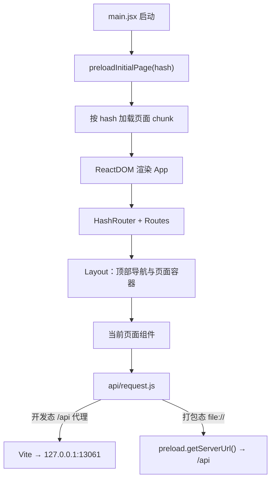

# 管理界面与请求层

> 说明 React 渲染层的路由、API 请求与缓存、删除影响确认和客户端接入页面；不替代后端接口契约与桌面主进程生命周期。

## 概述

渲染层是 Portunus 的管理界面，运行在 Electron 窗口内（开发态由 Vite 提供，打包态从 `file://` 加载）。它只通过 HTTP 调用本机 `/api`，不承担模型路由、协议转换或后端写入；与主进程的交互仅限 `window.api` 暴露的固定 IPC 能力（更新、网络模式、客户端配置、外部链接）。

当前主导航六个页面：渠道、模型、分组、日志、接入、设置。默认进入 `/channels`；页面按 hash 路由懒加载，空闲时预加载其余页面。界面没有 `window.api` 时仍可在浏览器预览中挂载，但更新、客户端配置写盘等桌面能力不可用。

## 核心流程

请求层行为：

1. `api/request.js` 以页面协议区分地址：开发态 `http:` 使用 `baseURL='/api'`，由 Vite 代理到 Dev 后端；打包态 `file:` 从 `window.api.getServerUrl()` 取地址，使用 `<serverUrl>/api`。
2. 所有请求统一加 `X-Portunus-Local: 1`，超时 30 秒；GET 响应进入内存缓存，写操作成功后失效缓存（预览/测试类接口除外）。
3. 只对“请求未到达后端”的 `ERR_NETWORK` / `Network Error` 做有限静默重试，固定 500ms、最多 5 次失败判定；超时、取消和已拿到 HTTP 响应的错误不重试。
4. 业务错误默认 toast 并 reject；调用方可用 `__silentError` 关闭提示。

## 关键实现

| 职责 | 位置 |
|---|---|
| 启动前预加载当前页面 | [`preloadInitialPage`](../../../web/src/renderer/App.jsx#L9)、[`main.jsx`](../../../web/src/renderer/main.jsx#L1) |
| 路由与页面懒加载 | [`App.jsx`](../../../web/src/renderer/App.jsx#L28)、[`pageResources.js`](../../../web/src/renderer/pageResources.js#L13) |
| 顶部导航与布局 | [`Layout.jsx`](../../../web/src/renderer/components/Layout.jsx#L23)、[导航表](../../../web/src/renderer/components/Layout.jsx#L15) |
| API 实例、缓存与重试 | [`request.js`](../../../web/src/renderer/api/request.js#L18)、[响应拦截器](../../../web/src/renderer/api/request.js#L40) |
| 删除影响状态机 | [`createDeletionImpactController`](../../../web/src/renderer/utils/deletionImpact.js#L102)、[`normalizeDeletionImpact`](../../../web/src/renderer/utils/deletionImpact.js#L29) |
| 删除影响展示 | [`DeletionImpactBody`](../../../web/src/renderer/components/DeletionImpactBody.jsx#L9) |
| 渠道页 | [`Channels`](../../../web/src/renderer/pages/Channels/index.jsx#L24) |
| 模型页 | [`Models`](../../../web/src/renderer/pages/Models/index.jsx#L16) |
| 分组页 | [`Groups`](../../../web/src/renderer/pages/Groups/index.jsx#L38) |
| 日志页 | [`Logs`](../../../web/src/renderer/pages/Logs.jsx#L22) |
| 接入页 | [`Clients`](../../../web/src/renderer/pages/Clients/index.jsx#L28) |
| Claude Code 配置面板 | [`ClaudeConfigPanel`](../../../web/src/renderer/pages/Clients/ClaudeConfigPanel.jsx#L31)、[`claudeConfig.js`](../../../web/src/renderer/utils/claudeConfig.js#L6) |
| 设置页 | [`Settings`](../../../web/src/renderer/pages/Settings.jsx#L13) |

## 路由、页面资源与导航

- `App.jsx` 使用 `HashRouter`；`/` 重定向到 `/channels`。六个页面由 `pageIds` 生成路由，没有通配符兜底。
- `main.jsx` 在 React 渲染前调用 `preloadInitialPage(window.location.hash)`，先加载当前 hash 对应的页面 chunk，避免冷启动先显示 Suspense；未知 hash 在这里只回退预加载 `channels`。
- `pageResources.js` 维护页面加载器和已加载缓存；`warmPages` 在空闲时预加载其余页面，导航悬停/聚焦时也会 `preparePage`。
- `Layout.jsx` 的导航表固定六个入口，页面切换前经过 `navGuard`：页面注册了未保存数据时，切页会被拦截并弹出确认。
- 路由表没有未知路径的兜底组件；当前源码只保证初始预加载回退到 `channels`。

## 删除影响确认

渠道和模型删除前会先请求只读影响预览：

- 渠道：`GET /api/channels/:id/deletion-impact`，返回受影响分组、渠道模型数 `model_count`、是否有余额来源 `has_quota_source`。
- 模型：`GET /api/models/:id/deletion-impact`，返回受影响分组、移除成员、手动选定项清除标记和是否变空。
- 分组删除目前是普通确认弹窗，不调用影响预览；确认后删除分组，上游渠道和模型保留。

`deletionImpact.js` 的 `createDeletionImpactController` 负责状态机：

- `open(target)` 先置 `loading`，用 `AbortController` 加载；切换目标或关闭弹窗时递增 generation 并中止旧请求，迟到响应直接丢弃。
- 响应经 `normalizeDeletionImpact` 校验；分组字段缺失、类型不对，或渠道缺少模型数/余额来源时，按“影响不完整”报错，绝不把缺失当成 0 或“无引用”。
- 只有 `status === 'ready'` 且已有影响数据时才允许确认；`error` 状态下确认按钮禁用，界面提供“重试预览”。
- `confirm()` 使用预览时的 target 执行删除，防止弹窗打开期间换对象后删错；删除中禁止重复提交；删除成功才触发 `onDeleted` 和父页面刷新。
- `buildDeletionImpactView` 只展示后端给出的内容：受影响分组数、每组移除成员数、手动选定项清除、分组将变空；渠道额外展示模型数和余额来源提示。文案明确“分组名称和历史调用记录保留，手动选定项清除后不会自动补位”。

后端删除与级联清理逻辑见[渠道、模型与分组](渠道模型与分组.md)；本页只描述前端影响预览和确认边界。

## 客户端接入与 Claude Code 配置

「接入」页按职责分为 API Key 与接入指南：

- API Key 列表管理命名密钥：创建、改名、重置、启禁用和删除；历史列表可包含已删除 Key，但只返回 ID、名称、状态和时间。
- 接入指南展示网关地址、分组选择、选中令牌、监听范围、通用 API 示例和客户端配置说明；设置页提供跳转，不重复编辑令牌与监听范围。
- 桌面端额外提供 Claude Code 配置面板：读取 `<homeDir>/.claude/settings.json`，编辑连接字段和六个模型槽位，保存或从 `.portunus.bak` 回滚。该面板只在 `window.api.clientConfig` 存在时可用；浏览器预览会提示不可用。
- 面板打开时才读取当前文件；页面持有原始文本，表单修改写回文本，源码编辑器是唯一真相。未保存改动通过 `navGuard` 拦截顶部切页。
- 模型槽位只接受 `/v1` 中的分组列表；分组不存在时显示“分组不存在”并禁用该项。写入前由 `claudeConfig.js` 校验 JSON 顶层对象和字段形状。

主进程侧的写入、备份与原子替换见[桌面主进程与 sidecar](桌面主进程与sidecar.md#claude-code-客户端配置)。

## 日志与设置页面

- `Logs.jsx` 当前只调用 `listLogs` 和 `getLogStats`，提供 API Key、渠道、状态、分组、模型名五个筛选条件，点击“查询”一次性提交；页面没有时间范围、入口协议或请求 ID 输入框。
- 后端仍提供 `/api/logs/requests` 关联归并、`/api/logs/attempts` 尝试链和 `/api/logs/routing` 切换诊断；`LogDetailModal` 保留 `association` 展示分支，但当前页面不会传入关联项。详情中的尝试与诊断组件仍可使用。
- 统计卡显示“记录数”“近期记录”和 token/缓存用量；这些是日志行口径，不是客户端请求数。详见[调用观测与日志](调用观测与日志.md)。
- `Settings.jsx` 管理自动同步间隔、立即同步、日志保留天数和应用信息；令牌与监听范围在接入页，设置页只做跳转和展示。修改保留天数后，自动清理按 cron 的小时级周期生效。

## 配置与扩展

| 扩展点 | 做法 |
|---|---|
| 新增页面 | 在 `pageResources.js` 增加加载器并确保 `pageIds` 包含；在 `Layout.jsx` 导航表增加入口；路由由 `pageIds` 自动生成，无需改 `App.jsx` 的显式 Route 列表 |
| 新增 API 模块 | 在 `web/src/renderer/api/` 新建模块并复用 `request.js`；GET 自动进入缓存，写操作成功后统一失效 |
| 调整缓存/重试 | 修改 `responseCache`、`retryPolicy` 或拦截器；注意预览/测试类接口不应触发全局缓存失效 |
| 新增删除影响展示 | 更新 `normalizeDeletionImpact`、`assertDeletionImpactComplete` 与 `buildDeletionImpactView`，并在弹窗中复用 `DeletionImpactBody` |
| 调整 Claude 配置字段 | 同时修改 `claudeConfig.js` 的解析/写回、`ClaudeConfigPanel.jsx` 的表单和主进程 `client-config.js` 的保存校验 |
| 桌面能力 | 只通过 `window.api` 的固定方法；不要在渲染层直接访问 Node、文件系统或任意 IPC |

## 修改须知

- **页面资源与导航要同步**：只加页面文件而不改 `pageResources.js`/`Layout.jsx`，页面不会被路由或导航到。
- **删除确认不能放宽**：影响预览失败或字段缺失时必须阻止确认；不能把缺失字段降级为 0 或“无引用”。
- **请求层重试只覆盖连接失败**：不要给超时、4xx/5xx 或写操作加自动重试，避免重复创建或重复删除。
- **缓存失效范围**：写操作成功会统一失效 GET 缓存；预览、解析、调用验证和余额测试属于只读/临时操作，不应触发全局失效。
- **日志页口径**：当前没有按请求归并入口；若恢复，必须使用服务端分页和关联项摘要，不在前端合并当前页。
- **Claude 配置是真实用户文件**：Dev 与正式版共享 `~/.claude/settings.json`；验收使用 `PORTUNUS_CLIENT_HOME` 指向临时目录，不要复制正式配置来测试。

来源

- [web/src/renderer/main.jsx](../../../web/src/renderer/main.jsx)
- [web/src/renderer/App.jsx](../../../web/src/renderer/App.jsx)
- [web/src/renderer/pageResources.js](../../../web/src/renderer/pageResources.js)
- [web/src/renderer/components/Layout.jsx](../../../web/src/renderer/components/Layout.jsx)
- [web/src/renderer/api/request.js](../../../web/src/renderer/api/request.js)
- [web/src/renderer/utils/deletionImpact.js](../../../web/src/renderer/utils/deletionImpact.js)
- [web/src/renderer/components/DeletionImpactBody.jsx](../../../web/src/renderer/components/DeletionImpactBody.jsx)
- [web/src/renderer/pages/Clients/ClaudeConfigPanel.jsx](../../../web/src/renderer/pages/Clients/ClaudeConfigPanel.jsx)
- [web/src/renderer/utils/claudeConfig.js](../../../web/src/renderer/utils/claudeConfig.js)
- [web/src/renderer/pages/Channels/index.jsx](../../../web/src/renderer/pages/Channels/index.jsx)
- [web/src/renderer/pages/Models/index.jsx](../../../web/src/renderer/pages/Models/index.jsx)
- [web/src/renderer/pages/Groups/index.jsx](../../../web/src/renderer/pages/Groups/index.jsx)
- [web/src/renderer/pages/Logs.jsx](../../../web/src/renderer/pages/Logs.jsx)
- [web/src/renderer/pages/Clients/index.jsx](../../../web/src/renderer/pages/Clients/index.jsx)
- [web/src/renderer/pages/Settings.jsx](../../../web/src/renderer/pages/Settings.jsx)

