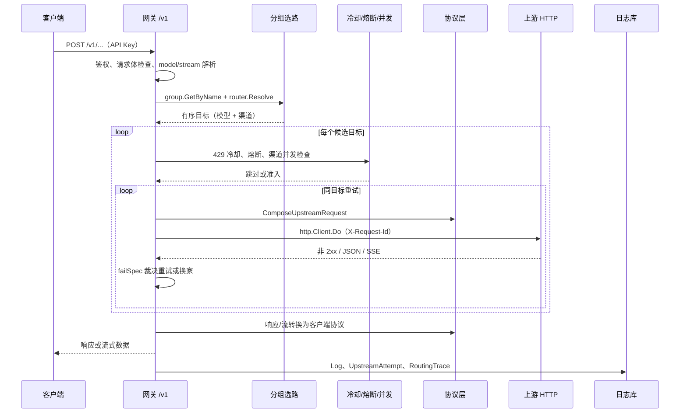

# 网关转发与保护

> 说明 /v1 入口、目标循环与失败处置、限流冷却、熔断、并发准入和主动验证；不负责协议字段转换和资源 CRUD。

## 概述

网关是客户端和应用访问 Portunus 的服务面。`main.go` 装配依赖后调用 `gateway.Register`；生产实现由 `gateway.Deps` 注入：转发配置、上游 HTTP 客户端、熔断/限流冷却/渠道并发 store、API Key 鉴权、调用日志、显式 HTTP 尝试和路由诊断写入。测试可替换为内存实现。`NewRelayServer` 只兜底 `Concurrency` 与 `Cooldowns`；`Client`、`Breakers`、`LogWrite` 等仍须由装配方提供。

| 方法与路径 | 客户端协议 | 行为 |
|---|---|---|
| `GET /v1/models` | OpenAI 形状 | 列出非空分组的名称作为对外模型；空分组跳过 |
| `POST /v1/chat/completions` | `openai` | Chat Completions 转发 |
| `POST /v1/responses` | `openai_responses` | Responses 转发 |
| `POST /v1/messages` | `anthropic` | Anthropic Messages 转发 |

四个端点统一经过 `authMiddleware`：兼容 `Authorization: Bearer <key>` 与 `x-api-key`。鉴权优先调用 `Deps.AuthIdentity`，为空时回退旧的 `Deps.Auth`；成功后把 `api_key_id`、`api_key_name` 注入上下文。失败返回 401，错误体按路径对应的客户端协议渲染。网关不负责管理 API 的本机回环限制，该限制在 `backend/api` 侧。

网关不承担的职责与明确边界：

- 不负责渠道、模型、分组、API Key 的 CRUD 与模型同步；这些在 `backend/api`、`backend/cron` 等模块。
- 不计算价格、默认价格或调用费用；只记录上游返回的 token 与缓存用量。
- 不承诺跨协议能力等价。跨协议只按 `backend/protocol` 已有字段语义转换；托管工具、原生扩展、思考桥等按既有规则映射或记录诊断，不代表所有字段无损。
- 流式响应一旦向客户端提交首个有效事件，就不能再切换到其他目标，也不支持无损重放。
- 调用日志是“上游尝试日志”，不是客户端请求计数；同一请求的重试/换家会产生多行。鉴权失败、请求体超限、分组不存在、路由解析失败等前置拒绝不写调用日志。
- 只暴露 Chat / Responses / Messages 三个客户端入口；Gemini 当前仅作为上游协议，没有客户端 `/v1` 入口。
- 熔断、限流冷却和渠道并发状态都在进程内，不跨实例共享；多实例一致性不是已支持能力。

## 核心流程

`handleRelay` 返回一个绑定客户端协议的处理器。三处转发入口分别固定 `openai`、`openai_responses`、`anthropic`。请求进入后：

1. 为当前请求复制 `relayServer`，并用鉴权时的 `api_key_name` 包装 `LogWrite`，保证同一请求所有成功、失败、重试日志使用同一名称快照。
2. 生成 16 位十六进制 `requestID`，在最早的响应头位置写入 `X-Request-Id`；同一次客户端请求的所有上游尝试共用该 ID，并随上游请求头发送。
3. 创建 `routingDiagnostics`，通过 defer 在请求结束时写入独立路由诊断。
4. 按 `ResourceLimits` 检查请求 `Content-Length`，再用 `resource.ReadAll` 读取（最多 `max+1` 字节，超限返回 413）；在解码路由元数据之前先做 JSON 深度检查。
5. 只解析最小公共字段 `model`、`stream`、`thinking`；缺少 `model` 或 JSON 非法时返回 400。
6. 创建 `requestControl`（请求级期限与 HTTP 尝试预算）并替换请求上下文；流式和非流式使用不同的累计期限语义。
7. 若对外模型名以 `-thinking` 结尾，先剥掉后缀再查分组，并生成思考开关意图；该意图是否写入上游请求体由 `protocol` 按目标协议决定，只有 OpenAI 兼容上游消费。
8. `group.GetByName` 查分组（预加载模型项）；不存在返回 404。`router.Resolve` 解出有序目标；空分组、manual 未指定激活项、未知策略返回 400。任一模型项引用的模型或渠道缺失，会让整个解析失败，而不是跳过该项。

### 目标循环、重试与切换

`handleRelay` 采用“外层遍历目标、内层重试同一目标”的循环：

1. 每个候选进入前先检查请求控制（取消、期限）是否已终止；已终止则结束整个请求。
2. 按目标检查 429 冷却，命中则记录 `candidate_skipped / rate_limit_cooldown` 并跳过，不消耗 HTTP 尝试预算。
3. 检查模型级熔断；开路或半开探测占用中则跳过，不消耗尝试预算。
4. 检查渠道并发上限；已满则跳过，不消耗尝试预算。
5. 对该目标执行 `attempt = 0..RetryCount`：首次 `initial`，换目标后 `failover`，同目标重试 `retry`。每次真实转发前再次检查请求控制；重试前再次检查熔断。
6. 调用 `relayToTarget`：非流式成功由调用方写 JSON 响应；流式成功已在 `relayStream` 中交付；失败交给 `failSpec` 统一裁决。若 `StopRequest` 为真，立即结束所有候选；若不可重试或属于“等响应头假死”，跳出同目标重试并换下一个目标；否则继续同目标重试。
7. 全部候选都被跳过且没有真正发出请求时，分别按冷却（429）、渠道并发（503，`Retry-After: 1`）或熔断（503）返回，并写一条合成调用日志。熔断分支的 `Retry-After` 取所有开路目标剩余冷却时间的最小值。
8. 候选耗尽后，按最后一次错误经 `failSpec` 得到客户端状态码与错误类别；透传上游 `Retry-After`，提取上游错误消息，并按客户端协议输出错误体。错误消息会追加 request id，方便客户端粘贴报错原文对齐日志。

HTTP 尝试预算（`MaxHTTPAttempts`，默认 4）是跨目标、跨重试、包含兼容重试的总上限；`RetryCount`（默认 2）只是单个目标内的重试次数。因此“配置了多个候选”不保证每个候选都会被尝试，预算耗尽会直接终止。

### 单目标转发：装配、执行与转换

`relayToTarget` 完成一次目标尝试，是请求转换、上游调用和交付编排的核心：

1. 调用 `protocol.ComposeUpstreamRequest(clientProto, t.Channel.Type, originalBody, ...)`：协议转换、上游模型名替换、思考意图注入都在 `protocol` 内完成；返回的 `ComposeStats` 只用于诊断遥测。
2. 计算 `StreamRequestReplaySafe`。函数工具（各协议的 `function` / `custom` / `functionDeclarations`）和已知搜索工具视为可安全重放；带 `previous_response_id`、会话/状态续接、加密内容、computer/MCP/code interpreter 等原生工具或状态的请求视为不安全。
3. 通过 `upstream.Open(t.Channel.ConnectionConfig())` 建立上游连接（端点、鉴权头由 `protocol.Upstream` 提供）。连接配置失败时不会产生 HTTP 尝试。
4. 绑定限流目标、熔断 permit、渠道并发 permit 到上下文；流式请求额外创建 `streamWatchdog`。
5. 调用 `doRequestWithChatBudgetFallback` 发起显式 `http.Client.Do`。`doRequest` 的执行顺序是：大小/深度复查 → 构建请求 → 请求控制 → 429 冷却检查 → 熔断 permit 校验 → 可取消退避等待 → 冷却复查 → 渠道并发准入 → 熔断租约获取 → 尝试预算预留 → 记录尝试开始与诊断事件 → `Client.Do`。
6. 上游返回非 2xx：读取受限响应体，先检查请求控制，再构造 `upstreamStatusError`。若客户端请求不可安全重放，5xx / 429 会被包装为“禁止自动重放”的终止错误。
7. 流式 2xx：创建 `StreamConverter` 和 `StreamSession`，由 `relayStream` 逐事件转换、按客户端协议装帧并写回。首包前失败返回错误，允许重试/换家；一旦提交，失败以 `streamCommittedError` 表示，对上层返回 nil 错误但记录失败原因，用量仍保留。
8. 非流式 2xx：读取受限响应体，`ConvertResponseWithReport` 转换，`UsageFromResponse` 提取用量，最后 `requestControl.commit()` 仲裁“交付就绪”与期限；成功后再交给 `handleRelay` 写客户端。

`relayToTarget` 的 defer 顺序固定为：熔断 permit 结算 → 渠道并发释放 → 路由诊断 `relay_finished` → 显式尝试写入 → 429 冷却补记 → 调用日志 → 失败 stderr。健康准入和并发名额先于观测写入释放，避免观测阻塞影响容量。

兼容重试（`chatBudgetRetry`）只在“客户端协议不是 OpenAI Chat、目标上游是 OpenAI Chat”时启用：上游返回 400/422 且错误明确表示不支持 `max_tokens` 字段时，把 `max_tokens` 原值改名为 `max_completion_tokens`，再执行一次带 `budget_compat` 原因的显式 Do。每个目标最多触发一次，普通重试不会重复触发；第二次 Do 同样受总尝试预算和退避约束。

### 流式交付

- **预提交缓存**：首个“有意义事件”或终态之前，无意义且非终态（或尚无输出帧）的批次先缓存在 `deliveryGate`，默认上限 256 KiB / 128 个事件；超限返回 `precommitBufferError`，属于请求级终止。客户端此时还看不到任何响应头。
- **提交**：首个有意义事件或终态到达时，先 `requestControl.commit()` 与期限仲裁，再写 200、`text/event-stream` 头和帧并 flush。提交后 `delivered=true`，禁止再发起新的 HTTP 尝试或换目标。
- **看门狗**：拿到上游响应头后启动“首包”阶段计时（默认 120 秒，即 `FirstByteTimeoutSeconds`）；首包阶段的数据读取不续期，元数据/心跳不会延长首内容期限，只有提交后的正常内容读取才重置静默计时。提交后切换到静默时限（默认 120 秒，0 禁用）；观察到终态后进入有界收尾窗口（默认 1 秒），不再因心跳延长。客户端主动取消与看门狗触发可通过 `Fired()` 区分。
- **提交后失败**：流已提交后发生断连、静默、转换错误或客户端写失败，不再换家，也不补发普通 JSON 错误。若尚无终态且不是客户端取消/写失败，Anthropic 客户端会收到一个流内 `error` 事件；OpenAI/Responses 客户端没有标准流内错误形状，表现为流被截断。已交付部分若已累积 usage，仍写入日志。
- **终态语义**：上游缺少合法终态时不会伪造 `end_turn` / `completed` / `[DONE]`；`StreamSession` 返回 `ErrStreamIncomplete`，记录 `truncated` / `missing_terminal`。流结果区分 `completed`、`incomplete`、`blocked` 等；`streamSucceeded` 同时要求观察到终态。

### 失败处置与重放安全

`failSpec` 是失败语义的唯一权威，所有消费方（重试循环、熔断结算、归因、客户端状态码、错误体类别、`Retry-After`）都读同一份 `failDecision`。判定顺序有意固定，改动前应先看 `fail_test.go` 的行为表：

- 已提交的流失败最先识别，然后区分客户端期限、资源上限、尝试预算、非流式期限、首内容期限、用户取消、重放不安全、限流冷却、渠道并发、熔断、流预提交/资源/转换错误、流不完整、流内上游错误、等响应头假死、流静默假死、上游非 2xx、推理转换错误、协议转换错误、网络错误，最后归为内部错误。
- 客户端取消不重试、不计熔断；资源上限、重放不安全、流预提交/SSE 解析等转换安全类错误通常是请求级终止；429 只记录冷却，不计故障熔断；5xx 在可重放请求上可重试并计入熔断；等响应头假死跳过同目标重试、按快速阈值开路并返回 504；未提交的流静默假死保留同目标重试，按普通阈值累积。

重放安全采用保守策略：只有函数工具和已知搜索工具被视为安全；带状态续接、原生工具、加密内容或未知工具形状的请求，在请求可能已被上游执行后，不允许自动重试或换家。该判断同时用于非流式与流式请求。

### 429 限流冷却

`RateLimitStore` 是进程内有界缓存（最多 16384 项），不是 RPM 配额。冷却键包含渠道 ID、连接指纹（连接配置/选项/思考兼容等哈希）、作用域，以及按模型作用域时的模型名；渠道级冷却覆盖该渠道全部模型，模型级只影响同名模型。上游 429 响应头一到即记录，流内 429 通过回调记录；`Retry-After` 支持秒数（饱和解析、上限截断）和 HTTP 日期，缺失或非法时用默认 30 秒，上限 300 秒。冷却中的目标会被跳过，不消耗尝试预算；成功不会清除冷却。

### 熔断与半开

熔断按模型 ID 跨分组共享。连续失败达到 `CircuitFailureThreshold`（默认 4）或“等响应头假死”连续达到 2 次时开路；开路持续 `CircuitResetSeconds`（默认 60 秒）。开路到期后的首次请求会把状态转为半开并获取唯一探测租约；探测租约在退避、冷却、预算检查之后、真正 Do 之前获取，兼容重试共用同一租约，body/流处理结束并关闭后结算。半开期间其他请求看到 `probe_busy` 会被跳过。半开探测成功需连续达到 `CircuitSuccessThreshold`（默认 2）才关闭；探测失败立即重新开路。429、客户端取消、资源/转换等本地错误中性释放；已提交的流中断按普通失败计数；迟到或失效代次的租约不会改写状态。

### 渠道并发

`ChannelConcurrencyStore` 按渠道 ID 跨模型、跨分组统计在途 relay。上限来自渠道 `max_concurrent_requests`，0 表示不限但仍计数；没有排队，也没有会过期的 permit。选路时先预览，真正 Do 前在退避、控制、冷却检查之后原子准入；一个 relay 的整个 body/流处理和兼容 Do 共用一个名额，关闭 body 后、观测写入前释放。满员时返回本地 503（`channel_capacity`），固定 failover 可顺延，manual 不切换成员；该拒绝不产生 HTTP 尝试、不计熔断。

### 期限、尝试预算与退避

- 流式请求：从解析完 `model`/`stream` 后累计首内容期限（默认 240 秒），覆盖选路和所有尝试，直到首个有效事件提交；提交后撤销该期限，改由看门狗控制静默。
- 非流式请求：跨目标累计处理期限（默认 600 秒），覆盖上游读取和转换，直到 `commit()`；客户端自身期限到达按 504 处理。
- 连接超时默认 30 秒；等响应头（Transport 层）与流式首包默认 120 秒；流式静默默认 120 秒（0 禁用）；终态后收尾窗口默认 1 秒。
- `max_http_attempts`、`first_content_timeout_seconds`、`non_stream_timeout_seconds`、退避、限流冷却和熔断阈值配置为 0 时回退默认值；`connect_timeout_seconds`、`first_byte_timeout_seconds`、`stream_idle_timeout_seconds` 直接使用配置值，显式配置 0 表示该阶段不设超时或禁用静默看门狗。
- HTTP 总尝试预算默认 4 次（包含兼容重试）；每个目标最多重试 `RetryCount` 次（默认 2）。退避基数和上限默认 200 ms / 2000 ms，采用 equal jitter，并在每次后续 Do（含兼容重试）前安排；等待期间不占预算、不持锁，可被请求期限或客户端取消中断。首次 Do 不等待。
- 转换资源限额默认：请求体 / 非流式响应各 32 MiB、原生结构片段 8192、单工具参数 4 MiB、每个有状态阶段累计 64 MiB、JSON 深度 128。超限产生 `resource_limit` 并停止请求，不计熔断，也不会在交付后自动重放。

### 观测写入

- **调用日志 `shared.Log`**：每次 `relayToTarget` 写一条，重试/换家产生多行但共享 `RequestID`；全部候选被跳过时写一条合成日志。记录 API Key 名称快照、分组/渠道/模型、状态码与成功标记、流式标记、token/缓存用量、耗时与首包耗时、失败类别与截断原文、客户端入口协议、请求与响应转换摘要、流终态/交付状态。前置拒绝（鉴权失败、请求体超限、缺 model、分组不存在、路由解析失败）不写调用日志。流提交后失败可能出现 `status=200` 但 `success=false`，不能只凭状态码判断成功。
- **显式 HTTP 尝试 `shared.UpstreamAttempt`**：每次实际 `http.Client.Do`（含兼容重试）写一条，按 `request_id + sequence` 关联，`reason` 区分 `initial`、`retry`、`failover`、`budget_compat`。记录状态码、成功标记、失败类别、耗时、预算字段等；不记录正文、URL 或鉴权头。连接失败、取消也有记录；装配失败、熔断/冷却/并发跳过没有记录。写入失败只记 stderr，不因此重试上游。HTTP 200 不等于模型完成，尝试的成功标记来自 relay 结果。该表只表示应用显式发起的 Do，不等同于上游实际收到或 Transport 物理发送次数；缺失记录不能反推尝试次数。
- **路由诊断 `shared.RoutingTrace`**：每个请求一条，事件包括候选跳过、候选选择、HTTP 尝试、准入阻塞、并发获取/释放、半开探测获取/结束、目标结束、relay 结束等；每请求最多 256 条，超出计入 `DroppedEvents`。记录停止原因、结果、是否已开始交付、HTTP 尝试数、最终候选/渠道/模型。不保存正文、上游消息、URL、凭据或客户端动态字段名。写入失败不影响转发，也不会触发重试。完成的路由诊断只描述网关选路，不代表客户端收到完整响应。

详细查询口径与前端展示见[调用观测与日志](调用观测与日志.md)。

### 主动调用验证

管理端 `POST /api/channels/test` 调用 `gateway.ProbeConnection`，复用正式链路的 `relayToTarget`，但只针对一个渠道、一个模型、一种响应模式，不经过 `router.Resolve`，不进行路由切换或普通失败重试。

- 请求固定按 OpenAI Chat 形状构造，再按目标渠道协议转换；因此也可以验证 Anthropic / Gemini 渠道。
- 使用私有 `probeHTTPClient`、私有熔断器、内存 `LogWrite`，不写日志库、尝试表或路由诊断表；`quiet` 模式不输出上游原文。
- 输入限制：模型名非空且不超过 512 字符，`max_output_tokens` 1–128；总时限 25 秒，连接 5 秒、等响应头 15 秒、静默 10 秒、非流式 25 秒；上游原始响应与转换后输出都限制 1 MiB。
- 校验成功不仅要求 HTTP 2xx，还要求响应中存在有效文本或推理内容以及非空 `finish_reason`；流式要求观察到内容与结束标记。
- 返回分阶段结果：`input`、`request`、`timeout`、`upstream`、`response`、`complete`、`cancelled`。验证通过只代表“该渠道 + 该模型 + 该模式”的一次真实调用成功，不代表预设、模型列表或正常路由整体健康；验证结果也不影响生产熔断与冷却状态。

## 关键实现

| 职责 | 位置 |
|---|---|
| 注册 `/v1` 端点与鉴权中间件 | [`Register`](../../../backend/gateway/gateway.go#L16)、[`authMiddleware`](../../../backend/gateway/gateway.go#L29) |
| 模型列表跳过空分组 | [`listModels`](../../../backend/gateway/gateway.go#L78) |
| 请求入口与目标循环 | [`handleRelay`](../../../backend/gateway/relay.go#L56) |
| 单目标转发与交付编排 | [`relayToTarget`](../../../backend/gateway/relay.go#L358) |
| 失败处置唯一裁决 | [`failSpec`](../../../backend/gateway/fail.go#L139) |
| 上游 HTTP 客户端与 Do | [`NewHTTPClient`](../../../backend/gateway/upstream.go#L23)、[`doRequest`](../../../backend/gateway/upstream.go#L32)、[`doRequestWithChatBudgetFallback`](../../../backend/gateway/upstream.go#L134) |
| 请求期限、尝试预算与退避 | [`requestControl`](../../../backend/gateway/request_control.go#L15)、[`newRelayRequestControl`](../../../backend/gateway/request_control.go#L46) |
| 429 冷却 | [`RateLimitStore`](../../../backend/gateway/rate_limit.go#L34)、[`Check`](../../../backend/gateway/rate_limit.go#L79)、[`Record`](../../../backend/gateway/rate_limit.go#L117) |
| 熔断与半开 | [`BreakerStore`](../../../backend/gateway/circuit_breaker.go#L33)、[`Acquire`](../../../backend/gateway/circuit_breaker.go#L144) |
| 渠道并发 | [`ChannelConcurrencyStore`](../../../backend/gateway/channel_concurrency.go#L14)、[`Acquire`](../../../backend/gateway/channel_concurrency.go#L42) |
| 流式看门狗与交付 | [`relayStream`](../../../backend/gateway/stream.go#L133)、[`streamWatchdog`](../../../backend/gateway/stream.go#L21)、[`deliveryGate`](../../../backend/gateway/stream_delivery.go#L56) |
| 路由诊断 | [`routingDiagnostics`](../../../backend/gateway/routing_diagnostics.go#L17)、[`flush`](../../../backend/gateway/routing_diagnostics.go#L133) |
| 主动调用验证 | [`ProbeConnection`](../../../backend/gateway/probe.go#L64) |
| 默认阈值与资源上限 | [`DefaultProxyConfig`](../../../backend/shared/config.go#L46)、[`resource.Defaults`](../../../backend/resource/limits.go#L26) |

## 配置与扩展

`Deps` 是网关的唯一注入点：

| 字段 | 作用 | 生产装配 |
|---|---|---|
| `Cfg` | 重试、期限、熔断、冷却和资源上限 | `main` 传入 `cfg.Proxy` |
| `Client` | 上游 HTTP 客户端 | `gateway.NewHTTPClient(cfg.Proxy)` |
| `Breakers` | 进程内熔断状态 | `gateway.NewBreakerStore(cfg.Proxy)` |
| `Cooldowns` | 429 冷却状态 | `gateway.NewRateLimitStore(cfg.Proxy)` |
| `Concurrency` | 渠道在途计数 | `gateway.NewChannelConcurrencyStore()` |
| `AuthIdentity` | 返回稳定 Key ID 与名称 | `shared.AuthenticateAPIKeyIdentity` |
| `LogWrite` / `AttemptWrite` / `RoutingWrite` | 三类观测写入 | 写 `shared.LogDB` 的对应实体 |

新增客户端入口需要同时修改 `Register`、`clientProtoFromPath`、错误体渲染和前端接入说明；新增上游协议不需要改网关，只需在 `backend/protocol` 注册完整能力。修改重试/超时/熔断默认值需同步 `shared.ProxyConfig`、`DefaultProxyConfig`、`PORTUNUS_PROXY_*` 覆盖和本页表格。

## 修改须知

| 想改什么 | 主要位置 |
|---|---|
| 新增/调整 `/v1` 端点或鉴权 | `backend/gateway/gateway.go` 的 `Register`、`authMiddleware` |
| 选路策略、候选顺序 | `backend/router/router.go` 的 `Resolve`；`backend/group/group.go` 的 `Strategy` |
| 重试/换家/状态码/错误归因 | `backend/gateway/fail.go` 的 `failSpec`，以及 `relay.go` 的目标循环 |
| 请求期限、HTTP 尝试预算、退避 | `backend/gateway/request_control.go` |
| 流式预提交、提交、SSE 交付 | `backend/gateway/stream.go`、`stream_delivery.go`；帧形状在 `backend/protocol/stream_frame.go` |
| 429 冷却 | `backend/gateway/rate_limit.go` |
| 熔断、半开探测 | `backend/gateway/circuit_breaker.go`、`breaker_attempt.go` |
| 渠道并发 | `backend/gateway/channel_concurrency.go` |
| 路由诊断事件与停止原因 | `backend/gateway/routing_diagnostics.go`、`backend/shared/routing_trace.go` |
| 显式尝试记录 | `backend/gateway/attempt.go`、`backend/shared/upstream_attempt.go` |
| 协议转换与流式转换 | `backend/protocol/convert.go`、`native_request.go`、`native_response.go`、`stream.go`、`stream_session.go`、`provider_registry.go` |
| 预算字段兼容重试 | `backend/gateway/upstream.go`、`backend/protocol/token_budget.go` |
| 主动调用验证 | `backend/gateway/probe.go`、`backend/api/channel_connection.go` |
| 默认超时/阈值/资源上限 | `backend/shared/config.go` 的 `DefaultProxyConfig`；`backend/resource/limits.go` |

改动 `failSpec` 前先读 `fail_test.go` 的行为表；改动提交后写日志口径前先读 `log_test.go`、`attempt_test.go` 与 `routing_diagnostics_test.go`。本页描述当前源码路径，不代表真实上游联调或故障注入结果。

来源

- [backend/gateway/gateway.go](../../../backend/gateway/gateway.go)
- [backend/gateway/dep.go](../../../backend/gateway/dep.go)
- [backend/gateway/relay.go](../../../backend/gateway/relay.go)
- [backend/gateway/fail.go](../../../backend/gateway/fail.go)
- [backend/gateway/upstream.go](../../../backend/gateway/upstream.go)
- [backend/gateway/request_control.go](../../../backend/gateway/request_control.go)
- [backend/gateway/rate_limit.go](../../../backend/gateway/rate_limit.go)
- [backend/gateway/circuit_breaker.go](../../../backend/gateway/circuit_breaker.go)
- [backend/gateway/breaker_attempt.go](../../../backend/gateway/breaker_attempt.go)
- [backend/gateway/channel_concurrency.go](../../../backend/gateway/channel_concurrency.go)
- [backend/gateway/routing_diagnostics.go](../../../backend/gateway/routing_diagnostics.go)
- [backend/gateway/probe.go](../../../backend/gateway/probe.go)
- [backend/shared/config.go](../../../backend/shared/config.go)
- [backend/resource/limits.go](../../../backend/resource/limits.go)

