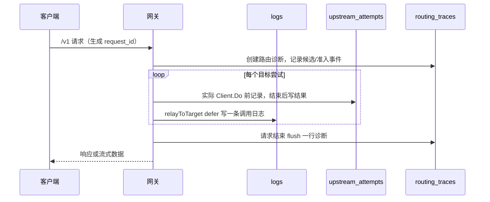

# 调用观测与日志

> 说明调用日志、显式 HTTP 尝试、路由诊断的写入与查询口径及保留清理；不把记录数当作客户端请求数或成功率。

## 概述

本模块把一次 `/v1` 调用留下为三类互不替代的记录，并为本机管理端提供查询：

| 记录 | 表 | 回答的问题 | 不回答的问题 |
|---|---|---|---|
| `shared.Log` | `logs` | 某个目标渠道/模型这次 relay 的用量、耗时、结果、失败类别与兼容诊断 | 客户端请求的最终结果、完整请求次数 |
| `shared.UpstreamAttempt` | `upstream_attempts` | 应用显式发起的第几次 `http.Client.Do`、为何发起、结果如何 | 传输层内部重发/重定向、上游实际收到几次 |
| `shared.RoutingTrace` | `routing_traces` | 网关如何选路、跳过、准入、探测、交付以及为何停止 | 客户端是否收到完整响应、最终成功率 |

三者的职责和粒度不同：

- `Log` 按目标 relay 尝试写入，同一客户端请求可能产生多行；没有发出 HTTP 的目标调用也可能留下日志行。
- `UpstreamAttempt` 只对应一次显式 `http.Client.Do`，不重复记录 token，也不参与旧日志的请求数统计。
- `RoutingTrace` 每个请求一行，保存有界路由事件和独立结束摘要，不参与调用行数或 HTTP 尝试数统计。

边界：

- 三类记录均通过 `request_id` 关联，但当前没有请求终态或采集完整性凭证，不能把日志行数、关联项数或已采集尝试数命名为准确的客户端请求数、最终成功率或物理上游发送数。
- 日志库可选独立 SQLite（`database.log_path`），为空时复用主库；三类实体由 `shared.InitLogDB` 自动迁移。日志库与主业务库之间没有外键，资源删除不会级联清理日志。
- `/api/logs*` 属于管理接口，受 `localManagementOnly` 保护，仅接受真实回环对端，并检查 Host/Origin；不能通过公开反向代理暴露。
- 记录不提供价格配置、费用计算或成本聚合。历史 `currency`/`cost` 列及旧值保留在存储中，但不进入当前 JSON 输出和统计。
- 管理端的渠道调用验证（`gateway.ProbeConnection`）使用内存日志写入器，不写 `logs`、`upstream_attempts` 或 `routing_traces`，其验证流量不会出现在调用记录中。

## 核心流程

## 关键实现

| 职责 | 位置 |
|---|---|
| 调用日志实体 | [`Log`](../../../backend/shared/log.go#L11) |
| 日志查询、统计与清理 | [`ListLogs`](../../../backend/shared/log_query.go#L41)、[`LogStatsBy`](../../../backend/shared/log_query.go#L59)、[`DeleteOldLogs`](../../../backend/shared/log_query.go#L128) |
| 请求关联归并 | [`ListLogRequests`](../../../backend/shared/log_requests.go#L25) |
| 显式尝试实体与查询 | [`UpstreamAttempt`](../../../backend/shared/upstream_attempt.go#L10)、[`WriteUpstreamAttempt`](../../../backend/shared/upstream_attempt.go#L35)、[`ListUpstreamAttempts`](../../../backend/shared/upstream_attempt.go#L44) |
| 路由诊断实体与查询 | [`RoutingTrace`](../../../backend/shared/routing_trace.go#L33)、[`MaxRoutingEvents`](../../../backend/shared/routing_trace.go#L13)、[`WriteRoutingTrace`](../../../backend/shared/routing_trace.go#L59)、[`GetRoutingTrace`](../../../backend/shared/routing_trace.go#L76) |
| 日志库初始化 | [`InitLogDB`](../../../backend/shared/db.go#L52) |
| 日志写入组装 | [`logCall`](../../../backend/gateway/log.go#L18) |
| 尝试写入 | [`finishAttempt`](../../../backend/gateway/attempt.go#L35) |
| 路由诊断刷写 | [`flush`](../../../backend/gateway/routing_diagnostics.go#L133) |
| 管理查询路由 | [`registerLogRoutes`](../../../backend/api/log.go#L15) |
| 桌面日志页 | [`Logs.jsx`](../../../web/src/renderer/pages/Logs.jsx#L16)、[`LogDetailModal`](../../../web/src/renderer/pages/LogDetailModal.jsx#L1) |
| 尝试链与切换诊断组件 | [`RequestAttemptTimeline`](../../../web/src/renderer/pages/RequestAttemptTimeline.jsx#L1)、[`RequestRoutingTrace`](../../../web/src/renderer/pages/RequestRoutingTrace.jsx#L1) |
| 前端日志 API | [`log.js`](../../../web/src/renderer/api/log.js#L1) |

## 写入与请求关联

`main.go` 在装配网关时注入三个写入函数：

- `gateway.Deps.LogWrite`：生产实现为 `shared.LogDB.Create(e)`；只接收 `*shared.Log`，没有返回错误。
- `gateway.Deps.AttemptWrite`：生产实现为 `shared.WriteUpstreamAttempt`，写入失败会返回错误。
- `gateway.Deps.RoutingWrite`：生产实现为 `shared.WriteRoutingTrace`，写入失败会返回错误。

`gateway.NewRelayServer` 持有这些依赖。`handleRelay` 为每个请求复制一份 `relayServer`，并在 `LogWrite` 外包一层，把鉴权时取得的 `api_key_name` 快照写入每条日志；因此同一请求的成功、失败、重试和合成日志都使用同一个名称快照。

请求进入 `/v1` 的 relay handler 后由 `newRequestID` 生成关联 ID：优先取 8 字节随机数的十六进制，随机源失败时退回 `UnixNano` 的十六进制。该 ID：

- 写入本次请求的所有 `Log`、`UpstreamAttempt`、`RoutingTrace`；
- 作为响应头 `X-Request-Id` 返回客户端；
- 随上游请求头 `X-Request-Id` 透传，便于与中转上游对账；
- 不采用客户端传入的同名请求头。

写入时机：

- `Log`：`relayToTarget` 的 defer 在每次目标调用结束时写一行，即使没有真正发出 HTTP（例如装配失败）也可能有日志；所有候选无法调用时（限流冷却、渠道并发已满、全部熔断）由 `handleRelay` 额外写合成日志。鉴权失败及进入 relay handler 前的拒绝没有日志行；请求体非法、分组不存在、路由无法解析等选路前拒绝通常只有 `RoutingTrace`。
- `UpstreamAttempt`：`doRequest` 在完成资源检查、请求控制、限流冷却、熔断探测、渠道并发与退避等准入后，于实际 `Client.Do` 前开启记录；目标调用结束时写一条。装配失败、准入拒绝、熔断跳过不产生尝试记录。预算字段兼容重试先结束第一条 HTTP 尝试，再以 `budget_compat` 开启下一条。
- `RoutingTrace`：`handleRelay` 在入口处创建并在 defer 中 `flush`，每个进入 relay handler 的请求写一行；写入前事件按 `MaxRoutingEvents` 截断并累计丢弃数。

三类写入都是同步的，失败不会触发上游重试或补偿：

- 生产的 `LogWrite` 忽略 `Create` 错误，因此数据库写失败只表现为缺少日志行。
- `AttemptWrite` 失败会打印包含 request_id、sequence 和错误的告警，但不重试上游。
- `RoutingWrite` 失败只打印 request_id，不输出驱动错误；转发结果不受影响。
- `AttemptWrite`/`RoutingWrite` 允许为 nil（测试或嵌入调用）；`LogWrite` 在网关路径上按非 nil 使用，修改装配时不能省略。

## 三类记录的内容与口径

### Log

`shared.Log` 由 `gateway.logCall` 组装，主要字段包括：

- 身份与归属：`api_key_id`、鉴权时名称快照 `api_key_name`、`group_name`、`channel_id`、`model_name`、`request_id`。
- 结果：`status`、`success`、`stream`、`duration_ms`、`first_token_ms`。
- 用量：`input_token`、`output_token`、`cache_read_token`、`cache_write_token`。
- 失败：`err_kind`（`gateway.failSpec` 归因的固定类别）与截断后的 `err_msg`。
- 诊断遥测：`client_protocol`、思考桥解码数、垫片改写数、托管工具剥离数、请求/响应兼容检查摘要、流式交付结果与终态标志。

口径：`success` 是本次目标 relay 的处理结果，不是模型 `completed` 的证明，也不是客户端请求的最终结果。一行日志可能对应一次真实 HTTP 尝试，也可能对应一次未发 HTTP 的目标处理；同一请求的多行日志不能直接相加为客户端请求数。日志不保存 `model_id`，历史模型归属以当时写入的 `model_name` 快照为准。

### UpstreamAttempt

`shared.UpstreamAttempt` 记录一次显式 `http.Client.Do`，主要字段包括：

- `request_id` + `sequence`（唯一索引）、`relay_attempt`、`reason`；
- `api_key_id`、`group_name`、`channel_id`、`model_id`、`model_name`；
- `client_protocol`、`upstream_protocol`、`stream`、`budget_field`；
- `status`、`success`、`err_kind`、`err_msg`、`duration_ms`、`started_at`、`created_at`。

`reason` 的当前取值为 `initial`/`retry`/`failover`/`budget_compat`。同一请求内所有显式 Do 共用递增的 `request_id + sequence` 序列；预算兼容重试与外层普通重试不会重置该序列。`relay_attempt` 标识外层 relay 轮次，预算兼容重试与外层尝试共用该值。`budget_field` 只保存实际出现的预算字段名（`max_tokens`、`max_completion_tokens`、`max_output_tokens`），不保存字段值。

口径：尝试记录包含连接失败和取消（此时 `status` 可能为 0），但不包含传输层内部重发、重定向和上游是否真正收到的证明；`success` 不是模型正常结束或整个请求成功的证明。记录不含 token，不参与 `Log` 统计。

### RoutingTrace

`shared.RoutingTrace` 每个请求一行，`schema_version` 当前为 1，主要字段包括：

- 请求与分组：`request_id`、`api_key_id`、`group_id`、`strategy`、`client_protocol`、`stream`；
- 候选摘要：`candidate_count`、`final_candidate`、`final_channel_id`、`final_model_id`；
- 事件：`events`（最多 256 条）、`dropped_events`；
- 结束摘要：`stop_reason`、`stop_err_kind`、`status`、`outcome`、`delivery_started`、`http_attempts`、`started_at`、`finished_at`。

事件只包含路由元数据：候选序号、relay 轮次、渠道/模型 ID、事件与原因、错误类别、冷却作用域与建议重试秒数、是否半开探测、渠道并发上限/在途数。当前事件类型包括候选跳过、候选选择、准入受阻、显式 HTTP 尝试、探测取得/结束、并发取得/释放、目标调用结束、目标耗尽等；未知事件由前端保留原值展示。

口径：候选跳过和准入受阻不构成 HTTP 尝试，不增加旧日志或用量统计。`final_candidate` 只表示最后选中的候选，不表示已发起 HTTP 或调用成功。`delivery_started` 表示开始尝试写模型响应，不证明客户端收到完整响应；非流式路径在写响应头/响应体时也会置位。`http_attempts` 只统计已记录的显式 Do，不含 Transport 内部发送。`stop_reason`/`outcome` 是网关侧结束观察，不是客户端最终结果。

## 查询、筛选与统计

管理端接口由 `registerLogRoutes` 注册：

| 接口 | 作用 | 关键条件 |
|---|---|---|
| `GET /api/logs` | 按日志行分页查询 | `api_key_id`、`channel_id`、`group_name`、`model_name`、`request_id`、`client_protocol`、`success`、`start_time`、`end_time`、`page`、`page_size` |
| `GET /api/logs/stat` | 按同一筛选汇总 token 与行数 | 忽略分页；返回 `input_tokens`、`output_tokens`、`cache_read_tokens`、`cache_write_tokens`、`total_requests`、`recent_requests` |
| `GET /api/logs/requests` | 按请求关联归并后分页 | 同一 `LogFilter`；先命中关联项，再从全部关联日志生成摘要 |
| `GET /api/logs/attempts` | 精确查询一个请求的已采集尝试 | 必须提供非空 `request_id`；`page`、`page_size` |
| `GET /api/logs/routing` | 精确查询一个请求的切换诊断 | 必须提供非空 `request_id`；无分页 |
| `DELETE /api/logs` | 删除早于指定时间的记录 | `target_timestamp`（Unix 秒）必填；`limit` 默认 100 |

`LogFilter` 的匹配规则：

- `api_key_id`/`channel_id` 只在大于 0 时参与过滤；`group_name`、`model_name`、`request_id`、`client_protocol` 按精确字符串匹配，不做模糊、前缀或通配符匹配。
- `success` 按布尔值匹配；`start_time`/`end_time` 按 `created_at >=`/`<=` 的包含边界匹配。
- 非法 ID、非法 `success` 或无法按 RFC3339 解析的时间在 API 解析层被静默忽略，可能导致查询范围比预期更宽；后端不返回参数错误。
- 分页参数先归一化：页码小于 1 取 1，页大小小于 1 取 20，大于 100 取 100。`/api/logs` 按 `id desc` 返回；`/api/logs/stat` 不受分页影响。

统计口径：`total_requests` 实际是符合筛选条件的 `logs` 行数；`recent_requests` 是同一筛选下 `created_at` 位于最近 60 秒的行数。它们都不是客户端请求数。前端统计卡据此显示“记录数”“近期记录”，并分别展示非缓存输入、缓存读/写和输出 token。

当前 `Logs.jsx` 页面只暴露 API Key、渠道、状态、分组、模型名五个筛选条件，并在点击“查询”时一次性提交；页面没有时间范围、入口协议或请求 ID 输入框。分组和模型名在后端仍是精确匹配，不是模糊搜索。

## 请求关联归并

`shared.ListLogRequests` 的语义与 `/api/logs` 的按行查询不同：

1. **关联键**：`request_id` 非空时键为 `request:<request_id>`；为空时每条历史日志独立，键为 `log:<id>`。前缀避免真实请求 ID 恰好形如 `log:27` 时与无 ID 日志 `27` 碰撞。
2. **筛选命中关联项**：`matched()` 对 `LogFilter` 命中的日志行选择关联键并 `GROUP BY`，`total` 是命中的关联项数，不是日志行数，也不是客户端请求数。任一日志行匹配即可让整个关联项入选。
3. **摘要取全部关联日志**：摘要子查询按关联键读取该请求的全部日志，不受筛选条件限制。`log_count` 是全部关联日志行数，可能大于当前筛选命中的行数。
4. **最新日志**：`latest_id = MAX(id)`，即最近写入的日志行，不是 `created_at` 最大的行；回填数据的写入顺序可能早于/晚于时间顺序。`latest_log` 的请求 ID、渠道、模型、结果、时间和用量全部来自这一行。
5. **时间边界**：`first_at`/`last_at` 分别取 `created_at` 最早/最晚的日志行时间，通过窗口函数先定位对应行 ID，再从原列读取；它们描述整个关联项的时间范围，可能与 `latest_id` 的顺序不一致。
6. **分页与排序**：按 `latest_id DESC` 排序后在数据库分页，页大小同样归一化到 20/最大 100。有结果时页内固定 3 次查询：关联项计数、摘要窗口查询、按最新/最早/最晚 ID 批量读取日志；`total` 为 0 时在计数后直接返回，不执行后两次查询。不把全部日志加载到前端合并。
7. **读一致性**：计数、摘要和明细读取在同一 `LogDB` 读事务中完成，避免并发写入或清理让同一页的数量、边界时间和最新日志互相矛盾。

筛选与摘要的口径差异是有意的：例如同一请求先在渠道 A 失败、随后在渠道 B 成功，筛选“A 渠道 + 失败”会命中该关联项，但 `latest_log` 可能是“B 渠道 + 成功”；`log_count` 仍包含该请求的全部日志。统计卡则只统计符合筛选条件的日志行。两种口径不能互相替代。

当前桌面页面没有使用 `ListLogRequests`：`web/src/renderer/api/log.js` 仍导出 `listLogRequests`，`LogDetailModal` 也保留了 `association` 展示分支，但 `Logs.jsx` 只调用 `listLogs` 和 `getLogStats`，不会传入关联项。后端接口及其测试仍存在；这是当前界面与接口能力的差异，不是后端缺失。

## 尝试链与切换诊断

**上游尝试**

`shared.ListUpstreamAttempts(requestID, page, pageSize)`：

- 必须提供精确 `request_id`；API 对空串或纯空白返回 400。
- 按 `sequence asc, id asc` 排序，分页参数归一化同上；`total` 是该请求的尝试记录总数。
- 空结果返回非 nil 的空数组；超出范围的页返回空数组和真实 `total`。
- 查询不会从旧 `Log` 回填，也不会根据日志数量推断尝试数量。
- 前端 `RequestAttemptTimeline` 每页 20 条，提供刷新、上一页/下一页、错误重试和错误摘要复制；`attemptCoverage` 只在当前页检查序号是否从期望值连续，并明确说明连续不等于完整。

**切换诊断**

`shared.GetRoutingTrace(requestID)`：

- 精确按 `request_id` 查询；不存在时返回 `nil, nil`，API 返回 200 与 `{"data":null}`，而不是 404。
- 不做分页；返回整行及全部保留事件。
- 前端 `RequestRoutingTrace` 展示策略/候选数、最后选中候选、网关结束结果、停止原因、状态/交付、显式 HTTP 尝试数、开始/结束时间和事件列表；`schema_version` 不是 1 时提示部分事件可能未识别。
- `routingCoverage` 在无诊断时明确说明“可能未采集、尚未完成或已清理”，不能据此判断没有跳过；有 `dropped_events` 时提示事件已截断。

## 留存、清理与资源删除

- 保留天数来自设置 `log_retention_days`，默认 30 天；`0` 禁用自动清理，负数由设置接口拒绝。
- `cron.Start` 每分钟 tick，每 60 个 tick 执行一次 `cleanupTick`，即启动后约一小时首次执行，之后每小时一次；调用 `DeleteOldLogs(now - days, 500)`。
- 管理端 `DELETE /api/logs` 可在未启用自动清理时手动删除：`target_timestamp` 为 Unix 秒，只删除 `created_at < target` 的日志；`limit` 默认 100，小于等于 0 时由 `DeleteOldLogs` 回退为 100。
- `DeleteOldLogs` 先分批删除 `logs`（按 `created_at`），再按 `started_at` 删除 `upstream_attempts`，最后删除 `routing_traces`。每次先查 ID 再按 ID 删除，避免 GORM 忽略 `Limit`。
- 返回值 `deleted` 只统计旧 `logs` 行数，不包含尝试和诊断；尝试清理失败会提前返回，诊断清理可能未执行。`routing_traces` 表不存在时跳过诊断清理，兼容只迁移了日志/尝试的嵌入方。
- 日志、尝试、诊断的清理截止时间分别基于 `created_at` 和 `started_at`。长请求或回填数据可能使同一请求的日志仍在、尝试或诊断已被清理，关联信息会随时间不完整。

资源删除与历史记录：

- 渠道、模型、分组的删除事务只操作主业务库，不删除 `LogDB` 中的日志、尝试或诊断。
- API Key 删除是软删除；历史日志仍保存 `api_key_id` 和调用时的 `api_key_name` 快照，不会因删除、改名或重置而回写。
- 日志库可以是独立 SQLite 文件，且三类实体与主库资源之间没有外键，因此即使在同一文件内也不会发生数据库级联。
- 展示时渠道名称来自当前渠道目录，已删除渠道显示为 `渠道 #<id>（已删除或未加载）`，API Key 旧日志没有名称快照时显示“未记录调用时名称”。尝试记录保留模型名和分组名快照，但只保存渠道 ID；切换诊断只保存渠道/模型/分组 ID。

## 存储字段与敏感边界

三类记录的结构化字段只保存调用诊断元数据，不保存完整提示词、模型响应正文、请求/响应体、上游 URL 或鉴权头。具体边界：

- `Log` 保存分组名、上游模型名、渠道 ID、token/缓存用量、耗时、失败类别与截断错误、协议兼容计数和流式交付标志；不保存 `model_id`，也不保存请求正文。
- `UpstreamAttempt` 保存目标 ID/名称、协议、预算字段名、状态、耗时和截断错误；不保存 token、正文、URL 或鉴权头。
- `RoutingTrace` 只保存路由事件和摘要元数据；写入注释明确不写入 payload、上游消息、URL、凭据或客户端动态字段名。

错误文本仍是主要敏感面：

- `gateway.logCall` 对 `callErr.Error()` 直接按 256 字节截断（含省略号，落在合法 UTF-8 边界）；当错误是 `*url.Error` 时，原文可能包含完整上游 URL 及其 query。
- `finishAttempt` 会先识别 `*url.Error`，只取底层 `Err.Error()` 再截断，避免把 URL 拼进尝试记录；`shared.WriteUpstreamAttempt` 还会把错误文本兜底限制为 256 个字符。
- 两处错误文本都可能带有上游返回片段或其他敏感内容。分享诊断内容前应检查 `err_msg`，不能仅凭“未保存正文”就认为错误文本无敏感信息。
- 日志只保存 API Key 的稳定 ID 与调用时名称快照，不保存 Key 明文；名称快照不会被后续改名、禁用、重置或删除回写。
- 路由诊断写入显式使用 GORM Silent 日志模式，避免 SQL 错误把序列化参数带进日志；`Log`/`UpstreamAttempt` 的写入没有同样的显式静默处理。
- 查询接口只在本机回环管理面开放，但本地 SQLite 本身不提供字段级加密或自动脱敏。

## 修改须知

- **新增或改名日志字段**：需要同步 `shared.Log`、`LogDB.AutoMigrate`、JSON 契约、前端展示和旧数据兼容。历史行缺失字段应显示“未记录”，不能回填当前渠道/Key 名称或把 0 解释为真实用量。
- **调整筛选或分页**：会同时影响 `/api/logs`、`/api/logs/stat` 和 `/api/logs/requests`，并改变界面统计卡与列表的计数口径；当前精确匹配、非法参数静默忽略、页大小上限 100 都是既有行为。
- **调整关联归并 SQL**：必须保留无 ID 历史行各自独立、`latest_log` 取最大写入 ID、时间边界取 `created_at` 最早/最晚、筛选只决定关联项入选等语义；数据库内分组分页和固定查询次数也依赖现有窗口查询结构。
- **调整写入注入**：`LogWrite` 没有错误返回且在网关路径上按非 nil 调用；`AttemptWrite`/`RoutingWrite` 允许 nil，写入失败不得阻断转发或触发上游重试。改动 `Deps` 签名需同步 `main.go`、探针、嵌入调用方和相关测试。
- **调整留存清理**：`DeleteOldLogs` 同时清理日志、尝试和诊断，但三类表的截止时间列不同，返回值只统计日志行；修改清理顺序、批大小或失败处理会影响关联信息的完整性与手动删除结果。资源删除当前不清理日志，新增级联前必须考虑独立日志库和历史可追溯性。
- **调整切换诊断事件**：事件上限 256、丢弃计数和 `schema_version` 是前端兼容边界；新增事件或字段时应递增版本并保留未知值展示，不能把候选选择或交付开始解释成成功。
- **调整日志页**：若恢复按请求归并，应使用服务端分页、`latest_log` 单行字段和明确的完整性提示，不能把关联项数、日志行数或尝试数改名为准确请求数。当前页面已经移除归并入口，相关前端分支处于未使用状态。

## 缺记录与不可推断语义

| 现象 | 可以说明 | 不能推断 |
|---|---|---|
| 没有日志行 | 请求可能在鉴权或选路前被拒绝、日志写入失败、记录被清理，或该请求未进入 relay | 客户端没有调用、上游没有响应 |
| 日志没有 `request_id` | 旧数据未采集请求关联 ID，或该行来自历史版本 | 该请求没有尝试链，或无法通过其他字段核对 |
| 没有/空的尝试数组 | 未发起显式 Do、未采集、写入失败或已清理 | 实际 HTTP 调用为 0 |
| 尝试序号有缺口 | 记录可能不完整或存在未落库的尝试 | 具体缺失原因或请求最终结果 |
| 尝试序号连续 | 当前页的已采集序号连续 | 请求已结束、尾部没有丢失、上游只收到这些请求 |
| 没有切换诊断 | 未采集、尚未完成、写入失败或已清理 | 没有发生候选跳过或切换 |
| `latest_log` 成功 | 最近写入的这条日志处理成功 | 客户端请求最终成功、模型正常结束 |
| `http_attempts` 为 0 | 没有已记录的显式 Do | 物理上游发送为 0 |
| 切换诊断 `delivery_started` | 已开始写模型响应 | 客户端收到完整响应 |
| 统计卡“记录数”/“近期记录” | 符合筛选的日志行数/最近 60 秒的行数 | 准确客户端请求数、最终成功率 |

单条日志没有对应尝试，可能是因为在发起 HTTP 前就因装配、资源、控制或准入失败，也可能是尝试记录写入失败；单条尝试没有对应日志同样可能是日志写入失败或记录被清理。三类写入彼此独立，不能互相补齐完整性。

来源

- [backend/shared/log.go](../../../backend/shared/log.go)
- [backend/shared/log_query.go](../../../backend/shared/log_query.go)
- [backend/shared/log_requests.go](../../../backend/shared/log_requests.go)
- [backend/shared/upstream_attempt.go](../../../backend/shared/upstream_attempt.go)
- [backend/shared/routing_trace.go](../../../backend/shared/routing_trace.go)
- [backend/shared/db.go](../../../backend/shared/db.go)
- [backend/api/log.go](../../../backend/api/log.go)
- [backend/gateway/log.go](../../../backend/gateway/log.go)
- [backend/gateway/attempt.go](../../../backend/gateway/attempt.go)
- [backend/gateway/routing_diagnostics.go](../../../backend/gateway/routing_diagnostics.go)
- [web/src/renderer/pages/Logs.jsx](../../../web/src/renderer/pages/Logs.jsx)
- [web/src/renderer/pages/LogDetailModal.jsx](../../../web/src/renderer/pages/LogDetailModal.jsx)
- [web/src/renderer/pages/RequestAttemptTimeline.jsx](../../../web/src/renderer/pages/RequestAttemptTimeline.jsx)
- [web/src/renderer/pages/RequestRoutingTrace.jsx](../../../web/src/renderer/pages/RequestRoutingTrace.jsx)
- [web/src/renderer/api/log.js](../../../web/src/renderer/api/log.js)

