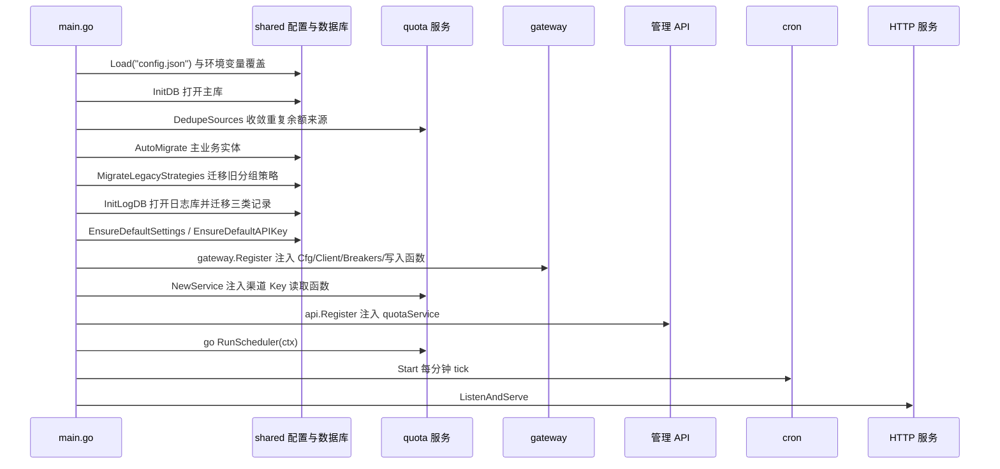

# 运行入口与基础设施

> 说明 Go 进程启动、配置与数据库、管理接口边界、API Key、设置和定时维护；不负责渠道业务、网关路由与协议转换。

## 概述

`main.go` 是 Go 后端的唯一生产装配入口：读取配置，初始化主库和日志库，执行迁移，向网关和管理 API 注入实现，启动额度调度、定时任务和 HTTP 服务。模块之间尽量通过注入函数或外键 ID 关联，但 `shared.DB`、`shared.LogDB` 是进程级数据库句柄，不是完全隔离的依赖注入容器。

本页覆盖配置文件、环境变量覆盖及 SQLite 主库/独立日志库，`/api` 的本机管理访问边界，`/v1` 注册与生产 writer 注入，命名服务 API Key、运行设置，以及模型自动同步、过期日志/尝试/路由诊断清理和进程关闭。渠道保存、分组选路、协议转换、额度适配器及桌面包构建分别见[渠道、模型与分组](渠道模型与分组.md)、[网关转发与保护](网关转发与保护.md)、[协议转换与流式交付](协议转换与流式交付.md)、[余额与额度](余额与额度.md)和[桌面主进程与 sidecar](桌面主进程与sidecar.md)。

独立 `go run .` 默认监听 `0.0.0.0:3060`，使用启动工作目录下的 `config.json` 和 `data/portunus.db`；桌面正式版和 Dev 由 Electron 注入不同端口及数据路径。

## 核心流程

启动步骤失败会 `log.Fatalf` 终止进程，不是可忽略的后台警告；没有跨主库/日志库的分布式事务，也没有在此实现业务数据库备份或恢复。

## 关键实现

| 职责 | 位置 |
|---|---|
| 读取配置并应用 `PORTUNUS_*` 覆盖 | [`shared.Load`](../../../backend/shared/config.go#L81)、[`applyEnv`](../../../backend/shared/config.go#L150) |
| 默认配置与网关转发默认值 | [`DefaultConfig`](../../../backend/shared/config.go#L70)、[`DefaultProxyConfig`](../../../backend/shared/config.go#L46) |
| 打开 SQLite 主库并自动创建父目录 | [`InitDB`](../../../backend/shared/db.go#L30)、[`openSQLite`](../../../backend/shared/db.go#L19) |
| 打开独立日志库并迁移日志实体 | [`InitLogDB`](../../../backend/shared/db.go#L52) |
| 启动迁移顺序 | [main.go](../../../main.go#L29) |
| 注册 `/v1` 与注入生产依赖 | [`gateway.Register`](../../../backend/gateway/gateway.go#L16)、[main.go](../../../main.go#L72) |
| 注册 `/api` 并注入额度服务 | [`api.Register`](../../../backend/api/api.go#L18)、[main.go](../../../main.go#L90) |
| 本机管理访问边界 | [`localManagementOnly`](../../../backend/api/local_access.go#L14) |
| API Key 生成、默认 Key 与鉴权 | [`GenerateAPIKey`](../../../backend/shared/apikey.go#L25)、[`EnsureDefaultAPIKey`](../../../backend/shared/apikey.go#L60)、[`AuthenticateAPIKeyIdentity`](../../../backend/shared/apikey.go#L184) |
| 运行设置读写 | [`GetSyncInterval`](../../../backend/shared/setting.go#L53)、[`GetLogRetentionDays`](../../../backend/shared/setting.go#L101) |
| 定时同步与过期清理 | [`cron.Start`](../../../backend/cron/cron.go#L22)、[`syncTick`](../../../backend/cron/cron.go#L38)、[`cleanupTick`](../../../backend/cron/cron.go#L56) |
| 优雅关闭 | [main.go](../../../main.go#L91) |

## 配置与扩展

`shared.Load` 先构造默认值，再读取当前进程工作目录中的指定文件，最后应用 `PORTUNUS_*` 环境变量。配置文件不存在时使用默认值，不会由 `Load` 主动创建；非法 JSON、读取失败、负数限额或部分上下限倒置会使启动失败。

| 配置 | 默认值 | 覆盖方式 |
|---|---|---|
| `server.host` / `server.port` | `0.0.0.0` / `3060` | `PORTUNUS_SERVER_HOST` / `PORTUNUS_SERVER_PORT` |
| `database.type` / `database.path` | `sqlite` / `data/portunus.db` | `PORTUNUS_DATABASE_TYPE` / `PORTUNUS_DATABASE_PATH` |
| `database.log_path` | 空，复用主库 | `PORTUNUS_DATABASE_LOG_PATH` |
| `proxy.retry_count` | 2 | `PORTUNUS_PROXY_RETRY_COUNT` |
| `proxy.max_http_attempts` | 4 | `PORTUNUS_PROXY_MAX_HTTP_ATTEMPTS` |
| `proxy.first_content_timeout_seconds` | 240 | `PORTUNUS_PROXY_FIRST_CONTENT_TIMEOUT_SECONDS` |
| `proxy.first_byte_timeout_seconds` | 120 | `PORTUNUS_PROXY_FIRST_BYTE_TIMEOUT_SECONDS` |
| `proxy.non_stream_timeout_seconds` | 600 | `PORTUNUS_PROXY_NON_STREAM_TIMEOUT_SECONDS` |
| `proxy.circuit_failure_threshold` / `success_threshold` / `reset_seconds` | 4 / 2 / 60 | 对应 `PORTUNUS_PROXY_*` |
| `proxy.rate_limit_cooldown_seconds` / `max_cooldown_seconds` | 30 / 300 | 对应 `PORTUNUS_PROXY_*` |

网关转发配置项的消费语义见[网关转发与保护](网关转发与保护.md)。`InitDB` 当前只接受 `sqlite`；配置中的 MySQL/PostgreSQL 名称会返回“暂不支持的数据库类型”，目录结构保留扩展点不代表已可切换。

主库启动顺序为：`quota.DedupeSources` 收敛历史重复余额来源；迁移渠道、模型、分组及成员、API Key、设置、余额来源/状态；`group.MigrateLegacyStrategies` 把旧 `round_robin` 分组转为 `failover`；`InitLogDB` 打开独立日志库或复用主库并迁移 `Log`、`UpstreamAttempt`、`RoutingTrace`；补齐缺失设置，并在从未创建过任何 API Key 的空库中创建默认 Key。

`shared.Setting` 是数据库中的字符串键值表，与 `config.json` 的进程配置不同：

| 设置 | 默认值 | 语义 |
|---|---|---|
| `sync_interval` | 360 分钟 | `0` 关闭自动同步 |
| `last_sync_at` | 0 | 上次同步 Unix 秒，0 表示从未 |
| `log_retention_days` | 30 | `0` 关闭自动清理 |

设置接口拒绝负数；读取缺失或非法值会回退默认值。

`shared.APIKey` 保存命名密钥、稳定 ID、`revoked` 和软删除时间：

- 创建/重置生成 24 字节随机数的 URL-safe `sk-` 密钥；名称去除首尾空白后须为 1–80 个字符。
- 禁用可恢复；软删除后不再从普通列表返回，鉴权失败。重置使旧密钥失效。
- 启动时为空名称的旧 Key 补“默认 Key”。只有包含软删除记录在内也完全没有 Key 时才创建默认 Key；全部禁用或删除不会因重启而自动复活。

`cron.Start` 只启动一个 goroutine，每分钟 tick。每次重新读取同步间隔和上次同步时间；达到间隔后同步所有 `auto_sync=true` 且支持 API 发现的渠道，只新增模型，不删除上游消失项。每 60 个 tick 执行一次过期清理，即启动后约一小时首次运行；`DeleteOldLogs` 按日志 `created_at`、尝试和诊断 `started_at` 分批清理，返回数量只计日志行。修改保留天数后最多约一小时才由下一次清理采用。cron 不负责额度查询；`main` 另以可取消 context 启动 `quota.RunScheduler`。

`/api` 由 `localManagementOnly` 保护，包括 `/api/ping`：真实 TCP 对端必须是 IPv4/IPv6 回环地址，Host 必须是 localhost 或回环地址，Origin 为空、受允许的本机页面，或为带 `X-Portunus-Local: 1` 的桌面 `null`。`X-Forwarded-For` 和 `X-Real-IP` 不改变判定。局域网监听仍开放需令牌鉴权的 `/v1`，但不等于开放管理面。`/api/ping` 在设置 `PORTUNUS_INSTANCE_ID` 时返回同名响应头；桌面 sidecar 用它识别自己的子进程。

管理错误经 `respondError` 分类：`shared.StatusError` 使用自带状态，GORM 未找到为 404，包含 SQLite `UNIQUE constraint failed` 的错误为 409，其余为 500“内部错误”。

收到 SIGINT/SIGTERM 后，信号 context 被取消，HTTP server 在 5 秒上限内优雅关闭，额度调度收到取消。cron goroutine 没有独立停止函数，随进程退出结束。启动失败使用 `log.Fatalf`，不会进入优雅关闭流程。

## 修改须知

| 修改点 | 需要同步的位置与影响 |
|---|---|
| 新增配置项 | `Config`/`DefaultConfig`、`Load`/环境覆盖、桌面 sidecar 注入（若适用）与相关测试；注意工作目录与 `userData` 是不同路径来源 |
| 新增实体 | 决定进入主库还是日志库，并明确迁移、资源删除和过期清理边界；当前没有自动备份或跨库事务 |
| 调整管理访问 | 同时考虑 Electron `file://`、Vite 开发页面、本机 CLI 健康检查与 LAN `/v1`，不能把 CORS 或隐藏按钮当作唯一边界 |
| 改变 API Key 生命周期 | 同步鉴权、旧兼容接口、历史列表与日志名称快照；不能让重启重新启用禁用/删除的 Key |
| 改变启动顺序 | 渠道删除预览依赖注入的额度服务，额度去重依赖主库，日志 writer 依赖日志库；初始化顺序和失败行为需一起核对 |

来源

- [main.go](../../../main.go)
- [backend/shared/config.go](../../../backend/shared/config.go)
- [backend/shared/db.go](../../../backend/shared/db.go)
- [backend/shared/apikey.go](../../../backend/shared/apikey.go)
- [backend/shared/setting.go](../../../backend/shared/setting.go)
- [backend/shared/error.go](../../../backend/shared/error.go)
- [backend/api/api.go](../../../backend/api/api.go)
- [backend/api/local_access.go](../../../backend/api/local_access.go)
- [backend/api/apikey.go](../../../backend/api/apikey.go)
- [backend/api/setting.go](../../../backend/api/setting.go)
- [backend/cron/cron.go](../../../backend/cron/cron.go)
- [backend/shared/log_query.go](../../../backend/shared/log_query.go)
- [go.mod](../../../go.mod)

