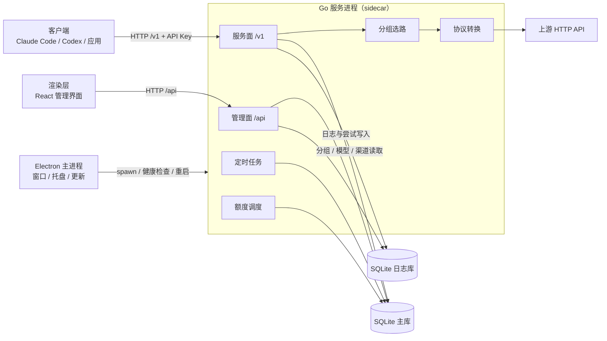
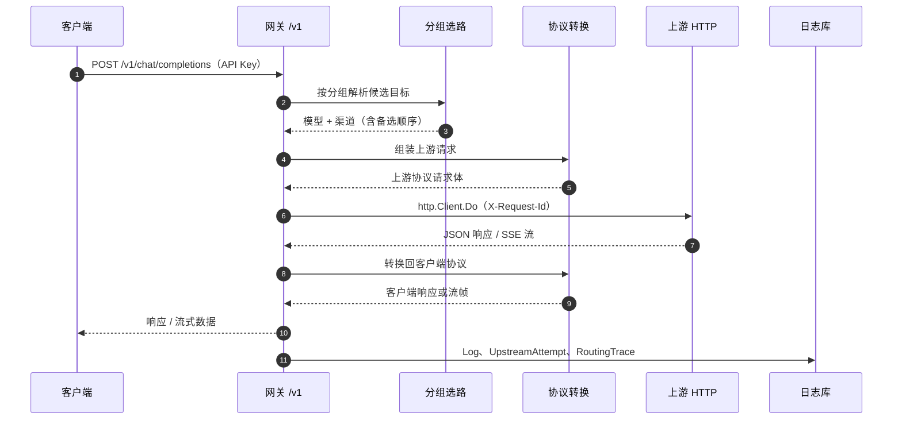

# 系统架构

> 说明 Portunus 的进程组成、模块依赖与请求主链路；不展开单模块内部实现和具体配置默认值。

## 概述

Portunus 是本地运行的多上游 API 聚合网关：渠道保存上游地址与凭据，模型目录保存渠道下的可调用资源，分组再把跨渠道模型组合成客户端看到的稳定 `model`。产品定位、单所有者范围，以及“桌面应用是交付外壳、Claude Code 等客户端是调用方”的说明见 [PRODUCT.md](../product/PRODUCT.md)。

运行形态分为两种：

- **独立 Go 服务**：`go run .` 直接启动，读取工作目录的 `config.json`，使用自身监听地址和 SQLite 路径。
- **桌面应用**：Electron 主进程负责窗口、托盘、更新与 sidecar 生命周期，Go 二进制作为子进程运行；渲染层是 React 管理界面。Dev 与正式版由主进程注入不同的端口、数据目录和数据库路径，互不共享配置或数据库。

Go 进程在一个 Gin 引擎、一个 HTTP 监听上同时承载两个接口面（[main.go](../../main.go#L70)）：

| 接口面 | 信任边界 | 入口 |
|---|---|---|
| 管理面 `/api` | 只接受真实 TCP 回环对端，并校验本机 Host / Origin；服务 API Key 不能替代管理授权 | [api.Register](../../backend/api/api.go#L18)、[localManagementOnly](../../backend/api/local_access.go#L14) |
| 服务面 `/v1` | 需要 Portunus API Key；局域网开放时也只开放这一面 | [gateway.Register](../../backend/gateway/gateway.go#L16) |

因此“管理接口仅本机、服务接口可对局域网”是**中间件和鉴权边界**，不是两个独立进程或两个监听端口。桌面端把 Go 服务作为 sidecar 拉起，渲染层则通过 HTTP 直连 `/api`，不经过 IPC 转发业务请求。

各模块的实现入口与修改影响见[运行入口与基础设施](核心模块/运行入口与基础设施.md)、[渠道、模型与分组](核心模块/渠道模型与分组.md)、[网关转发与保护](核心模块/网关转发与保护.md)、[协议转换与流式交付](核心模块/协议转换与流式交付.md)、[余额与额度](核心模块/余额与额度.md)、[调用观测与日志](核心模块/调用观测与日志.md)、[桌面主进程与 sidecar](核心模块/桌面主进程与sidecar.md)和[管理界面与请求层](核心模块/管理界面与请求层.md)；术语见[核心概念](核心概念.md)，开发流程见[本地开发与测试](指南/本地开发与测试.md)。

## 组件

| 组件 | 职责与边界 | 位置 |
|---|---|---|
| Electron 主进程 | 应用身份、单实例锁、窗口与托盘、更新、拉起并守护自己的 Go 后端；不实现模型路由或协议转换 | [web/src/main/main.js](../../web/src/main/main.js#L50) |
| sidecar 守护 | 只管理本次主进程创建的 Go 子进程：确认端口空闲、spawn、轮询 `/api/ping`、退出与重启；不接管端口上已有服务 | [createBackend](../../web/src/main/sidecar.js#L70)、[spawnBackend](../../web/src/main/sidecar.js#L105) |
| 渲染层 | React 管理界面，经 HTTP 调用 `/api`；开发态由 Vite 页面代理，打包后直连本机 sidecar | [request.js](../../web/src/renderer/api/request.js#L21)、[preload.js](../../web/src/main/preload.js#L39) |
| Go 服务进程 | 加载配置、初始化主库与日志库、迁移、装配依赖、注册两个接口面、启动调度与 HTTP 服务 | [main](../../main.go#L28) |
| 管理面 `/api` | 渠道、模型、分组、设置、API Key、日志与额度查询；统一经过本机访问校验 | [api.Register](../../backend/api/api.go#L18)、[路由注册](../../backend/api/api.go#L32) |
| 服务面 `/v1` | OpenAI 兼容模型列表与 Chat Completions、Responses、Messages 三个生成入口 | [gateway.Register](../../backend/gateway/gateway.go#L16) |
| 分组选路 | 把分组解析为有序的“模型 + 渠道”目标；`manual` 只取激活项，`failover` 返回全部候选 | [router.Resolve](../../backend/router/router.go#L26) |
| 协议转换 | 维护 OpenAI Chat、OpenAI Responses、Anthropic、Gemini 的解析、渲染、流式转换、usage 提取与上游接入能力 | [providerImpls](../../backend/protocol/provider_registry.go#L46) |
| 配置与数据库 | 读取 `config.json` 和环境变量；打开 SQLite 主库，按配置打开独立日志库或复用主库 | [shared.Load](../../backend/shared/config.go#L81)、[InitLogDB](../../backend/shared/db.go#L52) |
| 定时维护与额度 | 定时同步渠道模型、清理过期日志；额度查询由独立 service 和调度器运行 | [cron.Start](../../backend/cron/cron.go#L22)、[额度装配](../../main.go#L83) |

桌面主进程注入给 Go 子进程的关键环境包括监听 host / port、主库路径、日志库路径和实例 ID（[sidecar.js](../../web/src/main/sidecar.js#L114)）。设置实例 ID 时，`/api/ping` 返回同名 `X-Portunus-Instance` 响应头；sidecar 要求它与本次启动的 UUID 一致，避免把别的进程误判成自己的后端（[defaultPing](../../web/src/main/sidecar.js#L30)、[api.go](../../backend/api/api.go#L25)）。

## 数据流

一次客户端 `/v1` 请求的主链路如下，细节见[一次请求的生命周期](指南/请求生命周期.md)：

1. **入口与鉴权**：`/v1/chat/completions`、`/v1/responses`、`/v1/messages` 分别绑定客户端协议；统一中间件从 `Authorization: Bearer` 或 `x-api-key` 取出 Key，调用注入的 `AuthIdentity` 校验，把 API Key ID 与名称快照放入上下文（[鉴权中间件](../../backend/gateway/gateway.go#L29)、[生产实现](../../backend/shared/apikey.go#L184)）。`/v1/models` 只公布有成员的分组（[listModels](../../backend/gateway/gateway.go#L78)）。
2. **解析与选路**：`handleRelay` 先按资源上限读取请求体，解码 `model`、`stream` 和 `thinking`；若模型名带 `-thinking` 后缀，剥掉后缀并按分组名解析；`router.Resolve` 返回单个手动目标或按 `priority`、成员 ID 升序的全部故障转移候选（[handleRelay](../../backend/gateway/relay.go#L56)、[分组查询](../../backend/gateway/relay.go#L123)、[router.Resolve](../../backend/router/router.go#L26)）。
3. **候选循环**：按候选顺序跳过 429 冷却、熔断开路或渠道并发已满的目标；每个目标按配置重试，每次实际 relay 都共享同一 `request_id` 并记录路由诊断事件（[候选循环](../../backend/gateway/relay.go#L147)）。普通重试和目标切换都在这一层完成。
4. **组装并调用上游**：`protocol.ComposeUpstreamRequest` 将客户端请求转换为目标上游协议，替换模型名并注入思考配置；`upstream.Open` 用渠道连接配置构建协议接入器；网关使用注入的 `http.Client` 发 POST，并携带 `X-Request-Id`（[组装请求](../../backend/gateway/relay.go#L417)、[打开连接](../../backend/gateway/relay.go#L425)、[Client.Do](../../backend/gateway/upstream.go#L101)）。429 会记录冷却；非 2xx 响应体作为失败归因依据。
5. **转换并返回客户端**：流式路径用 `NewStreamConverter` 和 `relayStream` 边读上游 SSE 边写客户端；流内容一旦开始交付，就不能再无损切换到其他候选（[流式转换](../../backend/gateway/relay.go#L490)、[已提交分支](../../backend/gateway/relay.go#L509)）。非流式路径先读完整个响应并转换，成功后才把转换结果写回客户端，因此可以在候选之间缓冲切换（[非流式转换](../../backend/gateway/relay.go#L529)、[写回客户端](../../backend/gateway/relay.go#L223)）。usage 从上游响应或流中提取后随日志落库。
6. **落库观测**：每个 relay 尝试写一条 `shared.Log`；每次显式 `http.Client.Do` 写一条 `shared.UpstreamAttempt`（包含预算字段兼容重试）；整个请求结束时写一条 `shared.RoutingTrace`。三者共享 `request_id`，分别经 `Deps.LogWrite`、`AttemptWrite`、`RoutingWrite` 注入到日志库（[Log 写入](../../backend/gateway/log.go#L18)、[Attempt 写入](../../backend/gateway/attempt.go#L35)、[RoutingTrace 刷写](../../backend/gateway/routing_diagnostics.go#L133)）。日志行数、尝试数与路由诊断项数含义不同，不能互相替代为准确的客户端请求数。

## 外部依赖

| 依赖 | 接入点 | 失败与边界 |
|---|---|---|
| SQLite | `glebarez/sqlite` + GORM（[go.mod](../../go.mod#L7)）；主库和日志库分别由 `InitDB`、`InitLogDB` 打开 | 当前只接受 `sqlite`，其他数据库类型在启动时报错；数据库打开或迁移失败会终止进程。日志路径为空时日志表复用主库（[db.go](../../backend/shared/db.go#L52)）。 |
| 上游 HTTP API | 渠道保存的 base URL、凭据和协议；网关用 `http.Client` 访问，端点与鉴权头由 `protocol.Upstream` 提供（[NewHTTPClient](../../backend/gateway/upstream.go#L23)） | 连接失败、等响应头超时、非 2xx、流中断等分别归因，并可能触发重试或故障转移；日志不保存 URL query 或鉴权头。本次核验未访问真实上游。 |
| 配置 | `config.json` 加 `PORTUNUS_*` 环境变量（[Load](../../backend/shared/config.go#L81)） | 配置文件缺失时使用默认值；非法 JSON、负数或上下限倒置会导致加载失败，`main` 随即退出。转发配置在启动时定值，没有热更新（[Deps.Cfg](../../backend/gateway/dep.go#L13)）。 |
| Electron 运行时 | `web/package.json` 的主进程入口、打包与 `extraResources`（[package.json](../../web/package.json#L6)、[extraResources](../../web/package.json#L21)） | 打包时把平台 Go 二进制放进 `bin/`；更新由 electron-updater 负责。本次未启动桌面应用或安装包。 |
| Vite 开发服务器 | `pnpm dev` 并行启动 Vite 与 Electron（[scripts](../../web/package.json#L63)） | 仅开发态使用；页面通过 `/api` 代理访问本机 Go 后端。生产页面从 `file://` 加载并使用 sidecar 地址。 |

## 设计取舍

- **管理面与服务面同进程**：减少本地部署部件，共享配置、数据库和日志写入路径；代价是两个接口面处于同一进程故障域，代码未提供单独启停某一面的开关（推断：独立监听或拆分进程需要另行设计）。信任边界因此落在中间件：`/api` 检查真实 TCP 对端、Host 和 Origin，不信任转发头（[localManagementOnly](../../backend/api/local_access.go#L14)）；局域网只意味着 `/v1` 可达，不意味着管理面开放（[PRODUCT.md](../product/PRODUCT.md)）。
- **网关依赖显式注入**：`gateway.Deps` 把转发配置、上游客户端、熔断 / 冷却 / 并发 store、鉴权函数和三个日志 writer 交给 `main` 装配；`gateway` 据此不直接摸 `shared.DB`，测试可换内存实现（[dep.go](../../backend/gateway/dep.go#L11)、[main.go](../../main.go#L72)）。
- **模块依赖单向**：主要依赖边为 `channel → upstream → protocol`、`model → channel`、`group → model`、`router → group + model + channel`、`gateway → router + protocol + upstream`、`api → gateway + quota + 渠道/模型/分组`。`quota` 只依赖 `shared`，由 `main` 注入最小的渠道 Key 读取函数（[main.go](../../main.go#L83)）；`shared` 承载配置、数据库句柄、API Key 与观测实体，避免包级循环依赖。
- **协议能力集中注册**：`providerImpls` 是协议到解析、渲染、流式转换、usage 提取和上游接入的唯一分发表；新增协议按注册项补齐对应函数，而不是在转换器里散落 `switch`（[providerImpls](../../backend/protocol/provider_registry.go#L44)、[implFor](../../backend/protocol/provider_registry.go#L110)）。
- **观测记录分离且写入可注入**：`Log` 按 relay 尝试记录，并保存该次尝试的 token 与缓存用量；`UpstreamAttempt` 单独记录显式 HTTP 调用；`RoutingTrace` 记录请求级选路诊断。`LogWrite` 生产实现同步写日志库并忽略返回错误，`AttemptWrite` / `RoutingWrite` 失败只记告警，均不重试上游（[main.go](../../main.go#L79)、[finishAttempt](../../backend/gateway/attempt.go#L35)）。
- **桌面外壳与后端解耦**：渲染层只通过预加载桥暴露固定能力（应用信息、更新、网络模式、Claude Code 配置、外链），业务数据走 HTTP；sidecar 只管理自己 spawn 的进程，启动前要求端口空闲，退出时按平台等待或停止子进程（[preload.js](../../web/src/main/preload.js#L9)、[spawnBackend](../../web/src/main/sidecar.js#L105)、[before-quit](../../web/src/main/main.js#L249)）。
- **Dev 与正式版彻底隔离**：未打包一律视为 Dev；Dev 使用独立应用名、`userData`、后端工作目录和端口，不能读取正式库或接管正式进程（[runtime-profile.js](../../web/src/main/runtime-profile.js#L5)、[server-address.js](../../web/src/main/server-address.js#L9)）。

来源

- [main.go](../../main.go)
- [go.mod](../../go.mod)
- [backend/router/router.go](../../backend/router/router.go)
- [backend/gateway/gateway.go](../../backend/gateway/gateway.go)
- [backend/gateway/dep.go](../../backend/gateway/dep.go)
- [backend/api/api.go](../../backend/api/api.go)
- [backend/api/local_access.go](../../backend/api/local_access.go)
- [backend/protocol/provider_registry.go](../../backend/protocol/provider_registry.go)
- [backend/shared/config.go](../../backend/shared/config.go)
- [backend/shared/db.go](../../backend/shared/db.go)
- [web/src/main/main.js](../../web/src/main/main.js)
- [web/src/main/sidecar.js](../../web/src/main/sidecar.js)
- [web/package.json](../../web/package.json)
- [docs/product/PRODUCT.md](../product/PRODUCT.md)

核验范围：2026-10-30 工作区源码（任务基线 `3d63c30`）。已执行 `go test ./...`、`go vet ./...`、前端 245 项测试和 `pnpm typecheck` 并通过；未启动桌面应用，未访问真实上游或安装包。以上检查不构成线上运行或供应商能力的证明。

